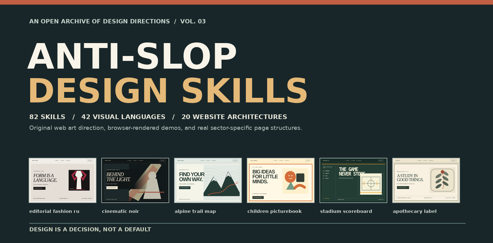

# Anti-Slop Design Skills v3.1 — Türkçe Rehber



**92 skill, 52 görsel stil, 20 sektörel site yapısı, 14 renk paleti, 5 sosyal medya tasarımı ve 1 Tasarım Direktörü.**

Geleneksel grafik tasarımdan farklı sektörlerin gerçek web sitesi ihtiyaçlarına uzanan, **görselliği olan** bir Agent Skills kütüphanesi. Klişe yapay zekâ arayüzlerinden kurtulmanın yolu yalnızca rengi değiştirmek değil; her projeye **uygun mimari + estetik + kullanıcı yolculuğu** seçmek.

- **[▶ Canlı galeri](https://dgylayse.github.io/anti-slop-design-skills/)**: 92 skill'i filtrele, her HTML demoyu tarayıcıda aç
- [52 görsel stilin tek sayfalık görseli](gallery/contact-sheet.jpg)
- [Sektörlere göre hazır kombinasyon örnekleri](examples/industry-recipes.md)

Her skill klasöründe: `SKILL.md`, `preview.png`, `demo.html` var. Görseller gerçek tarayıcıda render edilmiş özgün statik demoların ekran görüntüleridir; çalışan rezervasyon sistemi, üretime hazır site veya yayımlanmış ürün oldukları iddia edilmez.

## Skill türleri

| Katman | Adet | İşlev |
|---|---:|---|
| Görsel stil | 52 | Tasarım karakteri ve tarihsel esin |
| Sektörel site yerleşimi | 20 | Restoran, otel, emlak, hukuk, etkinlik ve daha fazlası |
| Renk paleti | 14 | Uyumlu ortak token sistemi |
| Sosyal medya | 5 | Kampanya / duyuru düzeni |
| Tasarım Direktörü | 1 | Doğru seçim, uyumluluk ve eleştiri kontrolü |

## Canlı stiller · tarayıcıda dene

Çoğu skill bir görünümü tarif eder. **Canlı stiller** ise yapay zekâya ayrıca bir imza etkileşimi, zanaatın kendisinden gelen bir hareket dili, sayfa bölümleri kütüphanesi ve çalışan kod verir.

| Stil | Dene | Ne yapabilirsin |
|---|---|---|
| [`ebru-marbling`](styles/ebru-marbling/SKILL.md) | [▶ canlı demo](https://dgylayse.github.io/anti-slop-design-skills/styles/ebru-marbling/demo.html) | Suya boya damlat, bizle çek, tarakla, kâğıda al |
| [`iznik-ceramic`](styles/iznik-ceramic/SKILL.md) | [▶ canlı demo](https://dgylayse.github.io/anti-slop-design-skills/styles/iznik-ceramic/demo.html) | Tek bir çini tasarla, bütün duvar yeniden döşensin |
| [`thermal-receipt`](styles/thermal-receipt/SKILL.md) | [▶ canlı demo](https://dgylayse.github.io/anti-slop-design-skills/styles/thermal-receipt/demo.html) | Menüden sipariş ver, fiş satır satır basılsın; çıkarılan ürün VOID, ödeme PAID damgası |
| [`wood-type-broadside`](styles/wood-type-broadside/SKILL.md) | [▶ canlı demo](https://dgylayse.github.io/anti-slop-design-skills/styles/wood-type-broadside/demo.html) | Kendi afişini ahşap harfle diz, mürekkeple, her biri farklı baskı al |
| [`op-art-optical`](styles/op-art-optical/SKILL.md) | [▶ canlı demo](https://dgylayse.github.io/anti-slop-design-skills/styles/op-art-optical/demo.html) | İmleci gezdir: çizgiler bükülür, hedef seni izler; tek tıkla sakin görünüm |
| [`illuminated-manuscript`](styles/illuminated-manuscript/SKILL.md) | [▶ canlı demo](https://dgylayse.github.io/anti-slop-design-skills/styles/illuminated-manuscript/demo.html) | Yaprakları çevir, her baş harf boyanarak açılsın, arama sonuçları kırmızı mürekkeple işaretlensin |

## v3.1'de yeni: 10 farklı tasarım dili

Her yeni stil, ortak bir kahraman şablonuna yeni renk giydirmek yerine **kendi sayfa kompozisyonuyla** gelir.

| Stil | Esin | Nerede iyi çalışır |
|---|---|---|
| [`ebru-marbling`](styles/ebru-marbling/SKILL.md) | Osmanlı ebru kâğıdı | Atölye, ciltevi, kırtasiye, çay-kahve, kültür |
| [`iznik-ceramic`](styles/iznik-ceramic/SKILL.md) | 16. yy İznik çinisi | Restoran, çay evi, otel, müze dükkânı |
| [`op-art-optical`](styles/op-art-optical/SKILL.md) | 1960'lar Op-Art | Galeri, sergi, müzik etkinliği, kampanya |
| [`new-wave-1980s`](styles/new-wave-1980s/SKILL.md) | 80'ler Basel/LA yeni dalga tipografi | Tasarım okulu, stüdyo, kültür programı |
| [`wood-type-broadside`](styles/wood-type-broadside/SKILL.md) | 19. yy ahşap harf afişi | Pazar, panayır, bira evi, berber, mahalle etkinliği |
| [`thermal-receipt`](styles/thermal-receipt/SKILL.md) | Termal kasa fişi | Kafe siparişi, sipariş takibi, ödeme onayı |
| [`paperback-tri-band`](styles/paperback-tri-band/SKILL.md) | 1930–50 cep kitabı serileri | Yayınevi, okuma kulübü, bülten, katalog |
| [`solarpunk-commons`](styles/solarpunk-commons/SKILL.md) | Umutlu ekolojik gelecek | Kooperatif, enerji, kent bostanı, iklim |
| [`vienna-secession-1905`](styles/vienna-secession-1905/SKILL.md) | Viyana Secession / Werkstätte | Mücevher, gümüş, mimari, iç mimari |
| [`illuminated-manuscript`](styles/illuminated-manuscript/SKILL.md) | Tezhipli el yazmaları | Arşiv, kütüphane, nadir kitap, uzun okuma |

Örnek: `restaurant-reservations + iznik-ceramic` ile çini temalı bir rezervasyon sayfası, `online-course-catalog + paperback-tri-band` ile renk kodlu bir kurs kataloğu.

## Kurulum

```bash
python tools/install.py --list
python tools/install.py --skill design-director --skill legal-practice --skill swiss-editorial --target /projem/.agents/skills
```

**Gemini CLI:** `.gemini/skills/` · **Claude Code:** `.claude/skills/` · **uyumlu ajanlar:** `.agents/skills/`. Ajanın güncel kurulum kurallarını kontrol edin.

Örnek komut:

```text
Önce design-director skill'ini uygula. Bir hukuk bürosu web sitesi için
legal-practice + swiss-editorial + oxblood-parchment kullan.
Gerçek kullanıcı akışını, mobil önceliği, klavye erişilebilirliğini ve
boş/yükleniyor/hata durumlarını tasarla. Klişe yapay zekâ arayüzünü ve
uydurma müşteri yorumlarını kullanma. Kodunu üret, kararı açıkla.
```

## Galeri ve kendi projende kullanma

Canlı galeri: https://dgylayse.github.io/anti-slop-design-skills/. Yerelde `gallery/index.html` dosyasını tarayıcıda açarak çevrimdışı da gezebilirsin. Bir stili projene eklemek için `tools/install.py` komutunu kullan ya da ilgili skill klasörünü olduğu gibi kopyala.

**Kaynak yaklaşımı:** SITE123'ün sektörel örnek çeşitliliğinden kategoriler için fikir alınmıştır, hazır SITE123 şablonları veya müşteri görselleri kopyalanmamıştır. Çalışma özgün statik HTML/SVG demolarına ve tarihsel tasarım prensiplerine dayanır. MIT lisanslıdır.
