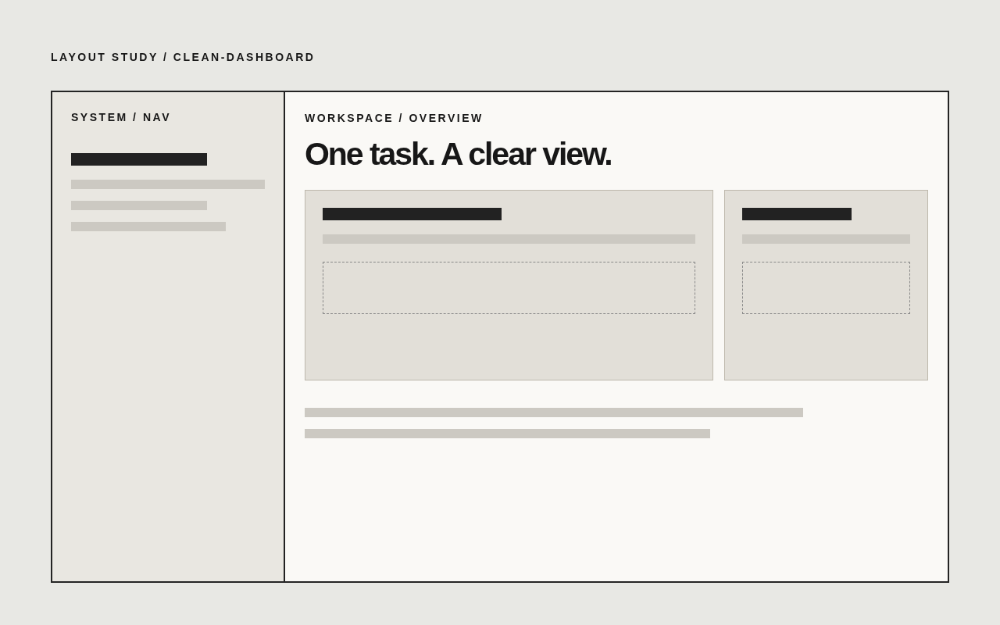

# Layout: Clean Dashboard Architecture

## Core Mandate
Dashboards are workspaces, not marketing brochures. Maximize clarity, minimize chrome, and ensure the user spots anomalies in under 2 seconds.

## Structural Blueprint
1. **Slim Persistent Navigation Rail (`200px–220px`):**
   - Workspace switcher top, flat grouped navigation links (max 2 levels), keyboard shortcut hint (`⌘K`) at bottom.
2. **Compact Utility Header (`48px–56px`):**
   - Breadcrumb path on left (`Systems / EU-West / Telemetry`), time-range selector & primary action button on right. No giant marketing banners.
3. **KPI Summary Row (3–4 Metrics Max):**
   - Flat horizontal strip separated by `1px` dividers. Show label, large tabular number, and concise delta (`+4.2%`). Avoid noisy mini-charts inside every single KPI box unless meaningful.
4. **Primary Workspace Split (65% / 35%):**
   - Left (65%): Main data table or primary time-series chart with clean filter controls directly integrated into the header.
   - Right (35%): Real-time activity stream, status matrix, or inspector drawer.

## Banned Dashboard Clichés
- NEVER wrap every single table cell or metric inside deeply nested padded cards-inside-cards.
- NEVER use rainbow pie charts or 3D donut charts (prefer clean horizontal bar charts, line charts, or sortable tables).
- NEVER hide critical filters behind 3 layers of dropdown menus.

## Required information architecture

- Identify the single primary task, secondary task, and must-not-miss information; reserve the most prominent region for the primary task, not a decorative metric.
- Desktop: align content to a 12-column grid with meaningful variable spans. Below 900px, reduce to 6 columns. Below 640px, use one reading column with consistent boundaries.
- Preserve semantic navigation and search/filter accessibility. No fixed navigation that obscures content or unscrollable horizontal regions.
- Design all loading, error, empty, filtered-zero, and permission-denied states, not only a filled marketing mockup.
- The selected style controls typography and visual language; an optional palette controls colors. Keep structural and decorative rules separate.

## Verification checklist

1. Is the main purpose obvious within five seconds? 2. Are all important interactions keyboard-accessible? 3. Is the mobile information order intentional? 4. Are labels and status data real or explicitly illustrative? 5. Does the layout avoid generic repeated feature-card rows?

