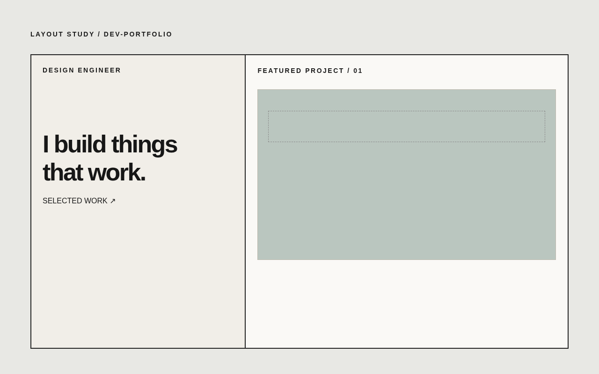

# Layout: Developer & Maker Portfolio

## Core Mandate
Show proof of work immediately. Visitors (recruiters, founders, peers) care about *what you built and how you think*—not animated percentage bars claiming "90% Python".

## Structural Blueprint
1. **Direct Identity Header (No Full-Screen Hero Waste):**
   - Name, crisp 2-line positioning statement (what you engineer/research), current status/location, and direct links (`GitHub`, `LinkedIn`, `Email`, `Writing`).
2. **Selected Works (Index Format):**
   - Structured table or clean numbered rows: `Year | Project Name | Core Stack / Domain | 1-Line Impact | Live/Repo Link`.
   - Clicking or expanding reveals architecture notes, screenshots, and real technical trade-offs.
3. **Technical Writing / Research Feed:**
   - Clean chronological list of articles, CTF write-ups, or case studies with publish date and reading time.
4. **Colophon Footer:**
   - Subtle note on typography, stack, and RSS feed link.

## Banned Portfolio Clichés
- NEVER include fake skill percentage bars (`HTML: 95%`, `Linux: 88%`).
- NEVER write "Hi 👋 I'm a passionate full-stack ninja turning coffee into code."
- NEVER lock basic info behind slow scroll-jacking animations or heavy 3D particle backgrounds.

## Required information architecture

- Identify the single primary task, secondary task, and must-not-miss information; reserve the most prominent region for the primary task, not a decorative metric.
- Desktop: align content to a 12-column grid with meaningful variable spans. Below 900px, reduce to 6 columns. Below 640px, use one reading column with consistent boundaries.
- Preserve semantic navigation and search/filter accessibility. No fixed navigation that obscures content or unscrollable horizontal regions.
- Design all loading, error, empty, filtered-zero, and permission-denied states, not only a filled marketing mockup.
- The selected style controls typography and visual language; an optional palette controls colors. Keep structural and decorative rules separate.

## Verification checklist

1. Is the main purpose obvious within five seconds? 2. Are all important interactions keyboard-accessible? 3. Is the mobile information order intentional? 4. Are labels and status data real or explicitly illustrative? 5. Does the layout avoid generic repeated feature-card rows?

