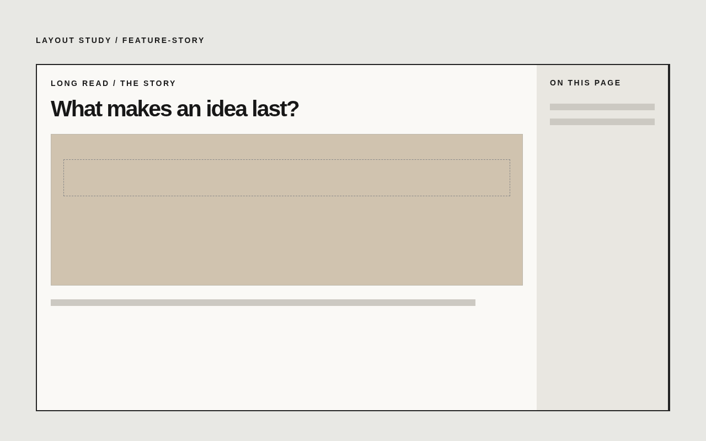

# Feature Story

Long-form journalism with rich pull quotes, media rhythm and accessible footnotes.

## Layout doctrine
Start from the content model: primary task, proof, navigation, and next action. Alternate dense information with resting space. Never turn a structural skill into a color system.

## Required information architecture

- Identify the single primary task, secondary task, and must-not-miss information; reserve the most prominent region for the primary task, not a decorative metric.
- Desktop: align content to a 12-column grid with meaningful variable spans. Below 900px, reduce to 6 columns. Below 640px, use one reading column with consistent boundaries.
- Preserve semantic navigation and search/filter accessibility. No fixed navigation that obscures content or unscrollable horizontal regions.
- Design all loading, error, empty, filtered-zero, and permission-denied states, not only a filled marketing mockup.
- The selected style controls typography and visual language; an optional palette controls colors. Keep structural and decorative rules separate.

## Verification checklist

1. Is the main purpose obvious within five seconds? 2. Are all important interactions keyboard-accessible? 3. Is the mobile information order intentional? 4. Are labels and status data real or explicitly illustrative? 5. Does the layout avoid generic repeated feature-card rows?

