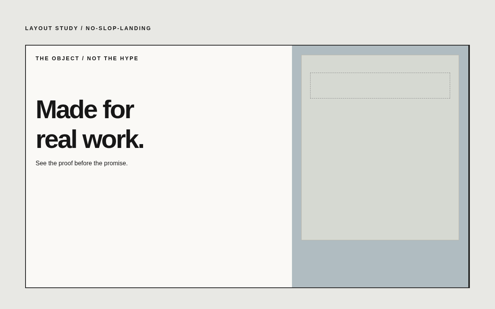

# Layout: No-Slop Landing Page

## Core Mandate
Break every predictable AI landing-page habit. Design a page that reads like a deliberate, human-directed product launch.

## Required Section Architecture
1. **Asymmetric Editorial Hero (Above the Fold):**
   - Left-aligned oversized headline (max 7 words) + sharp 1-sentence value proposition + single clear CTA.
   - Right side: Real interactive product preview, live UI snippet, or bold structural graphic—NEVER a generic floating stock mockup with glowing orbs behind it.
2. **Proof Strip (Compact, Non-Cheesy):**
   - Clean 1-row technical specification bar or concrete metrics (`0.4ms latency · 100% local · MIT Licensed`) instead of fake "Trusted by 10,000+ companies" logo soup.
3. **Interactive / Editorial Feature Showcase (Bento or Numbered Index):**
   - Replace the cliché "3 identical boxes with Lucide icons on top" with either:
     - A numbered editorial list (`01`, `02`, `03`) paired with a sticky live visual on the right, OR
     - An asymmetric 2-column grid showing real code/UI before-and-after comparisons.
4. **Honest Technical Deep-Dive / Workflow:**
   - Show *how it actually works* in 3 concrete visual steps or a clean interactive terminal/code block.
5. **Restrained Footer:**
   - Clean 2-column or 3-column index footer with sharp dividers and zero bloat.

## Banned AI Landing Page Clichés
- NEVER open with a centered pill badge saying `✨ Introducing the future of X` above a centered gradient H1.
- NEVER use a 3-column symmetric row of identical rounded cards with circular purple icon backgrounds.
- NEVER invent fake testimonials from "Sarah J., CEO at TechFlow".
- NEVER stack 6 repetitive marketing sections with identical padding and alternating blobs.

## Required information architecture

- Identify the single primary task, secondary task, and must-not-miss information; reserve the most prominent region for the primary task, not a decorative metric.
- Desktop: align content to a 12-column grid with meaningful variable spans. Below 900px, reduce to 6 columns. Below 640px, use one reading column with consistent boundaries.
- Preserve semantic navigation and search/filter accessibility. No fixed navigation that obscures content or unscrollable horizontal regions.
- Design all loading, error, empty, filtered-zero, and permission-denied states, not only a filled marketing mockup.
- The selected style controls typography and visual language; an optional palette controls colors. Keep structural and decorative rules separate.

## Verification checklist

1. Is the main purpose obvious within five seconds? 2. Are all important interactions keyboard-accessible? 3. Is the mobile information order intentional? 4. Are labels and status data real or explicitly illustrative? 5. Does the layout avoid generic repeated feature-card rows?

