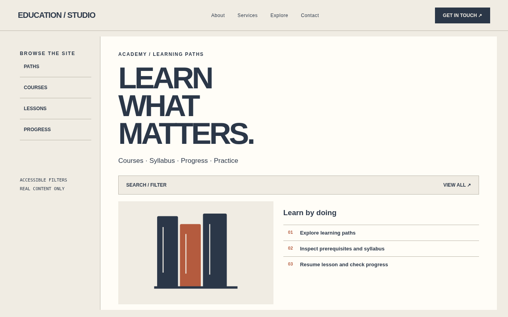

# Education — Website Architecture

## Purpose, not palette

This **website type** is a structural design skill, independent of visual style. It defines the sections, data and user journeys for a education site. Combine with one primary style and optionally a compatible color palette. Do **not** use it as a license to copy an existing website template.

**Core page functions:** Courses · Syllabus · Progress · Practice.

## Primary journey

1. Explore learning paths.
2. Inspect prerequisites and syllabus.
3. Resume lesson and check progress.

## Minimum page map

- **Global header:** brand, accessible navigation, current active page, and direct access to the main task.
- **Hero / first viewport:** Learn by doing. Clearly describe the service and show one specific next step.
- **Key navigation areas:** paths, courses, lessons, progress.
- **Main evidence section:** verifiable details, relevant artifacts and real proof; no fake statistics or unlicensed images.
- **Task workspace:** forms, filters, booking, inquiry, learning or ticket flow as appropriate to this site type. Display constraints and pricing/policy if relevant.
- **Confidence and trust:** real credentials, contact details, policies, accessibility and privacy; omit these where unavailable rather than fabricate.
- **Footer:** relevant legal disclosures, genuine channels and support information.

## Responsive information sequence

**Mobile rule:** Learning progress persists; assessment feedback is not color-only.

Use 12-column grid for the complex desktop view where appropriate, but it should collapse to 6 then 1 intentional columns; prioritize the decision and action over secondary promotional imagery. No horizontal page overflow.

## Interaction and state matrix

- Initial: core task discoverable with meaningful labels and full keyboard access.
- Loading: preserve context, announce progress, avoid disappearing navigation.
- Empty: constructive next steps; for search pages show a clear reset-filter action.
- Error: inline cause and recovery, not only a red border.
- Success: confirmation and next practical step, with no invented booking or transaction.
- Disabled: state why action is unavailable. Focus: visible and keyboard-reachable.

## Content authenticity and risk

Use project data, licensed assets, and explicit placeholders for unknowns. For regulated or high-stakes services, do not invent professional claims, credentials, urgency, safety information or outcomes. Never imply an illustrative demo includes a live backend.

## Combine with styles

A education layout may be combined with `design-director`, a single `styles/*` aesthetic and optionally a `palettes/*` layer. Load tokens in that order. The layout controls structure; the style controls personality; palette controls only the six canonical colors.

## Implementation contract

- Use the six shared color tokens (`--color-bg`, `--color-surface`, `--color-ink`, `--color-muted`, `--color-accent`, `--color-border`) so palettes can override color **only**; preserve the style’s independent typographic and spatial identity.
- Provide clear semantic `header`, `nav`, `main`, and `footer` landmarks. Use native links and buttons; no decorative-only CTAs.
- Under 768px, recast the information hierarchy into a single intentional reading path; do not simply shrink the desktop canvas. At 768–1199px use a measured two-column adaptation and at larger sizes use the complete art-directed composition.
- Use visible focus styles (`:focus-visible` with `--focus-ring`), proper text alternatives, logical tab order and touch targets around 44px. Honor `prefers-reduced-motion`.
- Check actual text/background pairs against WCAG AA (4.5:1 for ordinary copy); an accent that is decorative may not be suitable for text.
- Create genuine hover, focus, selected, disabled, loading, error, empty and success states when applicable. Make success/errors perceivable without color alone.
- Do not invent statistics, testimonials, inventory, services, safety information, legal outcomes or product capabilities. Placeholder brand names in previews are fictional demonstrations, not ready-made content.
- Do not copy SITE123 customer templates, third-party logos, photographs or artwork. All examples here use original abstract HTML/SVG illustration.

## QA before delivery

1. Does the structure look different when viewed in grayscale, rather than just swapping colors? 2. Is the user’s primary task obvious? 3. Do keyboard, mobile and error states work? 4. Does the content sound like the real brand and avoid made-up proof? 5. Does the output remain coherent across a second screen?

## Visual page study

See [the source HTML study](./demo.html). It is a static information-architecture composition, not a functional production site.
