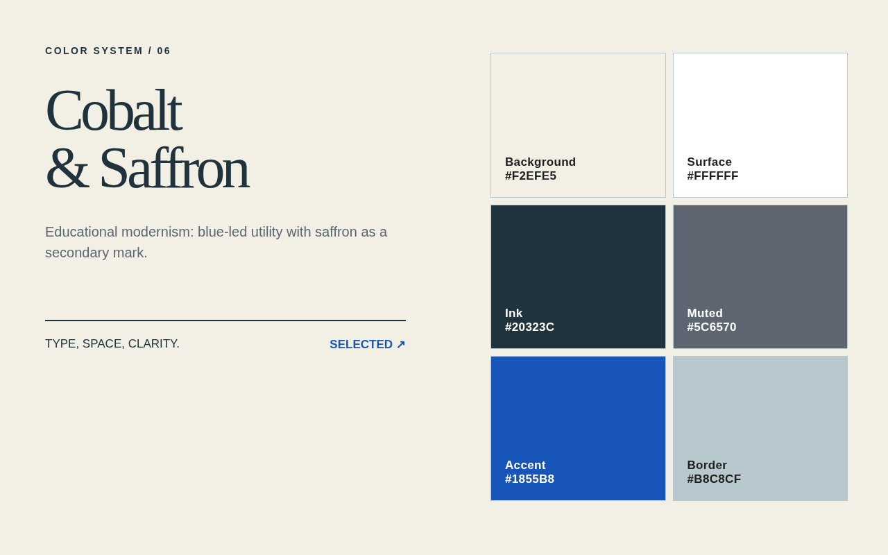

# Palette: Cobalt & Saffron

Educational modernism: blue-led utility with saffron as a secondary mark.

## Canonical palette contract (authoritative)

Apply this **after** a style's core tokens. The style owns its grid and typography. This palette only overrides semantic colors:

```css
:root {
  --color-bg: #F2EFE5;
  --color-surface: #FFFFFF;
  --color-ink: #20323C;
  --color-muted: #5C6570;
  --color-accent: #1855B8;
  --color-border: #B8C8CF;
}
```

**Contrast and application:** use `--color-ink` for body copy and `--color-muted` for secondary labels on the canvas. Do not assume `--color-accent` can be used as small text: run a contrast check and use it for larger labels, thick rules or backgrounds as needed. For buttons, verify contrast in both default and hover states. Error and success require distinct icons/text, not color alone.

## Composition rule

1. Style tokens first, then this palette. Use its accent sparingly on selected controls, key numbers, or strong editorial rules; do not turn each container into a colored block.
2. No gradient is introduced by choosing this palette. Solid surfaces and contrast do the work.
3. Ensure accessible dark/light differentiation and preserve focus outlines.


