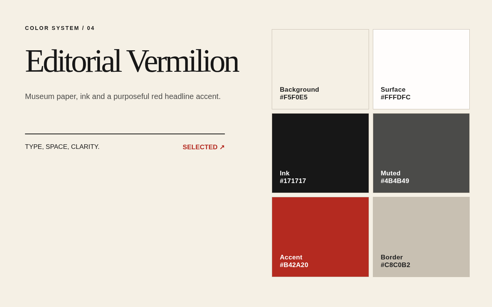

# Palette: Editorial Vermilion

## Color Tokens
```css
:root {
  --bg-bone: #F6F3EC;         /* Gallery wall cream */
  --ink-jet: #0E0E0E;         /* Exhibition black */
  --ink-muted: #52504B;       /* Caption grey */
  --accent-vermilion: #E03C28;/* Primary exhibition highlight */
  --accent-cobalt: #1E429F;   /* Secondary structural accent */
  --border-ink: #1A1A1A;      /* Crisp graphic border */
}
```

## Usage Rules
- Use vermilion and cobalt as bold flat graphic blocks, never as blended gradients.
- Pairs exceptionally well with `swiss-editorial`, `bauhaus-1925`, and `neo-brutalist`.

## Canonical palette contract (authoritative)

Apply this **after** a style's core tokens. The style owns its grid and typography. This palette only overrides semantic colors:

```css
:root {
  --color-bg: #F5F0E5;
  --color-surface: #FFFDFC;
  --color-ink: #171717;
  --color-muted: #4B4B49;
  --color-accent: #B42A20;
  --color-border: #C8C0B2;
}
```

**Contrast and application:** use `--color-ink` for body copy and `--color-muted` for secondary labels on the canvas. Do not assume `--color-accent` can be used as small text: run a contrast check and use it for larger labels, thick rules or backgrounds as needed. For buttons, verify contrast in both default and hover states. Error and success require distinct icons/text, not color alone.

## Composition rule

1. Style tokens first, then this palette. Use its accent sparingly on selected controls, key numbers, or strong editorial rules; do not turn each container into a colored block.
2. No gradient is introduced by choosing this palette. Solid surfaces and contrast do the work.
3. Ensure accessible dark/light differentiation and preserve focus outlines.


