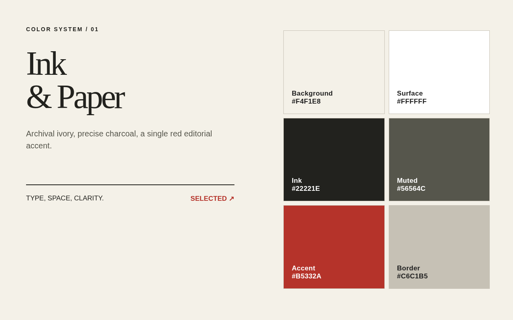

# Palette: Ink & Paper

## Color Tokens
```css
:root {
  --bg-primary: #F7F6F2;      /* 70% surface: Archival paper */
  --bg-elevated: #FFFFFF;     /* 15% surface: Crisp white cell */
  --bg-muted: #EBE9E2;        /* 5% surface: Subtle hover/badge */
  --ink-primary: #111111;     /* Primary text & rules (Contrast > 17:1) */
  --ink-secondary: #555450;   /* Metadata & captions (Contrast > 7:1) */
  --border-color: #D6D3CB;    /* Hairline grid divider */
  --accent-primary: #D92B2B;  /* Max 5% area: Functional vermilion */
}
```

## Usage Rules
- **60-30-10 Ratio:** 85% paper/white canvas, 10% dense black typography and lines, max 5% vermilion accent.
- **No Greys on Greys:** Never place low-contrast grey text on grey containers. Maintain strict WCAG AAA readability.
- **Forbidden:** Secondary accent colors, rainbow status badges, or gradient backgrounds.

## Canonical palette contract (authoritative)

Apply this **after** a style's core tokens. The style owns its grid and typography. This palette only overrides semantic colors:

```css
:root {
  --color-bg: #F4F1E8;
  --color-surface: #FFFFFF;
  --color-ink: #22221E;
  --color-muted: #56564C;
  --color-accent: #B5332A;
  --color-border: #C6C1B5;
}
```

**Contrast and application:** use `--color-ink` for body copy and `--color-muted` for secondary labels on the canvas. Do not assume `--color-accent` can be used as small text: run a contrast check and use it for larger labels, thick rules or backgrounds as needed. For buttons, verify contrast in both default and hover states. Error and success require distinct icons/text, not color alone.

## Composition rule

1. Style tokens first, then this palette. Use its accent sparingly on selected controls, key numbers, or strong editorial rules; do not turn each container into a colored block.
2. No gradient is introduced by choosing this palette. Solid surfaces and contrast do the work.
3. Ensure accessible dark/light differentiation and preserve focus outlines.


