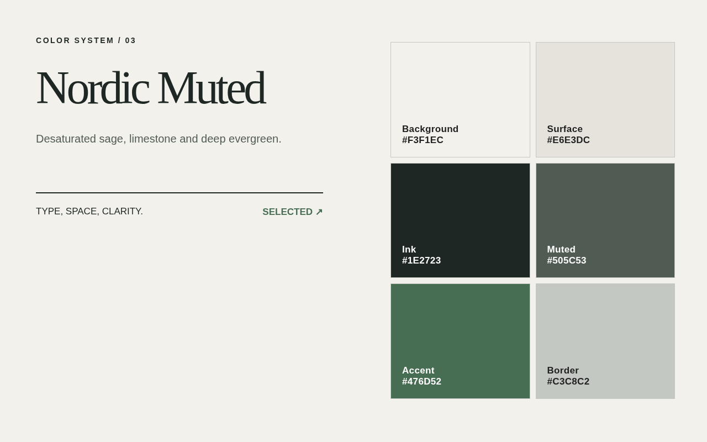

# Palette: Nordic Muted

## Color Tokens
```css
:root {
  --bg-sand: #F3F1EC;         /* Warm limestone canvas */
  --bg-stone: #E6E3DC;        /* Secondary section block */
  --ink-pine: #1E2723;        /* Deep forest charcoal text */
  --ink-slate: #5A635E;       /* Soft Nordic grey */
  --accent-sage: #5E7464;     /* Desaturated sage green */
  --accent-clay: #B57355;     /* Subtle muted terracotta */
  --border-mist: #D2CFC6;     /* Gentle divider */
}
```

## Usage Rules
- Keep saturation under 30% across the entire interface for an effortless, calming Nordic feel.
- Pair best with `warm-analog`, `swiss-editorial`, or `japanese-zen-minimalism`.

## Canonical palette contract (authoritative)

Apply this **after** a style's core tokens. The style owns its grid and typography. This palette only overrides semantic colors:

```css
:root {
  --color-bg: #F3F1EC;
  --color-surface: #E6E3DC;
  --color-ink: #1E2723;
  --color-muted: #505C53;
  --color-accent: #476D52;
  --color-border: #C3C8C2;
}
```

**Contrast and application:** use `--color-ink` for body copy and `--color-muted` for secondary labels on the canvas. Do not assume `--color-accent` can be used as small text: run a contrast check and use it for larger labels, thick rules or backgrounds as needed. For buttons, verify contrast in both default and hover states. Error and success require distinct icons/text, not color alone.

## Composition rule

1. Style tokens first, then this palette. Use its accent sparingly on selected controls, key numbers, or strong editorial rules; do not turn each container into a colored block.
2. No gradient is introduced by choosing this palette. Solid surfaces and contrast do the work.
3. Ensure accessible dark/light differentiation and preserve focus outlines.


