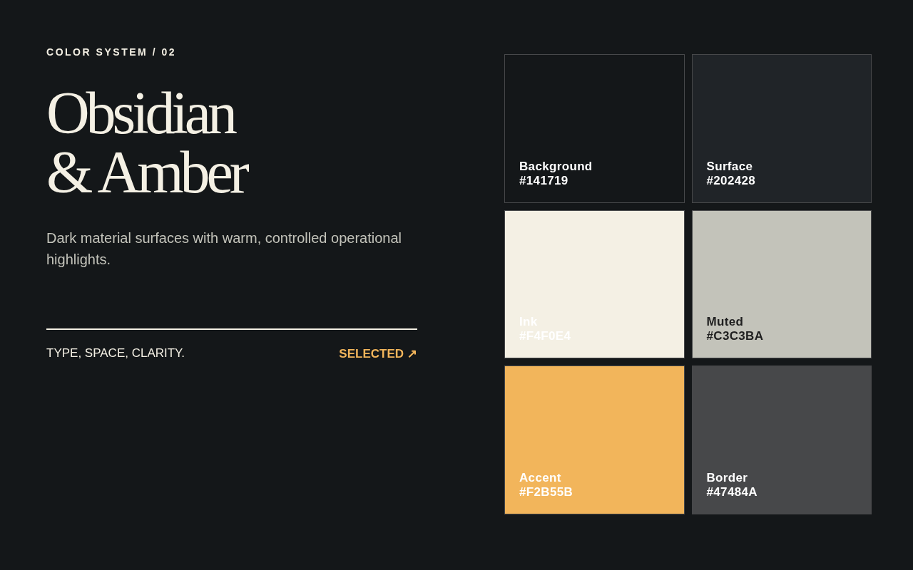

# Palette: Obsidian & Amber

## Color Tokens
```css
:root {
  --bg-canvas: #0D0F12;       /* Base obsidian */
  --bg-surface: #14171C;      /* Elevated card/panel */
  --bg-interactive: #1C2028;  /* Hover / input background */
  --border-subtle: #262B35;   /* Crisp 1px divider */
  --text-primary: #EDEFF2;    /* Crisp soft off-white */
  --text-secondary: #8A93A2;  /* Muted steel */
  --accent-amber: #E5A024;    /* Primary CTA / highlight */
  --accent-amber-soft: rgba(229, 160, 36, 0.12);
}
```

## Usage Rules
- Never pair amber with neon blue or purple—let amber act as the sole warm light source in a matte dark room.
- Keep glow effects off (`text-shadow: none; box-shadow: none;`). Let luminance contrast do the work.

## Canonical palette contract (authoritative)

Apply this **after** a style's core tokens. The style owns its grid and typography. This palette only overrides semantic colors:

```css
:root {
  --color-bg: #141719;
  --color-surface: #202428;
  --color-ink: #F4F0E4;
  --color-muted: #C3C3BA;
  --color-accent: #F2B55B;
  --color-border: #47484A;
}
```

**Contrast and application:** use `--color-ink` for body copy and `--color-muted` for secondary labels on the canvas. Do not assume `--color-accent` can be used as small text: run a contrast check and use it for larger labels, thick rules or backgrounds as needed. For buttons, verify contrast in both default and hover states. Error and success require distinct icons/text, not color alone.

## Composition rule

1. Style tokens first, then this palette. Use its accent sparingly on selected controls, key numbers, or strong editorial rules; do not turn each container into a colored block.
2. No gradient is introduced by choosing this palette. Solid surfaces and contrast do the work.
3. Ensure accessible dark/light differentiation and preserve focus outlines.


