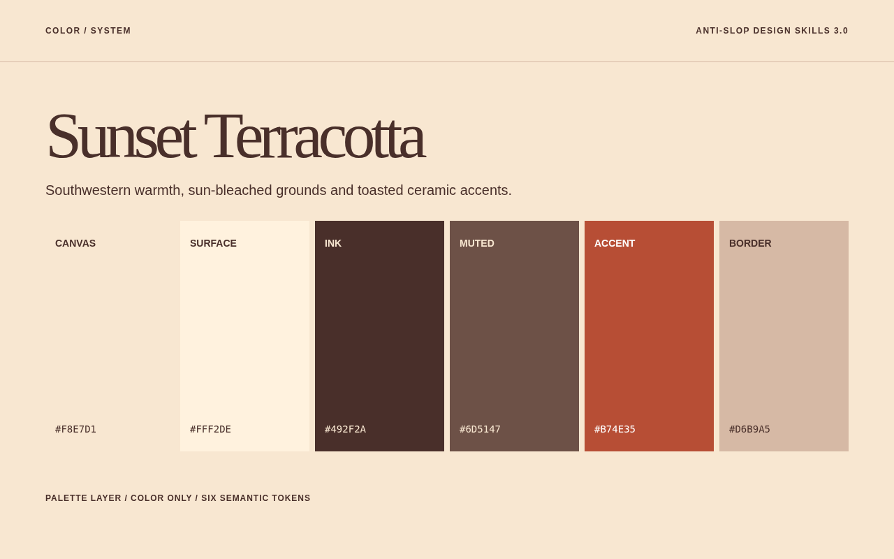

# Sunset Terracotta — Semantic Color Palette

Southwestern warmth, sun-bleached grounds and toasted ceramic accents.

## Canonical CSS contract

```css
:root {
  --color-bg: #F8E7D1;
  --color-surface: #FFF2DE;
  --color-ink: #492F2A;
  --color-muted: #6D5147;
  --color-accent: #B74E35;
  --color-border: #D6B9A5;
  --font-display: Georgia, serif;
  --font-body: Arial, Helvetica, sans-serif;
  --radius-control: 0px;
  --focus-ring: 3px solid var(--color-accent);
}
```

Load palette variables after style variables. Only six `--color-*` values should override the chosen style. Display type, geometry, CSS radii and component anatomy remain the responsibility of the style skill. Normal text and muted text against the canvas must pass WCAG AA. Verify every actual nested surface and hover state separately. Never communicate state through color alone.

## Applications

- Canvas: `#F8E7D1`; surface: `#FFF2DE`; readable ink: `#492F2A`; muted copy: `#6D5147`.
- Accent `#B74E35` is a deliberate visual cue, not automatically a safe color for body text.
- Border `#D6B9A5` separates systems; ensure critical inputs have visible boundaries.
- Avoid default gradients and changing the palette's intent with uncontrolled 12-color charts.

## Implementation contract

- Use the six shared color tokens (`--color-bg`, `--color-surface`, `--color-ink`, `--color-muted`, `--color-accent`, `--color-border`) so palettes can override color **only**; preserve the style’s independent typographic and spatial identity.
- Provide clear semantic `header`, `nav`, `main`, and `footer` landmarks. Use native links and buttons; no decorative-only CTAs.
- Under 768px, recast the information hierarchy into a single intentional reading path; do not simply shrink the desktop canvas. At 768–1199px use a measured two-column adaptation and at larger sizes use the complete art-directed composition.
- Use visible focus styles (`:focus-visible` with `--focus-ring`), proper text alternatives, logical tab order and touch targets around 44px. Honor `prefers-reduced-motion`.
- Check actual text/background pairs against WCAG AA (4.5:1 for ordinary copy); an accent that is decorative may not be suitable for text.
- Create genuine hover, focus, selected, disabled, loading, error, empty and success states when applicable. Make success/errors perceivable without color alone.
- Do not invent statistics, testimonials, inventory, services, safety information, legal outcomes or product capabilities. Placeholder brand names in previews are fictional demonstrations, not ready-made content.
- Do not copy SITE123 customer templates, third-party logos, photographs or artwork. All examples here use original abstract HTML/SVG illustration.

## QA before delivery

1. Does the structure look different when viewed in grayscale, rather than just swapping colors? 2. Is the user’s primary task obvious? 3. Do keyboard, mobile and error states work? 4. Does the content sound like the real brand and avoid made-up proof? 5. Does the output remain coherent across a second screen?

## Preview


