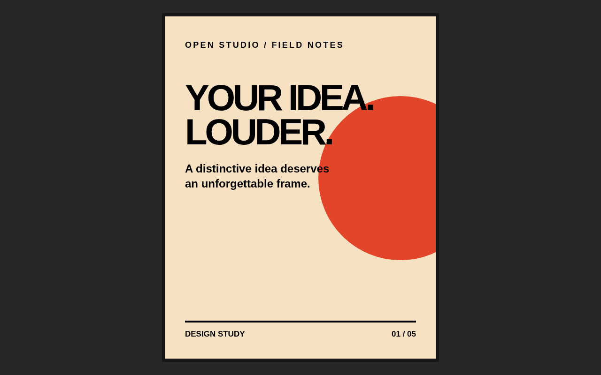

# Social Media: Brutalist Launch & Hook Graphic

## 1. Design Philosophy
Built to stop the thumb in 0.5 seconds on LinkedIn, X, or Product Hunt. Uses thick ink borders, vivid poster yellow or cobalt accents, and a real high-contrast "Before vs. After" split to prove value immediately.

## 2. Composition Blueprint (`1200 × 675px` or `1080 × 1080px`)
- **Top Strip:** Stark black or yellow banner with crisp monospace tag (`OPEN SOURCE RELEASE // v1.0`).
- **Core Headline:** Giant heavy uppercase grotesque (`STOP BUILDING IDENTICAL AI UIs.`), strictly 3–7 words.
- **Visual Proof Box:** Hard-bordered window (`3px solid #111`, `6px 6px 0 #111` shadow) displaying an actual before/after comparison or live interface screenshot.
- **Bottom Badge Row:** 2–3 sharp monospace tags (`12 DESIGN SKILLS` · `MIT LICENSE` · `WORKS IN CURSOR & CLAUDE`).

## 3. Forbidden Patterns
- NEVER blur screenshots or put unreadable tiny text inside promo cards.
- NEVER use purple-pink SaaS mesh gradients as the background.

## Export and editorial production gates

- Master size: 1080×1350 (4:5) for a feed poster; allow 1080×1080 when required. For carousel slides, retain consistent navigation and type hierarchy. The `preview.png` is only a catalog preview, **not** a print-ready final export.
- Safe margins: at least 72px on 1080×1350; do not hide key text against crop edges. Main headlines must remain readable on a narrow phone screen.
- Keep actual dates, locations, prices and sources supplied by the user; never invent event facts or testimonials.
- Use 1–2 display treatments at most; contrast and reading order outrank decorative complexity. Always provide descriptive alt text with social posts.
- For multi-slide content, label order and avoid orphaned text-only slides or arbitrary extra slides.

