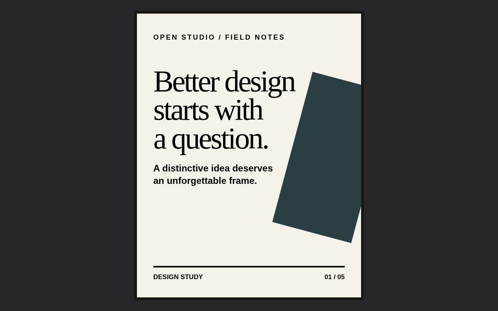

# Social Media: Editorial Carousel System

## 1. Design Philosophy
Transforms educational posts into crisp mini-magazines people actually bookmark. Stands out in noisy feeds through extreme clarity, high contrast, and restrained typography instead of cluttered clip-art and neon boxes.

## 2. Format & Safe Zones
- **Aspect Ratio:** `4:5` (`1080 × 1350px`) for maximum vertical feed presence on LinkedIn and Instagram.
- **Outer Margin:** Minimum `80px` breathing room on all 4 sides.
- **Persistent Framing:** Subtle hairline header (`01 / 07` on left, `@handle` or topic tag on right) and quiet footer cue (`SWIPE →`).

## 3. Slide-by-Slide Pacing Rules
- **Slide 1 (The Hook):** Massive bold headline (max 8 words), 1-line tension/sub-hook, zero clutter. Leave 40%+ open space.
- **Slides 2–6 (The Meat):** Strictly ONE idea per slide. Max 35 words per slide. Use a large index number (`02`), clear headline, and either a clean mini-diagram, code diff, or 2-column comparison ("Before / After").
- **Final Slide (The Takeaway & CTA):** Clean 3-line summary + clear action (`Star the repo / Save for later`).

## 4. Typography & Visual Discipline
- Pair `swiss-editorial` or `warm-analog` tokens.
- Use **one** bold highlight color to emphasize the single most important phrase on each slide.

## 5. Forbidden Social Media Slop
- NEVER cram 120 words onto a single slide.
- NEVER add random floating 3D rockets, glowing brains, or generic AI robot faces.
- NEVER switch fonts, margins, or color themes mid-carousel.

## Export and editorial production gates

- Master size: 1080×1350 (4:5) for a feed poster; allow 1080×1080 when required. For carousel slides, retain consistent navigation and type hierarchy. The `preview.png` is only a catalog preview, **not** a print-ready final export.
- Safe margins: at least 72px on 1080×1350; do not hide key text against crop edges. Main headlines must remain readable on a narrow phone screen.
- Keep actual dates, locations, prices and sources supplied by the user; never invent event facts or testimonials.
- Use 1–2 display treatments at most; contrast and reading order outrank decorative complexity. Always provide descriptive alt text with social posts.
- For multi-slide content, label order and avoid orphaned text-only slides or arbitrary extra slides.

