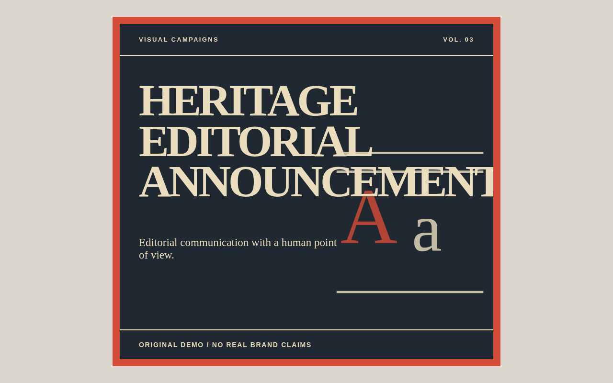

# Heritage Editorial Announcement — Campaign Composition

Make an editorial announcement with archival grid, clear provenance and tactile classic publishing rhythm.

## Publication anatomy

- Create a concise headline with one precise proposition; never add fictitious testimonials, counts, ratings or urgency.
- Place source/context, date or concrete action after the headline in the reading order.
- Design for social cropping: 4:5 portrait, 1:1 square and 16:9 banner. Maintain safe margins for mobile and platforms.
- Test readable information in a 350px thumbnail, not only on a 4K monitor.
- Produce original graphic assets only. Do not reuse trademarked covers, artist work or photograph likenesses without permission.
- Include alt text and editable source; exports should not bake false claims into decorative graphics.

## Implementation contract

- Use the six shared color tokens (`--color-bg`, `--color-surface`, `--color-ink`, `--color-muted`, `--color-accent`, `--color-border`) so palettes can override color **only**; preserve the style’s independent typographic and spatial identity.
- Provide clear semantic `header`, `nav`, `main`, and `footer` landmarks. Use native links and buttons; no decorative-only CTAs.
- Under 768px, recast the information hierarchy into a single intentional reading path; do not simply shrink the desktop canvas. At 768–1199px use a measured two-column adaptation and at larger sizes use the complete art-directed composition.
- Use visible focus styles (`:focus-visible` with `--focus-ring`), proper text alternatives, logical tab order and touch targets around 44px. Honor `prefers-reduced-motion`.
- Check actual text/background pairs against WCAG AA (4.5:1 for ordinary copy); an accent that is decorative may not be suitable for text.
- Create genuine hover, focus, selected, disabled, loading, error, empty and success states when applicable. Make success/errors perceivable without color alone.
- Do not invent statistics, testimonials, inventory, services, safety information, legal outcomes or product capabilities. Placeholder brand names in previews are fictional demonstrations, not ready-made content.
- Do not copy SITE123 customer templates, third-party logos, photographs or artwork. All examples here use original abstract HTML/SVG illustration.

## QA before delivery

1. Does the structure look different when viewed in grayscale, rather than just swapping colors? 2. Is the user’s primary task obvious? 3. Do keyboard, mobile and error states work? 4. Does the content sound like the real brand and avoid made-up proof? 5. Does the output remain coherent across a second screen?

## Preview

