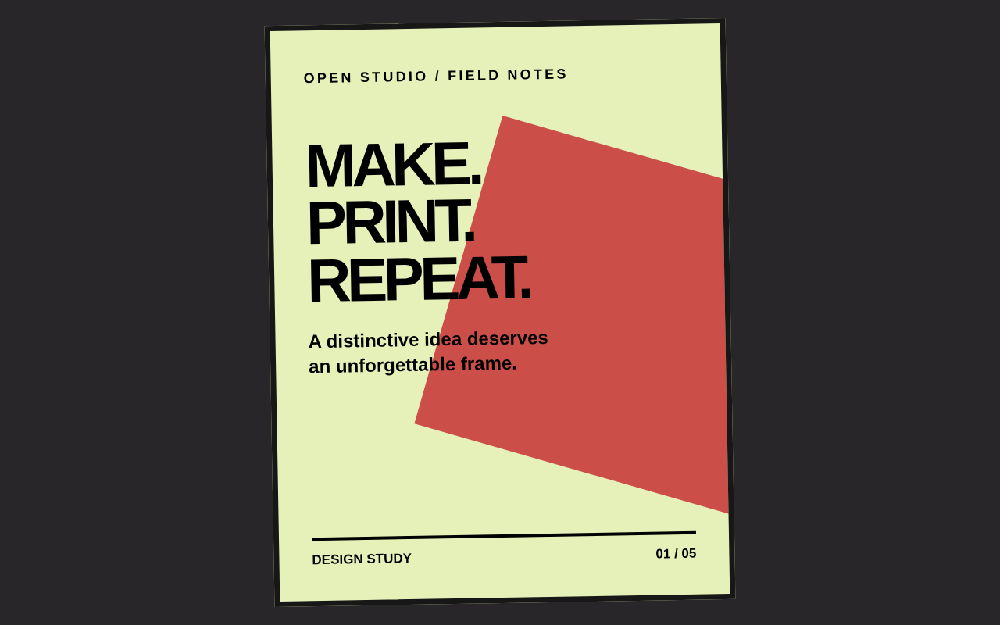

# Risograph Event Poster

DIY-inspired event communication with large legible details.

## Export and editorial production gates

- Master size: 1080×1350 (4:5) for a feed poster; allow 1080×1080 when required. For carousel slides, retain consistent navigation and type hierarchy. The `preview.png` is only a catalog preview, **not** a print-ready final export.
- Safe margins: at least 72px on 1080×1350; do not hide key text against crop edges. Main headlines must remain readable on a narrow phone screen.
- Keep actual dates, locations, prices and sources supplied by the user; never invent event facts or testimonials.
- Use 1–2 display treatments at most; contrast and reading order outrank decorative complexity. Always provide descriptive alt text with social posts.
- For multi-slide content, label order and avoid orphaned text-only slides or arbitrary extra slides.

