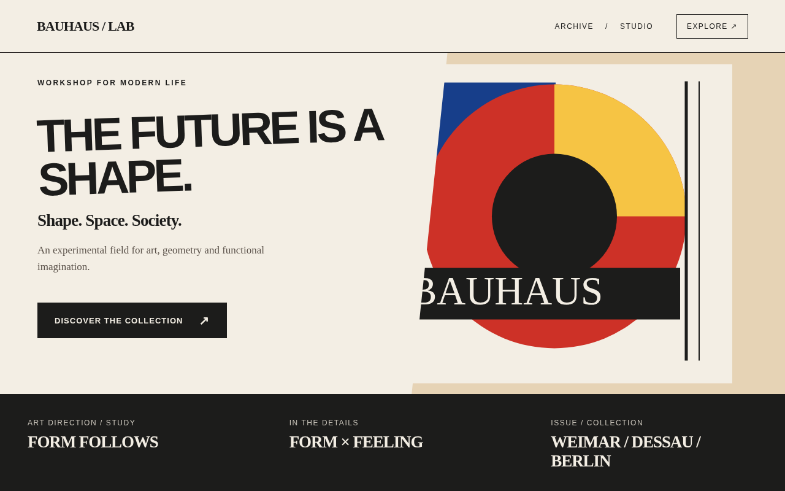

# Bauhaus 1925 (Geometric Modernism)

## 1. Design Philosophy
Guided by Walter Gropius, Wassily Kandinsky, and László Moholy-Nagy: *Form follows function*, and every visual element reduces to pure elementary geometry (circle, square, triangle) and primary colors. Turns a web page into a living modernist architectural poster.

## 2. Color Tokens & Surface Rules
```css
:root {
  --bg-raw-paper: #F2ECE1;    /* Unbleached warm exhibition paper */
  --ink-black: #121212;       /* Solid modernist black */
  --bauhaus-red: #D62828;     /* Primary cadmium red */
  --bauhaus-blue: #1D4E89;    /* Primary Bauhaus cobalt */
  --bauhaus-yellow: #F2B705;  /* Primary ochre yellow */
  --grid-bar: #121212;        /* Thick structural grid lines (2px–6px) */
}
```
- **Strict Palette Discipline:** Do not introduce secondary colors (no purple, teal, pink, or gradients). Stick strictly to paper, black, and the three primaries.

## 3. Typography & Hierarchy
- **Primary Font:** `'Futura', 'Jost', 'Montserrat', 'Outfit', sans-serif` (pure geometric sans-serif with circular `O` and pointed `A`/`M`).
- **Directionality:** Use intentional `writing-mode: vertical-rl; transform: rotate(180deg);` on sidebars, exhibition dates, or section indices to create dynamic Bauhaus tension.
- **Hierarchy:** Extreme scale jumps—gigantic uppercase geometric headlines colliding cleanly with crisp small technical blocks.

## 4. Layout, Grid & Geometry
- **Structural Bars:** Use thick solid black horizontal and vertical bars (`4px–8px`) to anchor asymmetric quadrants.
- **Geometric Accents:** Use pure SVG/CSS circles, quarter-circles, triangles, and diagonal bars as functional layout anchors or decorative dividers—never organic blobs.
- **Border Radius:** Strictly `0px` for boxes/cards, and `50%` exclusively for pure geometric circles.

## 5. Component Specifications
- **Buttons:** Bold primary-colored geometric blocks (square or sharp rectangle) with stark black or white uppercase text and instant color-swap hover states.
- **Cards / Modules:** Interlocking puzzle-like grid tiles where one tile is solid Bauhaus red, one is raw paper with oversized typography, and one features a stark black-and-white cropped photo or geometric emblem.

## 6. Strict Forbidden Patterns (Anti-Slop Checklist)
- NEVER use organic wavy blobs, soft rounded cards, or drop shadows.
- NEVER use serif fonts or decorative script typefaces.
- NEVER dilute primary colors into muddy gradients or neon glows.

---

## 7. Distinctive art direction and page anatomy

**Reference era:** 1920s Bauhaus. This is a contemporary interpretation, not a reproduction of a historical poster or a trademarked brand. Make work that feels designed by a person with a point of view.

- **Reference composition:** `poster`. Lead with a purposeful hierarchy, a real content block, and the signature `bauhaus` visual treatment; do not assume every product needs a dashboard.
- **Sample editorial voice:** “FORM FOLLOWS” / “THE FUTURE IS A SHAPE.”. Replace sample copy with authentic project copy; do not ship the preview's fictional brand or made-up metrics.
- **Use case:** Exhibition. Develop other applications only when the historical language matches their audience and task.
- **Key visual device:** `bauhaus`; create it with original vector or CSS geometry, real user-provided photography, or properly licensed assets. Never lift a historic poster pixel-for-pixel.
- **Minimum component vocabulary:** header/navigation, primary action, secondary action, content grouping, form/input, an item or list row, and visible feedback state.
- **Repeatable signature:** Maintain distinctive typographic proportion and materiality on subsequent pages; vary composition based on content so the site is not one repeated hero template.

## Required semantic-token interface
The implementation MUST use these shared CSS custom properties (the palette layer may override them later):

```css
:root {
  --color-bg: #F3EEE4;
  --color-surface: #E9DED0;
  --color-ink: #1C1C1B;
  --color-muted: #5A5149;
  --color-accent: #CD3127;
  --color-border: #262220;
  --font-display: Arial Black, Arial, sans-serif;
  --font-body: Arial, sans-serif;
  --radius-control: 0px;
  --focus-ring: 3px solid var(--color-accent);
}
```

Use `var(--color-bg)` rather than hardcoding background colors throughout components. When combining a palette, **load style tokens first, then palette tokens** (the later palette overrides the six `--color-*` values). A palette changes color only, not the style's spatial or typographic DNA. Any legacy token names in the original spec are descriptive aliases; use this semantic contract in new code.


## 8. Responsive behavior (do not skip)

- At `>= 1200px`, use the full asymmetrical or editorial grid. At `768–1199px`, reduce columns and proportionally scale headlines. Below `768px`, collapse to a single deliberate reading path; keep the primary action visible without floating overlays.
- Typography: `clamp(2.5rem, 6.5vw, 6.75rem)` for a large display heading, `clamp(1rem, 1.2vw, 1.125rem)` for body; adjust the clamp for special historical styles while keeping body text readable.
- Use `minmax(0, 1fr)` for long content, `overflow-wrap: anywhere` for technical tokens, and a horizontal overflow wrapper for necessary data tables.
- All interactive controls have touch targets around 44×44 CSS pixels. Do not hide access to important workflows on mobile.
- Offer low-motion alternatives; respect `prefers-reduced-motion: reduce`.

## 9. Accessible components and states

- Text contrast: normal text at least WCAG AA 4.5:1 and large text at least 3:1, including muted labels. Some illustrative accents are **not** safe for foreground copy; test the actual foreground/background pair.
- Keyboard: visible `:focus-visible` ring, logical tab order, Escape on dismissible overlays, proper native controls; hover is never the only feedback.
- Supply designed states: default, hover, focus, pressed, disabled, loading, empty, error, success, and selected where applicable. Announce async outcomes in a polite live region, not by color alone.
- Use semantic landmarks (`header`, `nav`, `main`, `aside`, `footer`) and ordered heading levels. Image alt describes meaning, while purely ornamental illustrations use empty alt or `aria-hidden`.

## 10. Anti-clone quality gate

Before delivery, check: (1) Could the preview be mistaken for another skill in this library? If so, change the **composition**, not merely its colors. (2) Are the content and controls plausible for the product? (3) Are there any illegible labels or fake chart metrics? (4) Do mobile, keyboard and reduced-motion states work? (5) Has AI-default hero/card/glow styling slipped back in?

## 11. Invocation example

```text
Use the bauhaus-1925 design skill. Identify the product's core workflow, map its content hierarchy, apply its tokens and signature composition, and build a usable responsive page with real content states. Do not mimic the sample preview's fictional brand; do not introduce generic AI gradient/card patterns. Explain design choices in 5 concise sentences after implementation.
```

## 12. Visual reference



`demo.html` is the local, self-contained composition used to generate this preview. It illustrates a style direction, not a production-ready application or a functional app.
