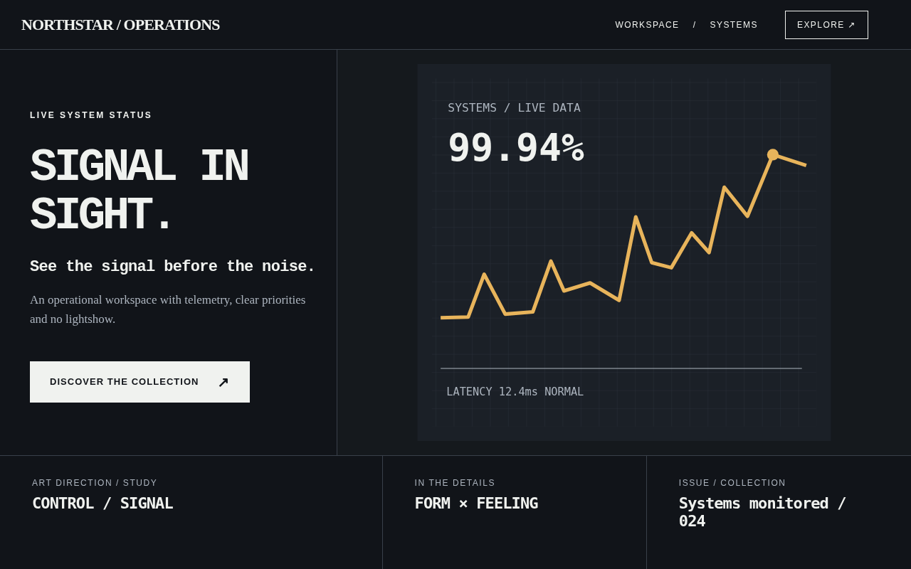

# Dark Precision (Technical Minimalist UI)

## 1. Design Philosophy
Built for engineering tools, telemetry consoles, security dashboards, and serious developer software. Inspired by precision aerospace instruments and tools like Linear, Vercel, and Bloomberg terminals. Calm, dense, high-contrast, and utilitarian—completely rejecting glowing neon "AI dark mode" aesthetics.

## 2. Color Tokens & Surface Rules
```css
:root {
  --bg-canvas: #0B0D10;       /* Deep matte obsidian */
  --bg-panel: #111418;        /* Primary elevated surface */
  --bg-panel-hover: #171B21;  /* Subtle hover state */
  --border-hairline: #232830; /* Crisp 1px structural divider */
  --border-active: #3A424E;   /* Focused or selected border */
  --text-primary: #ECEFF4;    /* Soft crisp white (never harsh #FFF) */
  --text-secondary: #8A94A6;  /* Muted steel metadata */
  --text-muted: #525C6B;      /* Timestamps & inactive labels */
  --status-ok: #2EB872;       /* Desaturated emerald */
  --status-warn: #D99B26;     /* Muted amber */
  --status-err: #D94B4B;      /* Muted crimson */
}
```
- **Depth rule:** Achieve layering strictly through subtle background lightness steps (`+3%` luminance) and `1px solid var(--border-hairline)` borders—never blurry shadows.

## 3. Typography & Hierarchy
- **UI Sans:** `'Inter', 'Geist', -apple-system, sans-serif`
- **Data / Code / Labels:** `'JetBrains Mono', 'Geist Mono', 'IBM Plex Mono', monospace`
- **Tabular Numbers:** Always apply `font-variant-numeric: tabular-nums;` on all metrics, tables, timestamps, and counters.
- **Section Micro-Headers:** `11px`, uppercase, `letter-spacing: 0.08em`, monospace, `--text-secondary`.

## 4. Layout, Grid & Geometry
- **Border Radius:** Tight technical corners (`2px` to `4px` max). Never pill-shaped containers.
- **Density:** Prioritize information density with clean breathing room (`12px–16px` internal cell padding).
- **Navigation:** Slim fixed left rail (`200px–220px`) with subtle active vertical indicator bar (`2px solid --text-primary`).

## 5. Component Specifications
- **Status Badges:** Compact rectangular tags (`border-radius: 2px`), `1px` tinted border, `10%` opacity background fill, uppercase `10px` monospace text (`OK`, `IDLE`, `WARN`).
- **Charts & Sparklines:** Ultra-thin `1.25px` vector strokes, minimal subtle gridlines, zero flashy gradient area fills or 3D effects.
- **Tables:** Monospace data columns, crisp `1px` row dividers, generous horizontal alignment, clear hover row highlight.

## 6. Strict Forbidden Patterns (Anti-Slop Checklist)
- NEVER use neon cyan, magenta, electric purple, or glowing box-shadows.
- NEVER use glassmorphism (`backdrop-filter: blur`) over glowing background blobs.
- NEVER use oversized `16px–24px` rounded cards.
- NEVER add fake "holographic" borders or animated gradient outlines.
- NEVER use decorative marketing illustrations inside a technical interface.

---

## 7. Distinctive art direction and page anatomy

**Reference era:** Precision interface. This is a contemporary interpretation, not a reproduction of a historical poster or a trademarked brand. Make work that feels designed by a person with a point of view.

- **Reference composition:** `dashboard`. Lead with a purposeful hierarchy, a real content block, and the signature `wave` visual treatment; do not assume every product needs a dashboard.
- **Sample editorial voice:** “CONTROL / SIGNAL” / “SIGNAL IN SIGHT.”. Replace sample copy with authentic project copy; do not ship the preview's fictional brand or made-up metrics.
- **Use case:** Technology. Develop other applications only when the historical language matches their audience and task.
- **Key visual device:** `wave`; create it with original vector or CSS geometry, real user-provided photography, or properly licensed assets. Never lift a historic poster pixel-for-pixel.
- **Minimum component vocabulary:** header/navigation, primary action, secondary action, content grouping, form/input, an item or list row, and visible feedback state.
- **Repeatable signature:** Maintain distinctive typographic proportion and materiality on subsequent pages; vary composition based on content so the site is not one repeated hero template.

## Required semantic-token interface
The implementation MUST use these shared CSS custom properties (the palette layer may override them later):

```css
:root {
  --color-bg: #111419;
  --color-surface: #1B2027;
  --color-ink: #F0F2EF;
  --color-muted: #ADB5BF;
  --color-accent: #E8B45B;
  --color-border: #39404A;
  --font-display: Arial, sans-serif;
  --font-body: Arial, sans-serif;
  --radius-control: 0px;
  --focus-ring: 3px solid var(--color-accent);
}
```

Use `var(--color-bg)` rather than hardcoding background colors throughout components. When combining a palette, **load style tokens first, then palette tokens** (the later palette overrides the six `--color-*` values). A palette changes color only, not the style's spatial or typographic DNA. Any legacy token names in the original spec are descriptive aliases; use this semantic contract in new code.


## 8. Responsive behavior (do not skip)

- At `>= 1200px`, use the full asymmetrical or editorial grid. At `768–1199px`, reduce columns and proportionally scale headlines. Below `768px`, collapse to a single deliberate reading path; keep the primary action visible without floating overlays.
- Typography: `clamp(2.5rem, 6.5vw, 6.75rem)` for a large display heading, `clamp(1rem, 1.2vw, 1.125rem)` for body; adjust the clamp for special historical styles while keeping body text readable.
- Use `minmax(0, 1fr)` for long content, `overflow-wrap: anywhere` for technical tokens, and a horizontal overflow wrapper for necessary data tables.
- All interactive controls have touch targets around 44×44 CSS pixels. Do not hide access to important workflows on mobile.
- Offer low-motion alternatives; respect `prefers-reduced-motion: reduce`.

## 9. Accessible components and states

- Text contrast: normal text at least WCAG AA 4.5:1 and large text at least 3:1, including muted labels. Some illustrative accents are **not** safe for foreground copy; test the actual foreground/background pair.
- Keyboard: visible `:focus-visible` ring, logical tab order, Escape on dismissible overlays, proper native controls; hover is never the only feedback.
- Supply designed states: default, hover, focus, pressed, disabled, loading, empty, error, success, and selected where applicable. Announce async outcomes in a polite live region, not by color alone.
- Use semantic landmarks (`header`, `nav`, `main`, `aside`, `footer`) and ordered heading levels. Image alt describes meaning, while purely ornamental illustrations use empty alt or `aria-hidden`.

## 10. Anti-clone quality gate

Before delivery, check: (1) Could the preview be mistaken for another skill in this library? If so, change the **composition**, not merely its colors. (2) Are the content and controls plausible for the product? (3) Are there any illegible labels or fake chart metrics? (4) Do mobile, keyboard and reduced-motion states work? (5) Has AI-default hero/card/glow styling slipped back in?

## 11. Invocation example

```text
Use the dark-precision design skill. Identify the product's core workflow, map its content hierarchy, apply its tokens and signature composition, and build a usable responsive page with real content states. Do not mimic the sample preview's fictional brand; do not introduce generic AI gradient/card patterns. Explain design choices in 5 concise sentences after implementation.
```

## 12. Visual reference



`demo.html` is the local, self-contained composition used to generate this preview. It illustrates a style direction, not a production-ready application or a functional app.
