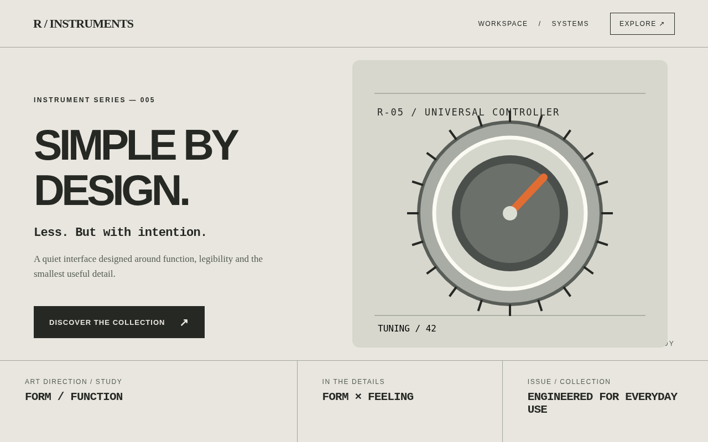

# Dieter Rams Industrial (Braun / Hardware UI)

## 1. Design Philosophy
Rooted in Dieter Rams' "Ten Principles for Good Design" (*Less, but better*) and modern Teenage Engineering hardware ergonomics. The interface feels like an exquisitely engineered physical synthesizer, radio, or precision laboratory instrument sitting on a desk.

## 2. Color Tokens & Surface Rules
```css
:root {
  --chassis-bg: #EAE8E3;      /* Matte warm anodized light grey */
  --panel-recess: #DEDBD4;    /* Slightly recessed hardware bay */
  --key-surface: #F4F3EF;     /* Tactile off-white physical key */
  --key-dark: #2B2B29;        /* Matte graphite control key */
  --ink-label: #1E1E1C;       /* Crisp silk-screened black label */
  --ink-sub: #6F6D68;         /* Micro technical legend */
  --braun-orange: #E8521A;    /* Signature functional power/action orange */
  --braun-green: #2E8B57;     /* Active status LED */
  --hairline: #C7C3BA;        /* Milled seam divider */
}
```
- **Accent Rule:** Use `--braun-orange` exclusively on ONE primary functional trigger (e.g., Power, Record, Execute) or a tiny `6px` circular status LED.

## 3. Typography & Hierarchy
- **Primary Font:** `'DIN Pro', 'Space Grotesk', 'Helvetica Neue', sans-serif` (clean geometric/industrial grotesque)
- **Micro-Legends:** `'IBM Plex Mono', monospace` at `9px–11px`, uppercase, generous tracking (`0.08em`), styled like silkscreen print on anodized metal.

## 4. Layout, Grid & Geometry
- **Modular Bays:** Divide the interface into strict rectangular hardware modules separated by `1px` milled seams (`--hairline`).
- **Physical Controls:** Incorporate circular rotary dial visualizations, crisp segmented LED bar meters, dot-matrix speaker perforations (subtle CSS radial-gradient patterns), and square tactile key grids.
- **Border Radius:** Machined `2px–4px` outer corners; true circles (`50%`) for rotary knobs and LED indicators.

## 5. Component Specifications
- **Tactile Keys:** Subtle `1px` bottom lip shadow (`box-shadow: 0 2px 0 #BDB9AF, inset 0 1px 0 #FFFFFF`) that depresses smoothly on click.
- **Readout Displays:** Dark matte OLED inset window (`#1A1B19`) with crisp crisp monochrome or amber dot-matrix / monospace readout text.
- **Switches & Sliders:** Mechanical track grooves with high-contrast center ticks.

## 6. Strict Forbidden Patterns (Anti-Slop Checklist)
- NEVER use glassmorphism, fluffy shadows, or decorative color gradients.
- NEVER overuse orange—more than 2–3% orange ruins the Braun discipline.
- NEVER add marketing fluff, mascots, or rounded bubbly SaaS illustrations.

---

## 7. Distinctive art direction and page anatomy

**Reference era:** 1960s industrial. This is a contemporary interpretation, not a reproduction of a historical poster or a trademarked brand. Make work that feels designed by a person with a point of view.

- **Reference composition:** `device`. Lead with a purposeful hierarchy, a real content block, and the signature `dial` visual treatment; do not assume every product needs a dashboard.
- **Sample editorial voice:** “FORM / FUNCTION” / “SIMPLE BY DESIGN.”. Replace sample copy with authentic project copy; do not ship the preview's fictional brand or made-up metrics.
- **Use case:** Product. Develop other applications only when the historical language matches their audience and task.
- **Key visual device:** `dial`; create it with original vector or CSS geometry, real user-provided photography, or properly licensed assets. Never lift a historic poster pixel-for-pixel.
- **Minimum component vocabulary:** header/navigation, primary action, secondary action, content grouping, form/input, an item or list row, and visible feedback state.
- **Repeatable signature:** Maintain distinctive typographic proportion and materiality on subsequent pages; vary composition based on content so the site is not one repeated hero template.

## Required semantic-token interface
The implementation MUST use these shared CSS custom properties (the palette layer may override them later):

```css
:root {
  --color-bg: #E8E6DE;
  --color-surface: #D7D7CD;
  --color-ink: #262824;
  --color-muted: #555C53;
  --color-accent: #E26D32;
  --color-border: #A2A59E;
  --font-display: Arial, sans-serif;
  --font-body: Arial, sans-serif;
  --radius-control: 0px;
  --focus-ring: 3px solid var(--color-accent);
}
```

Use `var(--color-bg)` rather than hardcoding background colors throughout components. When combining a palette, **load style tokens first, then palette tokens** (the later palette overrides the six `--color-*` values). A palette changes color only, not the style's spatial or typographic DNA. Any legacy token names in the original spec are descriptive aliases; use this semantic contract in new code.


## 8. Responsive behavior (do not skip)

- At `>= 1200px`, use the full asymmetrical or editorial grid. At `768–1199px`, reduce columns and proportionally scale headlines. Below `768px`, collapse to a single deliberate reading path; keep the primary action visible without floating overlays.
- Typography: `clamp(2.5rem, 6.5vw, 6.75rem)` for a large display heading, `clamp(1rem, 1.2vw, 1.125rem)` for body; adjust the clamp for special historical styles while keeping body text readable.
- Use `minmax(0, 1fr)` for long content, `overflow-wrap: anywhere` for technical tokens, and a horizontal overflow wrapper for necessary data tables.
- All interactive controls have touch targets around 44×44 CSS pixels. Do not hide access to important workflows on mobile.
- Offer low-motion alternatives; respect `prefers-reduced-motion: reduce`.

## 9. Accessible components and states

- Text contrast: normal text at least WCAG AA 4.5:1 and large text at least 3:1, including muted labels. Some illustrative accents are **not** safe for foreground copy; test the actual foreground/background pair.
- Keyboard: visible `:focus-visible` ring, logical tab order, Escape on dismissible overlays, proper native controls; hover is never the only feedback.
- Supply designed states: default, hover, focus, pressed, disabled, loading, empty, error, success, and selected where applicable. Announce async outcomes in a polite live region, not by color alone.
- Use semantic landmarks (`header`, `nav`, `main`, `aside`, `footer`) and ordered heading levels. Image alt describes meaning, while purely ornamental illustrations use empty alt or `aria-hidden`.

## 10. Anti-clone quality gate

Before delivery, check: (1) Could the preview be mistaken for another skill in this library? If so, change the **composition**, not merely its colors. (2) Are the content and controls plausible for the product? (3) Are there any illegible labels or fake chart metrics? (4) Do mobile, keyboard and reduced-motion states work? (5) Has AI-default hero/card/glow styling slipped back in?

## 11. Invocation example

```text
Use the dieter-rams-industrial design skill. Identify the product's core workflow, map its content hierarchy, apply its tokens and signature composition, and build a usable responsive page with real content states. Do not mimic the sample preview's fictional brand; do not introduce generic AI gradient/card patterns. Explain design choices in 5 concise sentences after implementation.
```

## 12. Visual reference



`demo.html` is the local, self-contained composition used to generate this preview. It illustrates a style direction, not a production-ready application or a functional app.
