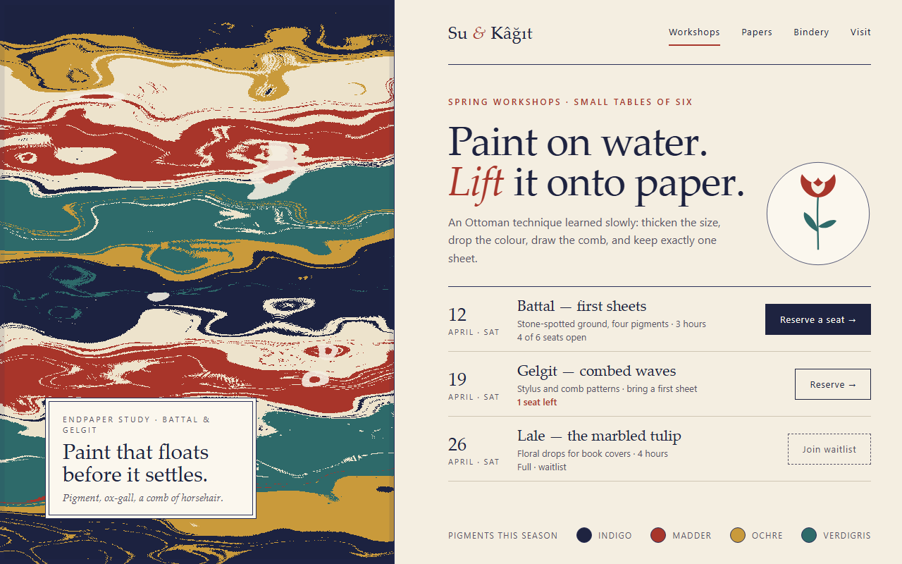

# Ebru Marbling (Ottoman Marbled Paper)

## 1. Design Philosophy
Ebru is paint floated on thickened water, combed, and lifted onto a single sheet; no two prints repeat. The interface borrows that tension: one wild, fluid surface (the endpaper) against an orderly, bookish reading column. The marbling is the only ornament; everything else is quiet, set like a book plate in a bindery.

## 2. Color Tokens & Surface Rules
```css
:root {
  --color-bg: #F4EEE1;
  --color-surface: #FBF7EE;
  --color-ink: #1E2340;
  --color-muted: #585467;
  --color-accent: #A8362B;
  --color-border: #2B3159;
  --pigment-indigo: #1E2340;
  --pigment-madder: #A8362B;
  --pigment-ochre: #C99A3B;
  --pigment-verdigris: #2F6B6A;
  --size-paper: #EDE3CC;
}
```
- **Rule:** `--color-accent` (#A8362B) is reserved for the primary action, the current state and one focal detail per view. Additional pigment tokens are for illustration and ornament; verify contrast before using any of them for text.

## 3. Typography & Hierarchy
- **Display font stack:** `'Palatino Linotype', Palatino, 'Book Antiqua', Georgia, serif`
- **Body font stack:** `'Segoe UI', Candara, Arial, sans-serif`
- Display: a humanist book serif (Palatino, Book Antiqua) at 52–66px, regular weight; italics carry emphasis in the accent madder.
- Body and UI: a calm humanist sans at 15–17px with generous 1.6 leading.
- Labels: 11–12px uppercase with 0.2em tracking, used sparingly for dates and kickers.
- Turkish terms (battal, gelgit, lale) stay in their original spelling with a plain-language gloss beside them.

## 4. Layout, Grid & Geometry
- Split the viewport: a full-height marbled panel (40–45% width) and a reading column. Never tile marbling behind body text.
- Place a small cream book-plate label with a double rule (outline-offset) on the marbled panel; it holds the one-line thesis.
- Use ruled list rows (date · title + detail · action) for sessions or products rather than cards.
- Square corners; a 1px ink rule separates panels.

## 5. Component Specifications
- **Marbled panel:** SVG stripes of four pigments distorted with `feTurbulence` + `feDisplacementMap`; add thin comb veins and a few 'stone' drops. Generate a fresh seed per page section so it never looks tiled.
- **Book plate:** cream surface, 1px border plus an inner outline, small caps kicker, serif headline, italic footnote.
- **Session row:** large serif day number with uppercase month, title + detail, seat status (accent only when scarce), and a right-aligned action.
- **Buttons:** rectangular; primary filled ink, secondary outlined, waitlist dashed with muted text.

## 6. Strict Forbidden Patterns (Anti-Slop Checklist)
- NEVER use marbling as a full-page background under text.
- NEVER recolour the marbling with neon or purple/blue AI gradients; keep earth and mineral pigments.
- NEVER add glassmorphism or drop shadows to the book plate.
- NEVER use stock 'oriental' clichés (lanterns, generic arabesques) instead of the actual paper technique.

---

## 7. Distinctive art direction and page anatomy

**Reference era:** 16th-century Ottoman ebru. This is a contemporary interpretation, not a reproduction of a historical artefact or a trademarked brand. Make work that feels designed by a person with a point of view.

- **Reference composition:** `split endpaper`. Lead with a purposeful hierarchy, a real content block, and the signature `marbled endpaper` treatment; do not assume every product needs a dashboard.
- **Sample editorial voice:** “Paint on water. Lift it onto paper.”. Replace sample copy with authentic project copy; do not ship the preview's fictional brand or made-up details.
- **Use cases:** Craft workshops, bookbinding, tea and coffee, boutique stationery, cultural programmes. Develop other applications only when the visual language matches their audience and task.
- **Key visual device:** `marbled endpaper`; create it with original vector or CSS geometry, real user-provided photography, or properly licensed assets.
- **Minimum component vocabulary:** header/navigation, primary action, secondary action, content grouping, form/input, an item or list row, and visible feedback state.
- **Repeatable signature:** keep the typographic proportion and materiality on subsequent pages; vary composition based on content so the site is not one repeated hero template.

## Required semantic-token interface
The implementation MUST use these shared CSS custom properties (the palette layer may override them later):

```css
:root {
  --color-bg: #F4EEE1;
  --color-surface: #FBF7EE;
  --color-ink: #1E2340;
  --color-muted: #585467;
  --color-accent: #A8362B;
  --color-border: #2B3159;
  --font-display: 'Palatino Linotype', Palatino, 'Book Antiqua', Georgia, serif;
  --font-body: 'Segoe UI', Candara, Arial, sans-serif;
  --radius-control: 0px;
  --focus-ring: 3px solid var(--color-accent);
}
```

Use `var(--color-bg)` rather than hardcoding background colors throughout components. When combining a palette, **load style tokens first, then palette tokens** (the later palette overrides the six `--color-*` values). A palette changes color only, not the style's spatial or typographic DNA.

## 8. Responsive behavior (do not skip)

- At `>= 1200px`, use the full composition described above. At `768–1199px`, reduce columns and proportionally scale headlines. Below `768px`, collapse to a single deliberate reading path; keep the primary action visible without floating overlays.
- Typography: scale the display size with `clamp()` (for example `clamp(2.5rem, 6vw, 4rem)`), keep body text between 16px and 18px.
- Use `minmax(0, 1fr)` for long content, `overflow-wrap: anywhere` for technical tokens, and a horizontal overflow wrapper for necessary data tables.
- All interactive controls have touch targets around 44×44 CSS pixels. Do not hide access to important workflows on mobile.
- Offer low-motion alternatives; respect `prefers-reduced-motion: reduce`.

## 9. Accessible components and states

- Text contrast: normal text at least WCAG AA 4.5:1 and large text at least 3:1, including muted labels. Decorative pigments and pattern colours are **not** automatically safe for foreground copy; test the actual pair.
- Keyboard: visible `:focus-visible` ring, logical tab order, Escape on dismissible overlays, proper native controls; hover is never the only feedback.
- Supply designed states: default, hover, focus, pressed, disabled, loading, empty, error, success, and selected where applicable. Announce async outcomes in a polite live region, not by color alone.
- Use semantic landmarks (`header`, `nav`, `main`, `aside`, `footer`) and ordered heading levels. Ornamental SVG uses `aria-hidden="true"`; meaningful illustrations get a short `role="img"` label.

## 10. Anti-clone quality gate

Before delivery, check: (1) Could the result be mistaken for another skill in this library? If so, change the **composition**, not merely its colors. (2) Are the content and controls plausible for the product? (3) Are there illegible labels or invented statistics? (4) Do mobile, keyboard and reduced-motion states work? (5) Has AI-default hero/card/glow styling slipped back in?

## 11. Invocation example

```text
Use the ebru-marbling design skill. Identify the product's core workflow, map its content hierarchy, apply its tokens and signature composition, and build a usable responsive page with real content states. Do not mimic the sample preview's fictional brand; do not introduce generic AI gradient/card patterns. Explain design choices in 5 concise sentences after implementation.
```

## 12. Visual reference



`demo.html` is the local, self-contained composition used to generate this preview. It illustrates a style direction, not a production-ready application.
