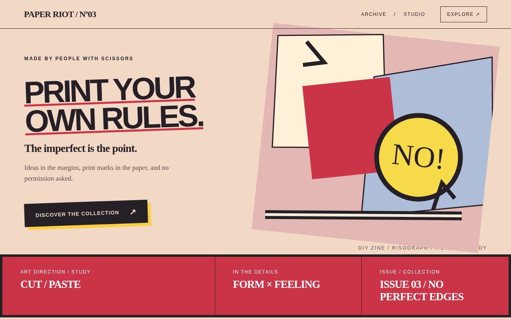

# Handmade Zine Collage (DIY Print & Underground Culture)

## 1. Design Philosophy
Inspired by photocopied punk zines, risograph print studios, scissors-and-glue paste-up layouts, and independent art collectives. Deliberately raw, tactile, slightly imperfect, and fiercely human—the exact opposite of polished corporate AI templates.

## 2. Color Tokens & Surface Rules
```css
:root {
  --paper-xerox: #EFECE6;     /* Slightly textured photocopy paper */
  --paper-cutout: #FAF8F3;    /* Brighter pasted paper strip */
  --ink-toner: #141414;       /* Heavy photocopy black toner */
  --ink-faded: #4A4A48;       /* Faded ink copy */
  --riso-red: #E63946;        /* Raw risograph red */
  --highlighter: #F4F142;     /* Marker yellow highlight */
  --tape-translucent: rgba(235, 226, 196, 0.72);
}
```

## 3. Typography & Hierarchy
- **Primary Body & Headers:** `'Courier Prime', 'Special Elite', 'IBM Plex Mono', monospace`
- **Cutout Headlines:** Heavy condensed grotesque (`'Anton', 'Impact', 'Archivo Black'`) placed inside black or paper-strip blocks, optionally rotated subtly (`-1.5deg` to `+1.5deg`).
- **Annotations:** Subtle handwritten/scribble accents for marginalia notes (`"ISSUE #09!"`, `"PRINT IS NOT DEAD"`).

## 4. Layout, Grid & Geometry
- **Controlled Imperfection:** Break rigid symmetry with slightly tilted paper strips (`transform: rotate(-1deg)`), overlapping taped photo cutouts, and asymmetrical collage stacks.
- **Texture:** Apply a subtle CSS SVG noise/grain overlay (`opacity: 0.04–0.07`) so backgrounds feel printed on paper rather than flat digital vectors.
- **Borders:** Dashed cut lines (`1px dashed #141414`), heavy jagged-feel solid ink frames (`2px solid #141414`), or translucent masking-tape strips across top corners of images.

## 5. Component Specifications
- **Buttons:** Look like stamped rubber-ink marks or cut-out paper labels with solid black fill or highlighter yellow background.
- **Photography:** High-contrast black-and-white (`filter: grayscale(100%) contrast(135%)`) with optional halftone dot overlay.
- **Pull Quotes:** Highlighted with marker yellow (`background: var(--highlighter)`) on typewriter text.

## 6. Strict Forbidden Patterns (Anti-Slop Checklist)
- NEVER make it unreadable—chaos should be strictly decorative while body copy stays clean and legible.
- NEVER use glossy 3D icons, glassmorphism, or smooth corporate SaaS gradients.
- NEVER use perfectly uniform symmetrical 3-column feature grids.

---

## 7. Distinctive art direction and page anatomy

**Reference era:** DIY zine / risograph. This is a contemporary interpretation, not a reproduction of a historical poster or a trademarked brand. Make work that feels designed by a person with a point of view.

- **Reference composition:** `loud`. Lead with a purposeful hierarchy, a real content block, and the signature `collage` visual treatment; do not assume every product needs a dashboard.
- **Sample editorial voice:** “CUT / PASTE” / “PRINT YOUR OWN RULES.”. Replace sample copy with authentic project copy; do not ship the preview's fictional brand or made-up metrics.
- **Use case:** Art. Develop other applications only when the historical language matches their audience and task.
- **Key visual device:** `collage`; create it with original vector or CSS geometry, real user-provided photography, or properly licensed assets. Never lift a historic poster pixel-for-pixel.
- **Minimum component vocabulary:** header/navigation, primary action, secondary action, content grouping, form/input, an item or list row, and visible feedback state.
- **Repeatable signature:** Maintain distinctive typographic proportion and materiality on subsequent pages; vary composition based on content so the site is not one repeated hero template.

## Required semantic-token interface
The implementation MUST use these shared CSS custom properties (the palette layer may override them later):

```css
:root {
  --color-bg: #F2D9C5;
  --color-surface: #F8EEDD;
  --color-ink: #242025;
  --color-muted: #5E4A4E;
  --color-accent: #CB3347;
  --color-border: #29232B;
  --font-display: Arial Black, Arial, sans-serif;
  --font-body: Georgia, serif;
  --radius-control: 0px;
  --focus-ring: 3px solid var(--color-accent);
}
```

Use `var(--color-bg)` rather than hardcoding background colors throughout components. When combining a palette, **load style tokens first, then palette tokens** (the later palette overrides the six `--color-*` values). A palette changes color only, not the style's spatial or typographic DNA. Any legacy token names in the original spec are descriptive aliases; use this semantic contract in new code.


## 8. Responsive behavior (do not skip)

- At `>= 1200px`, use the full asymmetrical or editorial grid. At `768–1199px`, reduce columns and proportionally scale headlines. Below `768px`, collapse to a single deliberate reading path; keep the primary action visible without floating overlays.
- Typography: `clamp(2.5rem, 6.5vw, 6.75rem)` for a large display heading, `clamp(1rem, 1.2vw, 1.125rem)` for body; adjust the clamp for special historical styles while keeping body text readable.
- Use `minmax(0, 1fr)` for long content, `overflow-wrap: anywhere` for technical tokens, and a horizontal overflow wrapper for necessary data tables.
- All interactive controls have touch targets around 44×44 CSS pixels. Do not hide access to important workflows on mobile.
- Offer low-motion alternatives; respect `prefers-reduced-motion: reduce`.

## 9. Accessible components and states

- Text contrast: normal text at least WCAG AA 4.5:1 and large text at least 3:1, including muted labels. Some illustrative accents are **not** safe for foreground copy; test the actual foreground/background pair.
- Keyboard: visible `:focus-visible` ring, logical tab order, Escape on dismissible overlays, proper native controls; hover is never the only feedback.
- Supply designed states: default, hover, focus, pressed, disabled, loading, empty, error, success, and selected where applicable. Announce async outcomes in a polite live region, not by color alone.
- Use semantic landmarks (`header`, `nav`, `main`, `aside`, `footer`) and ordered heading levels. Image alt describes meaning, while purely ornamental illustrations use empty alt or `aria-hidden`.

## 10. Anti-clone quality gate

Before delivery, check: (1) Could the preview be mistaken for another skill in this library? If so, change the **composition**, not merely its colors. (2) Are the content and controls plausible for the product? (3) Are there any illegible labels or fake chart metrics? (4) Do mobile, keyboard and reduced-motion states work? (5) Has AI-default hero/card/glow styling slipped back in?

## 11. Invocation example

```text
Use the handmade-zine-collage design skill. Identify the product's core workflow, map its content hierarchy, apply its tokens and signature composition, and build a usable responsive page with real content states. Do not mimic the sample preview's fictional brand; do not introduce generic AI gradient/card patterns. Explain design choices in 5 concise sentences after implementation.
```

## 12. Visual reference



`demo.html` is the local, self-contained composition used to generate this preview. It illustrates a style direction, not a production-ready application or a functional app.
