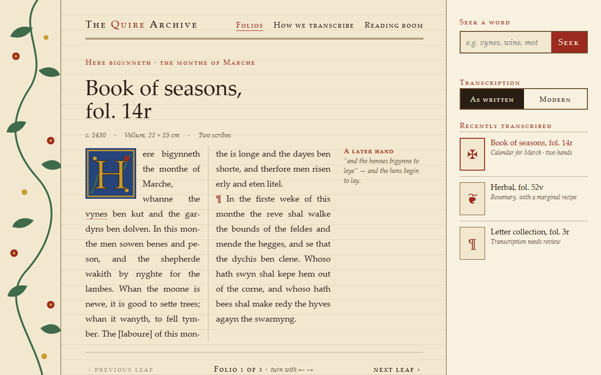

# Illuminated Manuscript — Living Style

> **Living style.** The page behaves like a codex: leaves turn, initials are painted as you arrive, the search is a rubricator's red pen, and marginal notes point to their words.

## 1. Design philosophy
A manuscript page is an interface refined over centuries: ruling lines for rhythm, red rubrics for wayfinding, painted initials to mark where a text begins, marginalia for commentary. Use those devices **as navigation and hierarchy**, not as fantasy decoration, and keep reading generous and calm.

Test: *would a scribe or a rubricator recognise what this element is for?*

## 2. Colour tokens
```css
:root {
  --color-bg: #F2E8D0;       /* vellum */
  --color-surface: #F8F1DF;  /* index panel, forms */
  --color-ink: #2A1D14;      /* iron-gall ink */
  --color-muted: #5C4A39;
  --color-accent: #9B2A1F;   /* vermilion: rubrics, search hits, primary action */
  --color-border: #6B4E2E;
  --gold: #C79A2E;           /* ornament only, never text */
  --lapis: #26437A;          /* initial grounds */
  --verdigris: #3F6B4A;      /* vines and tendrils */
}
```

## 3. Typography
- One old-style serif family (`'Palatino Linotype', 'Book Antiqua', Georgia, serif`) for everything.
- Hierarchy through size, **small caps** (`font-variant: small-caps; letter-spacing: .1em`) and vermilion.
- Body 18px on a 32px baseline, justified with hyphenation, two columns with a thin column rule on desktop, one column on phones.
- Uncertain readings are printed in [square brackets]; paragraph starts use a vermilion ¶.

## 4. Layout
- **Desktop:** decorated margin (≈130px, sticky vine) · reading block · index sidebar (≈330px).
- **Tablet:** margin narrows; the index moves under the text as two columns.
- **Phone:** no margin vine; text single-column; notes follow the text with a gold rule.
- Inside the reading block: rubric → title (two lines) → italic metadata → text columns + a 170px column for marginal notes → folio pager.
- Faint ruling lines (`repeating-linear-gradient`, 32px) across the reading block.

## 5. Signature interaction — the folio reader
| Visitor | What happens |
|---|---|
| Opens a leaf (pager, index, ← →) | a vellum leaf turns over the text (rotateY around its spine), the new leaf appears, its initial **draws itself** |
| Hovers or focuses a marked word or its note | both light up together (word background + note colour) |
| Types in "Seek a word" | matches are rubricated (vermilion, double underline) in the open leaf; each leaf in the index shows its match count; Enter jumps to the first leaf with a match |
| Switches As written / Modern | the same leaf re-renders in the other transcription; notes and anchors stay linked |

Initial drawing sequence: ground fades in → gold frame is drawn (stroke-dashoffset) → the letter is outlined, then gilded (fill) → verdigris tendrils grow → vermilion and gold dots appear. About 2 seconds in total.

## 6. Motion language
| Moment | Motion | Timing |
|---|---|---|
| Leaf turn | leaf rotates from 0 to −92° around the spine (or the opposite edge when going back), fading at the end | 0.8s, swap at 0.3s |
| Initial | stroke-drawing + gilding as above | 0.15–1.8s staggered |
| Everything else | none | — |

`prefers-reduced-motion`: leaves swap instantly; initials appear finished.

## 7. Section library
1. **Reader hero** — margin vine, header with small-caps nav, the folio (rubric, title, metadata, text with painted initial, marginal notes), pager; index sidebar with search, transcription toggle and folio list.
2. **Our rules** — three numbered principles (keep spelling, bracket doubt, note every hand) with roman numerals in vermilion.
3. **Reading room** — booking form (name, email, day, folio) with inline validation and a confirmation in italics with a gold rule.
4. **Footer** — italic colophon line.

## 8. Code recipes
```js
// text model: [[word|noteId]] links a word to a marginal note; {word} is an uncertain reading; " ¶ " starts a paragraph
"…whanne the [[vynes|n1]] ben kut … The {laboure} of this monthe … ¶ In the firste weke…"
// rendering: escape → anchors → [brackets] → ¶ paragraphs → (if searching) wrap hits in text parts only
h.split(/(<[^>]+>)/).map(part => part.startsWith('<') ? part : part.replace(re, '<mark class="hit">$1</mark>'))
```
```css
.ini.draw .frame { stroke-dasharray: 420; stroke-dashoffset: 420; animation: ink .7s .15s forwards }
.ini.draw .let   { fill-opacity: 0; stroke-dasharray: 520; stroke-dashoffset: 520;
                   animation: ink 1.1s .5s forwards, gild .6s 1.4s forwards }
@keyframes ink  { to { stroke-dashoffset: 0 } }
@keyframes gild { to { fill-opacity: 1 } }
.leaf.turn { animation: turn .8s cubic-bezier(.4,0,.2,1) }  /* transform-origin: left center */
```
Escape the search query before building a RegExp; never inject it into attributes.

## 9. Content rules
- Transcriptions must be genuine or clearly marked as illustrative. Never invent provenance, dates or shelfmarks for real collections.
- Keep both "as written" and "modern" texts; the modern one is an aid, not a replacement.
- Images of real manuscripts must carry their rights statement.

## 10. Forbidden patterns (anti-slop)
- NEVER use blackletter for body text or UI.
- NEVER use gold for text, or more than one painted initial per leaf.
- NEVER fake parchment with heavy noise, burnt edges or coffee stains.
- NEVER add fantasy clichés (dragons, candles, wax-seal buttons) unless the collection actually contains them.
- NEVER animate anything idle; leaves turn and initials draw only on navigation.

## 11. Accessibility
- The initial SVG has `role="img"` and an `aria-label`; the dropped first letter is also present as visually hidden text so the word reads correctly.
- Linked words are focusable (`tabindex=0`); notes are buttons; both highlight on focus as well as hover.
- The folio has `aria-live="polite"`; search results are announced in a `role=status` line; arrow-key paging ignores form fields.
- Vermilion and ink pass AA on vellum; gold is never used for text.

## 12. Quality gate
(1) Does every leaf open with a drawn initial and a turn (or instantly under reduced motion)? (2) Do notes and words highlight together for mouse and keyboard? (3) Does search work in both transcriptions and jump to the right leaf? (4) Is the text comfortable at 18px/32px in one column on phones? (5) No blackletter, no gold text?

## Required semantic-token interface
```css
:root {
  --color-bg: #F2E8D0;
  --color-surface: #F8F1DF;
  --color-ink: #2A1D14;
  --color-muted: #5C4A39;
  --color-accent: #9B2A1F;
  --color-border: #6B4E2E;
  --font-display: 'Palatino Linotype', 'Book Antiqua', Georgia, serif;
  --font-body: 'Palatino Linotype', 'Book Antiqua', Georgia, serif;
  --radius-control: 0px;
  --focus-ring: 3px solid var(--color-accent);
}
```

## Invocation example
```text
Use the illuminated-manuscript living style for this archive. Build a folio reader:
leaves turn on pager/arrow keys, each leaf's painted initial draws itself (frame,
letter outline, gilding, tendrils), search rubricates matches and counts them per
leaf, marginal notes highlight their anchored words, and an as-written/modern toggle
swaps transcriptions. One serif family, small-caps rubrics, no blackletter.
```



`demo.html` is a complete, interactive single-file page; the preview shows its first screen.
