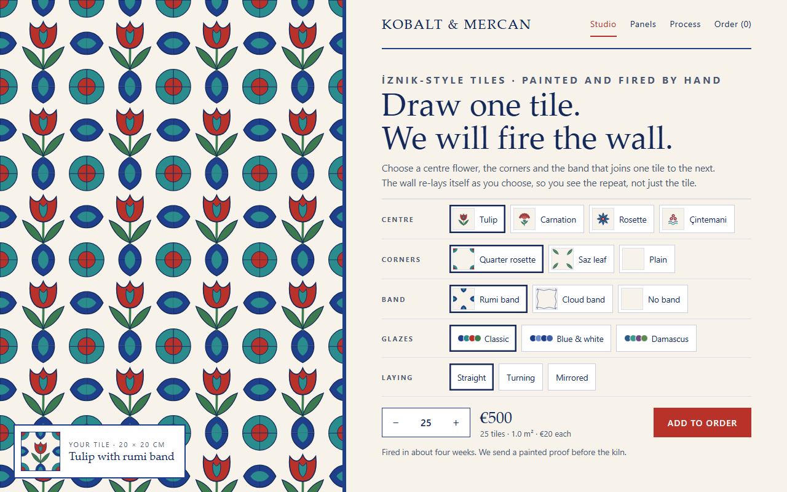

# İznik Ceramic — Living Style

> **Living style.** Beyond colours and fonts, this skill defines a signature interaction (design one tile, see the wall), a motion language taken from tile-laying, a section library and working code.

## 1. Design philosophy
İznik ware is a system: a single square tile carries half-motifs on its edges and quarter-motifs in its corners, so that four tiles complete a rosette and a row of tiles completes a band. The beauty is in the **repeat**, not the single tile.

The interface makes that system tangible. Visitors design **one** tile from a small set of parts, and the page shows the **wall**. Around it everything is calm white slip, cobalt type and one precious red.

Test every decision against the workshop: *could a tile painter make this with a pricked paper pattern, a brush and one firing?*

## 2. Colour tokens
```css
:root {
  --color-bg: #F7F3EA;        /* white slip */
  --color-surface: #FFFFFF;
  --color-ink: #14295A;       /* all text is cobalt-dark */
  --color-muted: #4B5873;
  --color-accent: #B8322A;    /* raised bole red: one primary action per view */
  --color-border: #1F3F8A;    /* cobalt rules and frames */
  --cobalt: #1F3F8A; --turquoise: #2A8C8C; --bole: #B8322A; --sage: #3E7A4F; --slip: #F7F3EA;
}
```
Glaze sets (swap all motif colours together, never individually):
| Set | cobalt | turquoise | red | green | slip |
|---|---|---|---|---|---|
| Classic | #1F3F8A | #2A8C8C | #B8322A | #3E7A4F | #F7F3EA |
| Blue & white | #1F3F8A | #6A8CCB | #1F3F8A | #3D5EA8 | #FAF8F2 |
| Damascus | #2D5D86 | #3E9A8C | #6E4A7E (manganese) | #5E8A50 | #F3F0E4 |

## 3. Typography
- **Display:** classical book serif (`'Palatino Linotype', 'Book Antiqua', Georgia, serif`), 38–56px, regular. Short, declarative lines.
- **Body/UI:** humanist sans (`'Segoe UI', Corbel, Arial, sans-serif`) 14–16px.
- **Labels:** 11px uppercase, 0.18–0.26em tracking, bold, muted or red.
- Motif names keep their Turkish names with English beside them: *lale* (tulip), *karanfil* (carnation), *çintemani*, *rumi*, *saz*.

## 4. Layout and geometry
- **Hero:** a tiled wall (≈44% width, full height, 6px cobalt edge) beside the studio column. On mobile the studio comes first, and a **sticky 92px strip** of the current tile stays visible while options scroll.
- **Arches:** ogee/round-topped frames (`border-radius: 48% 48% 0 0 / 24% 24% 0 0`) for process cards and the commission form. Only the arch is curved; everything else is square.
- **Bands:** section dividers are a 44px strip filled with the *current* tile as an SVG pattern, so the site's borders follow the visitor's design.
- Never set text on the tile field. Labels on the wall sit on a white plate with a 2px cobalt border.

## 5. Signature interaction — the tile studio
One tile (100×100 SVG units) is composed from five choices:

| Control | Options | Rule |
|---|---|---|
| Centre | tulip, carnation, rosette, çintemani | sits within the middle 60% of the tile |
| Corners | quarter rosette, saz leaf, plain | drawn at (0,0) and rotated 4× around the centre, so 4 tiles complete it |
| Band | rumi half-lobe, cloud line, none | drawn at mid-top edge and rotated 4×, so neighbours complete it |
| Glazes | classic, blue & white, Damascus | swaps all colours at once |
| Laying | straight, turning (rotate by position), mirrored (flip alternate) | applied per tile on the wall |

Each option is a radio button with a **live thumbnail** of that part. Arrow keys move within a group. Price updates with options and quantity (tiles → m² shown). The same tile definition feeds: the wall, the plate, the band strips, the process drawings and the mobile strip.

## 6. Motion language
| Moment | Motion | Timing |
|---|---|---|
| Design change | tiles flip into place in a diagonal wave from the top-left corner, like a tiler laying a wall | 0.55s each, delay `(x + y) × 26ms`, `cubic-bezier(.3,.8,.25,1)` |
| Load a ready panel | same wave, then scroll back to the studio | — |
| Everything else | none | — |

No idle animation, no hover zoom on tiles, no shimmer on glaze. `prefers-reduced-motion`: the wall swaps instantly.

## 7. Section library
1. **Studio hero** — wall + plate; kicker, two-line headline, short lede; five option rows; quantity stepper, total, area, primary "Add to order"; status line for lead time and confirmation.
2. **Band strip** — 44px live tile band.
3. **Process** — four arch cards showing *the visitor's own tile* at each stage: *Desen* (outline, CSS stroke-only), *Silkme* (dotted pounce outline), *Tahrir & boya* (painted), *Fırın* (painted + two translucent white glaze bands).
4. **Ready panels** — 2×2 tile previews of presets with price and "Load in the studio".
5. **Commission** — arch-topped form (name, email, wall width/height in cm, room notes) with inline validation and a reply that estimates tiles needed (`ceil(w/20) × ceil(h/20)`).
6. **Footer** — cobalt ground, workshop hours, contact.

## 8. Code recipes
The full engine is in `demo.html`. Key parts:
```js
// one source of truth
let D = { motif:'lale', corner:'rosette', edge:'rumi', pal:'classic', lay:'straight' };
const rot4 = svg => [0,90,180,270].map(a => `<g transform="rotate(${a} 50 50)">${svg}</g>`).join('');
const tileMarkup = d => `<rect width="100" height="100" fill="${slip}"/>`
  + rot4(EDGE[d.edge](c)) + rot4(CORNER[d.corner](c)) + MOTIF[d.motif](c);
// define once as <symbol id="tile" viewBox="0 0 100 100">, reuse everywhere with <use href="#tile"/>
// band strip: <pattern id="bandPat" width="44" height="44"><use href="#tile" width="44" height="44"/></pattern>

// laying wave: each wall tile has style="--i: x + y" and --rot for the laying mode
.grid.lay .tile { animation: lay .55s cubic-bezier(.3,.8,.25,1) both; animation-delay: calc(var(--i) * 26ms); }
@keyframes lay { from { transform: var(--rot) perspective(500px) rotateY(88deg); opacity: .15 } }
// restart: grid.classList.remove('lay'); void grid.offsetWidth; grid.classList.add('lay');
```
- Corners are drawn as a quarter shape at the origin; edge bands as a half shape on the top edge. Rotating four times guarantees seamless joins.
- Process stages need **inline** SVG (not `<use>`), because CSS cannot restyle elements inside a `<use>` shadow tree.
- Wall size: choose columns so tiles are ≈136px on desktop and ≈96px on phones; rebuild on resize.

## 9. Imagery
- Motifs are original vector drawings in the İznik vocabulary; do not trace museum tiles or mosque panels.
- Photography (if supplied): flat, even light, real tiles with visible brush marks and glaze pooling. No 3D renders, no AI "Turkish tile" textures.

## 10. Forbidden patterns (anti-slop)
- NEVER place text on the tile field; NEVER more than one red action per view.
- NEVER animate tiles idly, add hover lift/scale, or add glossy gradients to simulate glaze.
- NEVER use pills, glassmorphism, or soft card shadows.
- NEVER use "oriental" clichés (domes, lanterns, crescents) as decoration.
- NEVER copy a specific historical panel; design original repeats.

## 11. Accessibility
- The wall is `role="img"` with a label; thumbnails are decorative; each option is a labelled radio with `aria-checked` and arrow-key navigation.
- The order status and form outcomes use `role="status"` / `role="alert"`; invalid fields get `aria-invalid` and focus.
- Contrast: ink and muted pass AA on slip and white. Turquoise, sage and bole are motif colours, not text colours (bole is allowed on white for the CTA background with white text).
- Touch targets ≥ 44px.

## 12. Quality gate
(1) Does changing any option re-lay the wall, the plate, the bands and the process drawings? (2) Do four tiles complete the corner and band motifs without gaps? (3) Does anything move without the visitor causing it? (4) Can a phone user see their tile while choosing options? (5) Reduced motion and keyboard pass?

## Required semantic-token interface
```css
:root {
  --color-bg: #F7F3EA;
  --color-surface: #FFFFFF;
  --color-ink: #14295A;
  --color-muted: #4B5873;
  --color-accent: #B8322A;
  --color-border: #1F3F8A;
  --font-display: 'Palatino Linotype', 'Book Antiqua', Georgia, serif;
  --font-body: 'Segoe UI', Corbel, Arial, sans-serif;
  --radius-control: 0px;
  --focus-ring: 3px solid var(--color-accent);
}
```
A palette may recolour the six `--color-*` values; motif colours come from the glaze sets above.

## Invocation example
```text
Use the iznik-ceramic living style. Build the hero as a tile studio: one SVG tile
composed from centre, corner and band parts (corners and bands drawn once and
rotated 4×), shown repeated on a wall that re-lays in a diagonal wave on every
change. Reuse the same tile in the section bands and the process stages. No text
on the tile field, one red action per view, respect reduced motion.
```



`demo.html` is a complete, interactive single-file page; the preview shows its first screen.
