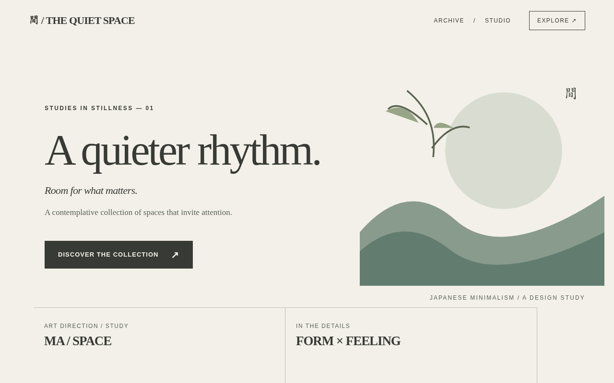

# Japanese Zen Minimalism (Wabi-Sabi & Ma)

## 1. Design Philosophy
Built around the Japanese aesthetic concepts of **Ma** (meaningful negative space) and **Wabi-Sabi** (quiet beauty in simplicity and natural materials). The interface never shouts; it breathes, slows the user's eye down, and frames content with museum-like restraint.

## 2. Color Tokens & Surface Rules
```css
:root {
  --bg-washi: #F7F5F0;        /* Pale handmade rice paper */
  --bg-stone: #ECE9E1;        /* Soft natural clay/linen */
  --ink-sumi: #1C1C1A;        /* Charcoal sumi ink */
  --ink-ash: #6E6C66;         /* Subtle stone grey */
  --ink-indigo: #23395B;      /* Deep traditional aizome indigo (optional) */
  --seal-vermilion: #B8332A;  /* Single tiny hanko stamp red */
  --hairline: #DEDBD2;        /* Ultra-fine 1px divider */
}
```

## 3. Typography & Hierarchy
- **Headings:** `'Shippori Mincho', 'Cormorant Garamond', 'Noto Serif', serif` (light to regular weight `300–400`, never heavy/shouting).
- **Body & UI:** `'Noto Sans', 'Inter', sans-serif` (clean, airy, `14px–15px`, line-height `1.8`).
- **Vertical Accents:** Use brief vertical text columns (`writing-mode: vertical-rl`) for chapter marks, dates, or poetic subtitles.

## 4. Layout, Grid & Geometry
- **Generous Ma (Whitespace):** Leave 50%+ of the canvas open and quiet. Resist filling empty margins.
- **Asymmetric Balance:** Balance one quiet, naturally lit photograph on one side against a delicate, spacious typographic column on the other.
- **Dividers:** Ultra-thin `1px` hairlines with wide margins (`48px–80px`).
- **Border Radius:** Strictly `0px`.

## 5. Component Specifications
- **Brand Mark (Hanko Seal):** A single small (`24px–32px`) crisp square red stamp (`--seal-vermilion`) containing a minimal monogram or symbol—the only bright color on the page.
- **Buttons:** Quiet, borderless text links with a fine hairline underline, or ultra-minimal `1px solid var(--ink-sumi)` rectangular frames with generous horizontal padding and slow, calm opacity transitions (`300ms ease`).
- **Imagery:** Quiet, diffused natural daylight photography (ceramics, cedar wood, stone, tea, shadow play) with muted saturation.

## 6. Strict Forbidden Patterns (Anti-Slop Checklist)
- NEVER use heavy bold drop shadows, neon colors, or noisy multi-card dashboards.
- NEVER crowd the screen with popups, notification badges, or floating action buttons.
- NEVER use loud promotional banners or aggressive uppercase sales copy.

---

## 7. Distinctive art direction and page anatomy

**Reference era:** Japanese minimalism. This is a contemporary interpretation, not a reproduction of a historical poster or a trademarked brand. Make work that feels designed by a person with a point of view.

- **Reference composition:** `minimal`. Lead with a purposeful hierarchy, a real content block, and the signature `zen` visual treatment; do not assume every product needs a dashboard.
- **Sample editorial voice:** “MA / SPACE” / “A quieter rhythm.”. Replace sample copy with authentic project copy; do not ship the preview's fictional brand or made-up metrics.
- **Use case:** Wellness. Develop other applications only when the historical language matches their audience and task.
- **Key visual device:** `zen`; create it with original vector or CSS geometry, real user-provided photography, or properly licensed assets. Never lift a historic poster pixel-for-pixel.
- **Minimum component vocabulary:** header/navigation, primary action, secondary action, content grouping, form/input, an item or list row, and visible feedback state.
- **Repeatable signature:** Maintain distinctive typographic proportion and materiality on subsequent pages; vary composition based on content so the site is not one repeated hero template.

## Required semantic-token interface
The implementation MUST use these shared CSS custom properties (the palette layer may override them later):

```css
:root {
  --color-bg: #F3F0E9;
  --color-surface: #E1E6DB;
  --color-ink: #383A35;
  --color-muted: #596156;
  --color-accent: #7E8B75;
  --color-border: #B7BEB2;
  --font-display: Georgia, serif;
  --font-body: Georgia, serif;
  --radius-control: 3px;
  --focus-ring: 3px solid var(--color-accent);
}
```

Use `var(--color-bg)` rather than hardcoding background colors throughout components. When combining a palette, **load style tokens first, then palette tokens** (the later palette overrides the six `--color-*` values). A palette changes color only, not the style's spatial or typographic DNA. Any legacy token names in the original spec are descriptive aliases; use this semantic contract in new code.


## 8. Responsive behavior (do not skip)

- At `>= 1200px`, use the full asymmetrical or editorial grid. At `768–1199px`, reduce columns and proportionally scale headlines. Below `768px`, collapse to a single deliberate reading path; keep the primary action visible without floating overlays.
- Typography: `clamp(2.5rem, 6.5vw, 6.75rem)` for a large display heading, `clamp(1rem, 1.2vw, 1.125rem)` for body; adjust the clamp for special historical styles while keeping body text readable.
- Use `minmax(0, 1fr)` for long content, `overflow-wrap: anywhere` for technical tokens, and a horizontal overflow wrapper for necessary data tables.
- All interactive controls have touch targets around 44×44 CSS pixels. Do not hide access to important workflows on mobile.
- Offer low-motion alternatives; respect `prefers-reduced-motion: reduce`.

## 9. Accessible components and states

- Text contrast: normal text at least WCAG AA 4.5:1 and large text at least 3:1, including muted labels. Some illustrative accents are **not** safe for foreground copy; test the actual foreground/background pair.
- Keyboard: visible `:focus-visible` ring, logical tab order, Escape on dismissible overlays, proper native controls; hover is never the only feedback.
- Supply designed states: default, hover, focus, pressed, disabled, loading, empty, error, success, and selected where applicable. Announce async outcomes in a polite live region, not by color alone.
- Use semantic landmarks (`header`, `nav`, `main`, `aside`, `footer`) and ordered heading levels. Image alt describes meaning, while purely ornamental illustrations use empty alt or `aria-hidden`.

## 10. Anti-clone quality gate

Before delivery, check: (1) Could the preview be mistaken for another skill in this library? If so, change the **composition**, not merely its colors. (2) Are the content and controls plausible for the product? (3) Are there any illegible labels or fake chart metrics? (4) Do mobile, keyboard and reduced-motion states work? (5) Has AI-default hero/card/glow styling slipped back in?

## 11. Invocation example

```text
Use the japanese-zen-minimalism design skill. Identify the product's core workflow, map its content hierarchy, apply its tokens and signature composition, and build a usable responsive page with real content states. Do not mimic the sample preview's fictional brand; do not introduce generic AI gradient/card patterns. Explain design choices in 5 concise sentences after implementation.
```

## 12. Visual reference



`demo.html` is the local, self-contained composition used to generate this preview. It illustrates a style direction, not a production-ready application or a functional app.
