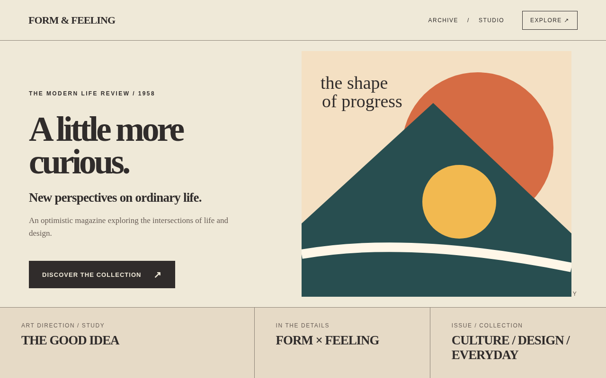

# Mid-Century Editorial (1950s Paul Rand & Saul Bass Era)

## 1. Design Philosophy
Captures the optimistic wit, warmth, and graphic elegance of 1950s–60s American magazine design, Blue Note album covers, and studios led by Paul Rand and Saul Bass. Playful yet deeply disciplined, marrying charming hand-cut geometry with smart editorial hierarchy.

## 2. Color Tokens & Surface Rules
```css
:root {
  --bg-cream: #F5EFE0;        /* Vintage warm magazine stock */
  --bg-card: #EDE4CE;         /* Subtle aged parchment panel */
  --ink-espresso: #231F1D;    /* Warm charcoal-brown ink */
  --mcm-olive: #6B7B3C;       /* Mid-century avocado/olive green */
  --mcm-mustard: #D9A026;     /* Warm ochre mustard */
  --mcm-terracotta: #C85532;  /* Burnt rust / vermilion orange */
  --mcm-teal: #2F6F73;        /* Vintage muted petrol teal */
}
```
- **Harmony Rule:** Colors are warm, earthy, and slightly muted—like matte gouache or offset lithography ink on cream paper.

## 3. Typography & Hierarchy
- **Display Headlines:** `'Fraunces', 'Syne', 'Archivo Black', 'Cooper Hewitt', sans-serif` — Bold, warm, slightly quirky retro display voice.
- **Body Text:** Clean humanist sans (`'DM Sans', 'Gill Sans', sans-serif`) or warm mid-century serif (`'Lora', serif`) at `16px` with generous `1.6` line-height.
- **Section Tags:** Small rounded-pill or star-flanked retro labels (`✦ FEATURED STORY`, `EST. 1958`).

## 4. Layout, Grid & Geometry
- **Playful Asymmetric Grids:** Combine strong horizontal bands with offset geometric color panels (e.g., an olive block holding a crisp cream cutout illustration alongside bold espresso typography).
- **Geometric Motifs:** Use crisp paper-cut shapes (atomic starbursts, half-circles, offset trapezoids, stylized eyes/hands/objects) rendered in flat solid gouache tones.
- **Border Radius:** Intentional mix of sharp `0px` paper edges and generous organic arches (`border-radius: 120px 120px 0 0` for mid-century arch frames).

## 5. Component Specifications
- **Buttons:** Bold flat terracotta or olive rectangles (or subtle `4px` corners) with crisp cream uppercase text and subtle dark offset border/shadow (`3px 3px 0 #231F1D`).
- **Dividers:** Clean `1.5px solid #231F1D` horizontal rules or dotted geometric dividers.
- **Cards:** Flat pastel/earthy color blocks (`--bg-card`, `--mcm-mustard`, `--mcm-olive`) with stark ink typography and zero soft blur shadows.

## 6. Strict Forbidden Patterns (Anti-Slop Checklist)
- NEVER use neon colors, pure digital `#FFFFFF` glare, or dark cyberpunk gradients.
- NEVER use blurry drop shadows or glassmorphism.
- NEVER default to generic modern tech illustrations (Corporate Memphis / Alegria characters are strictly banned).

---

## 7. Distinctive art direction and page anatomy

**Reference era:** 1950s mid-century. This is a contemporary interpretation, not a reproduction of a historical poster or a trademarked brand. Make work that feels designed by a person with a point of view.

- **Reference composition:** `journal`. Lead with a purposeful hierarchy, a real content block, and the signature `cutout` visual treatment; do not assume every product needs a dashboard.
- **Sample editorial voice:** “THE GOOD IDEA” / “A little more curious.”. Replace sample copy with authentic project copy; do not ship the preview's fictional brand or made-up metrics.
- **Use case:** Editorial. Develop other applications only when the historical language matches their audience and task.
- **Key visual device:** `cutout`; create it with original vector or CSS geometry, real user-provided photography, or properly licensed assets. Never lift a historic poster pixel-for-pixel.
- **Minimum component vocabulary:** header/navigation, primary action, secondary action, content grouping, form/input, an item or list row, and visible feedback state.
- **Repeatable signature:** Maintain distinctive typographic proportion and materiality on subsequent pages; vary composition based on content so the site is not one repeated hero template.

## Required semantic-token interface
The implementation MUST use these shared CSS custom properties (the palette layer may override them later):

```css
:root {
  --color-bg: #EFE9D8;
  --color-surface: #E8DDC7;
  --color-ink: #302C2B;
  --color-muted: #665B54;
  --color-accent: #D66C44;
  --color-border: #8C8276;
  --font-display: Georgia, serif;
  --font-body: Georgia, serif;
  --radius-control: 3px;
  --focus-ring: 3px solid var(--color-accent);
}
```

Use `var(--color-bg)` rather than hardcoding background colors throughout components. When combining a palette, **load style tokens first, then palette tokens** (the later palette overrides the six `--color-*` values). A palette changes color only, not the style's spatial or typographic DNA. Any legacy token names in the original spec are descriptive aliases; use this semantic contract in new code.


## 8. Responsive behavior (do not skip)

- At `>= 1200px`, use the full asymmetrical or editorial grid. At `768–1199px`, reduce columns and proportionally scale headlines. Below `768px`, collapse to a single deliberate reading path; keep the primary action visible without floating overlays.
- Typography: `clamp(2.5rem, 6.5vw, 6.75rem)` for a large display heading, `clamp(1rem, 1.2vw, 1.125rem)` for body; adjust the clamp for special historical styles while keeping body text readable.
- Use `minmax(0, 1fr)` for long content, `overflow-wrap: anywhere` for technical tokens, and a horizontal overflow wrapper for necessary data tables.
- All interactive controls have touch targets around 44×44 CSS pixels. Do not hide access to important workflows on mobile.
- Offer low-motion alternatives; respect `prefers-reduced-motion: reduce`.

## 9. Accessible components and states

- Text contrast: normal text at least WCAG AA 4.5:1 and large text at least 3:1, including muted labels. Some illustrative accents are **not** safe for foreground copy; test the actual foreground/background pair.
- Keyboard: visible `:focus-visible` ring, logical tab order, Escape on dismissible overlays, proper native controls; hover is never the only feedback.
- Supply designed states: default, hover, focus, pressed, disabled, loading, empty, error, success, and selected where applicable. Announce async outcomes in a polite live region, not by color alone.
- Use semantic landmarks (`header`, `nav`, `main`, `aside`, `footer`) and ordered heading levels. Image alt describes meaning, while purely ornamental illustrations use empty alt or `aria-hidden`.

## 10. Anti-clone quality gate

Before delivery, check: (1) Could the preview be mistaken for another skill in this library? If so, change the **composition**, not merely its colors. (2) Are the content and controls plausible for the product? (3) Are there any illegible labels or fake chart metrics? (4) Do mobile, keyboard and reduced-motion states work? (5) Has AI-default hero/card/glow styling slipped back in?

## 11. Invocation example

```text
Use the mid-century-editorial design skill. Identify the product's core workflow, map its content hierarchy, apply its tokens and signature composition, and build a usable responsive page with real content states. Do not mimic the sample preview's fictional brand; do not introduce generic AI gradient/card patterns. Explain design choices in 5 concise sentences after implementation.
```

## 12. Visual reference



`demo.html` is the local, self-contained composition used to generate this preview. It illustrates a style direction, not a production-ready application or a functional app.
