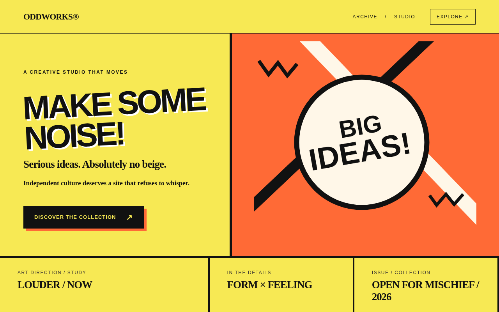

# Neo-Brutalist (Bold Graphic & Tactile Web)

## 1. Design Philosophy
A loud, energetic antidote to sterile corporate SaaS design. Inspired by indie print studios, punk flyers, and raw graphic design systems. Everything feels physical, deliberate, clickable, and impossible to scroll past.

## 2. Color Tokens & Surface Rules
```css
:root {
  --bg-canvas: #FAF7F0;      /* Warm bone off-white */
  --bg-white: #FFFFFF;       /* Stark card surface */
  --ink-black: #111111;      /* Heavy structural ink */
  --accent-yellow: #FFD84D;  /* Butter / poster yellow */
  --accent-blue: #2357E8;    /* Electric cobalt blue */
  --accent-orange: #FF5C35;  /* Vermilion pop */
  --shadow-hard: 4px 4px 0px #111111;
  --shadow-hard-lg: 6px 6px 0px #111111;
}
```
- **Color blocking:** Use flat, unmuted solid fills inside heavy black containers. Never blend or fade colors together.

## 3. Typography & Hierarchy
- **Display Headlines:** `'Space Grotesk', 'Syne', 'Archivo Black', sans-serif` — Heavy (`800–900`), uppercase, tight leading (`0.95`).
- **Body & Labels:** `'Space Mono', 'IBM Plex Mono', monospace` or crisp grotesque sans-serif.
- **Visual Rhythm:** Pair oversized loud headlines with compact monospace badge strips (`★ THE ANTI-SLOP LAB ★`, `01 / WEB SKILLS`).

## 4. Layout, Grid & Geometry
- **Borders:** Thick `2px` to `3px solid #111111` on every container, navbar divider, button, and input.
- **Shadows:** Hard, unblurred offset shadows only (`box-shadow: 4px 4px 0px #111111;`). Zero blur radius (`0px`).
- **Border Radius:** Sharp `0px` (or very rare intentional `2px`). Never soft `12px–24px` pill cards.

## 5. Component Specifications
- **Buttons:** Thick black border + hard offset shadow. On `:hover` or `:active`, physically translate the button into its shadow (`transform: translate(3px, 3px); box-shadow: 1px 1px 0px #111111;`).
- **Navigation Bar:** Full-width horizontal bar divided into explicit boxed cells using vertical `2px` black borders, ending with a high-contrast yellow CTA cell.
- **Cards:** Distinct color-blocked header or full-fill cards numbered `01 /`, `02 /`, `03 /`.

## 6. Strict Forbidden Patterns (Anti-Slop Checklist)
- NEVER use soft, blurred drop shadows (`box-shadow: 0 10px 30px rgba(...)`).
- NEVER use pastel gradients or translucent overlays.
- NEVER use thin, low-contrast grey borders (`#E5E7EB`).
- NEVER use timid, small font sizes for hero statements.
- NEVER hide interactive affordances—everything clickable must look unmistakably solid and tactile.

---

## 7. Distinctive art direction and page anatomy

**Reference era:** Contemporary brutalism. This is a contemporary interpretation, not a reproduction of a historical poster or a trademarked brand. Make work that feels designed by a person with a point of view.

- **Reference composition:** `loud`. Lead with a purposeful hierarchy, a real content block, and the signature `sticker` visual treatment; do not assume every product needs a dashboard.
- **Sample editorial voice:** “LOUDER / NOW” / “MAKE SOME NOISE!”. Replace sample copy with authentic project copy; do not ship the preview's fictional brand or made-up metrics.
- **Use case:** Culture. Develop other applications only when the historical language matches their audience and task.
- **Key visual device:** `sticker`; create it with original vector or CSS geometry, real user-provided photography, or properly licensed assets. Never lift a historic poster pixel-for-pixel.
- **Minimum component vocabulary:** header/navigation, primary action, secondary action, content grouping, form/input, an item or list row, and visible feedback state.
- **Repeatable signature:** Maintain distinctive typographic proportion and materiality on subsequent pages; vary composition based on content so the site is not one repeated hero template.

## Required semantic-token interface
The implementation MUST use these shared CSS custom properties (the palette layer may override them later):

```css
:root {
  --color-bg: #F7E954;
  --color-surface: #FFF7E8;
  --color-ink: #111111;
  --color-muted: #383330;
  --color-accent: #FF6A36;
  --color-border: #171717;
  --font-display: Arial Black, Arial, sans-serif;
  --font-body: Arial, sans-serif;
  --radius-control: 0px;
  --focus-ring: 3px solid var(--color-accent);
}
```

Use `var(--color-bg)` rather than hardcoding background colors throughout components. When combining a palette, **load style tokens first, then palette tokens** (the later palette overrides the six `--color-*` values). A palette changes color only, not the style's spatial or typographic DNA. Any legacy token names in the original spec are descriptive aliases; use this semantic contract in new code.


## 8. Responsive behavior (do not skip)

- At `>= 1200px`, use the full asymmetrical or editorial grid. At `768–1199px`, reduce columns and proportionally scale headlines. Below `768px`, collapse to a single deliberate reading path; keep the primary action visible without floating overlays.
- Typography: `clamp(2.5rem, 6.5vw, 6.75rem)` for a large display heading, `clamp(1rem, 1.2vw, 1.125rem)` for body; adjust the clamp for special historical styles while keeping body text readable.
- Use `minmax(0, 1fr)` for long content, `overflow-wrap: anywhere` for technical tokens, and a horizontal overflow wrapper for necessary data tables.
- All interactive controls have touch targets around 44×44 CSS pixels. Do not hide access to important workflows on mobile.
- Offer low-motion alternatives; respect `prefers-reduced-motion: reduce`.

## 9. Accessible components and states

- Text contrast: normal text at least WCAG AA 4.5:1 and large text at least 3:1, including muted labels. Some illustrative accents are **not** safe for foreground copy; test the actual foreground/background pair.
- Keyboard: visible `:focus-visible` ring, logical tab order, Escape on dismissible overlays, proper native controls; hover is never the only feedback.
- Supply designed states: default, hover, focus, pressed, disabled, loading, empty, error, success, and selected where applicable. Announce async outcomes in a polite live region, not by color alone.
- Use semantic landmarks (`header`, `nav`, `main`, `aside`, `footer`) and ordered heading levels. Image alt describes meaning, while purely ornamental illustrations use empty alt or `aria-hidden`.

## 10. Anti-clone quality gate

Before delivery, check: (1) Could the preview be mistaken for another skill in this library? If so, change the **composition**, not merely its colors. (2) Are the content and controls plausible for the product? (3) Are there any illegible labels or fake chart metrics? (4) Do mobile, keyboard and reduced-motion states work? (5) Has AI-default hero/card/glow styling slipped back in?

## 11. Invocation example

```text
Use the neo-brutalist design skill. Identify the product's core workflow, map its content hierarchy, apply its tokens and signature composition, and build a usable responsive page with real content states. Do not mimic the sample preview's fictional brand; do not introduce generic AI gradient/card patterns. Explain design choices in 5 concise sentences after implementation.
```

## 12. Visual reference



`demo.html` is the local, self-contained composition used to generate this preview. It illustrates a style direction, not a production-ready application or a functional app.
