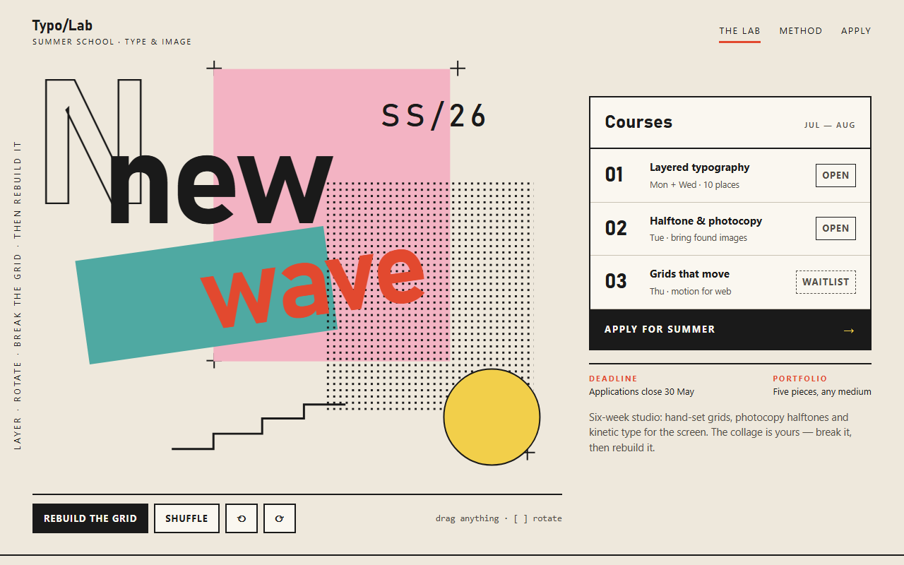

# New Wave Typography — Living Style

> **Living style.** New wave took the Swiss grid and broke it on purpose. This page lets visitors do the same — and rebuild it — while the information they need stays perfectly still.

## 1. Design philosophy
Controlled chaos. Type is layered, rotated, outlined and overprinted with dots and pastel planes; but every piece of the collage knows where it would sit on a 12-column grid. One half of the page is expressive and **playable**; the other half is a calm, aligned panel where people read and act.

Test: *can the collage be broken and rebuilt without the useful information ever moving?*

## 2. Colour tokens
```css
:root {
  --color-bg: #EEE8DC;
  --color-surface: #FAF7F0;
  --color-ink: #1A1A1A;
  --color-muted: #524E47;
  --color-accent: #E2492F;   /* one red word, the active nav, focus */
  --color-border: #1A1A1A;
  --plane-pink: #F3B3C3; --plane-teal: #4FA9A2; --plane-yellow: #F2CF4A;
}
```
Print-derived pastels plus black. No neon, no synthwave gradients.

## 3. Typography
- **Display:** geometric/DIN-like sans (`Bahnschrift, 'Arial Narrow', Arial`) 150–250px for collage words; solid, outlined (`-webkit-text-stroke`) and rotated (−6° to −12°) variants; letter-spaced light codes (`SS/26`, 0.18em).
- **Vertical micro-text** (`writing-mode`) along one edge for a manifesto line.
- **Panel and body:** Segoe UI/Arial 13–16px, never rotated.

## 4. Layout
- **Desktop:** collage stage (760 × 620 design space, scaled to fit) · 400px course panel.
- **Below 1180px:** stage full width, panel underneath. The stage scales with `transform: scale(k)` and pointer movement is divided by `k`.
- The panel uses 2px rules, numbered rows, outlined status tags (dashed when waitlisted) and a full-width black CTA.
- Registration crosshairs sit at grid intersections; red 12-column guides appear only in grid mode.

## 5. Signature interaction — break and rebuild
| Visitor | Result |
|---|---|
| Drags a piece (pointer/touch) | it moves freely; a monospace readout shows `name · x · y · angle` |
| Focuses a piece + arrows (Shift = 32px) | moves by 8px |
| `[` / `]` or ⟲ ⟳ | rotates the selected piece by 5° (±45° max) |
| **Rebuild the grid** | every piece animates to its grid pose (staggered 40ms), guides fade in; the button becomes **Break it again** |
| **Break it again** | the visitor's own collage comes back |
| **Shuffle** | random collage within bounds |
| Drags while in grid mode | the grid poses become the new collage, so nothing jumps |

Each piece stores two poses: `broken: [x, y, r]` and `grid: [x, y, 0]`.

## 6. Motion language
- Only the snap between collage and grid animates: `transform .7s cubic-bezier(.7,0,.2,1)`, delay `index × 40ms`.
- Transitions are enabled **after** first paint (two `requestAnimationFrame`s) so nothing flies in on load.
- Dragging has no transition. No hover effects on pieces besides the cursor.
- `prefers-reduced-motion`: snaps happen instantly.

## 7. Section library
1. **Lab hero** — header (mark + small caps line, nav), vertical manifesto, collage stage, toolbar (Rebuild/Break, Shuffle, rotate, readout); course panel, deadline/portfolio notes, one paragraph.
2. **Four moves we teach** — Layer, Rotate, Break, Rebuild: four boxed mini-compositions in CSS with one-line rules.
3. **Apply** — course choice as big radio cards, name, email, portfolio URL; inline validation; pink confirmation box.
4. **Footer** — two uppercase facts.

## 8. Code recipes
```js
const P = [{ id:'wave', cls:'word red', st:'--fs:150px', text:'wave', broken:[240,270,-8], grid:[20,470,0] }, /* … */];
// pose → CSS variables
el.style.setProperty('--x', x + 'px'); el.style.setProperty('--y', y + 'px'); el.style.setProperty('--r', r + 'deg');
.pc { transform: translate(var(--x), var(--y)) rotate(var(--r)); touch-action: none }
.stage.anim .pc { transition: transform .7s cubic-bezier(.7,0,.2,1); transition-delay: calc(var(--i) * 40ms) }
// scaled stage: k = min(1, wrap.clientWidth / 760); dx = (clientX - startX) / k
```
Halftone field: `radial-gradient(var(--color-ink) 1.6px, transparent 1.8px)` at 9px. Grid guides: a `repeating-linear-gradient` of 1px red lines at the column pitch.

## 9. Content rules
- Real course names, dates, places and deadlines in the panel; the collage carries only display words (school name, season, one word of brand voice).
- Never put prices, dates or form labels inside the collage.

## 10. Forbidden patterns (anti-slop)
- NEVER rotate or layer interactive text, prices or form labels.
- NEVER use neon/synthwave gradients or glow.
- NEVER let the panel move, scale or reflow when the collage changes.
- NEVER apply the collage to every page; use it on landing/section openers.
- NEVER centre the composition symmetrically.

## 11. Accessibility
- Pieces are focusable `role="button"` with `aria-roledescription="movable piece"` and a name; arrow keys and `[ ]` work; the readout is `aria-live="polite"`.
- Toolbar buttons are labelled; Rebuild is `aria-pressed`.
- The collage is decorative for the task: everything needed to apply is in the panel and the form.
- Radio cards are real inputs inside labels; focus is visible via `:has(input:focus-visible)`.

## 12. Quality gate
(1) Can every piece be moved and rotated by mouse, touch and keyboard? (2) Does Rebuild produce a clean grid and Break return the visitor's collage? (3) Does anything animate on load? (4) Does the panel stay perfectly still? (5) Mobile: stage scales, toolbar wraps, no horizontal scroll?

## Required semantic-token interface
```css
:root {
  --color-bg: #EEE8DC;
  --color-surface: #FAF7F0;
  --color-ink: #1A1A1A;
  --color-muted: #524E47;
  --color-accent: #E2492F;
  --color-border: #1A1A1A;
  --font-display: Bahnschrift, 'Arial Narrow', Arial, sans-serif;
  --font-body: 'Segoe UI', Arial, sans-serif;
  --radius-control: 0px;
  --focus-ring: 3px solid var(--color-accent);
}
```

## Invocation example
```text
Use the new-wave-1980s living style. Build a collage of planes, halftone, outlined
and rotated words where each piece has a collage pose and a 12-column grid pose.
Pieces drag, rotate ([ ]) and move by keyboard; "Rebuild the grid" snaps them with
a staggered transition and "Break it again" restores the visitor's collage. Keep the
course panel aligned and still; no load animation; reduced-motion safe.
```



`demo.html` is a complete, interactive single-file page; the preview shows its first screen.
