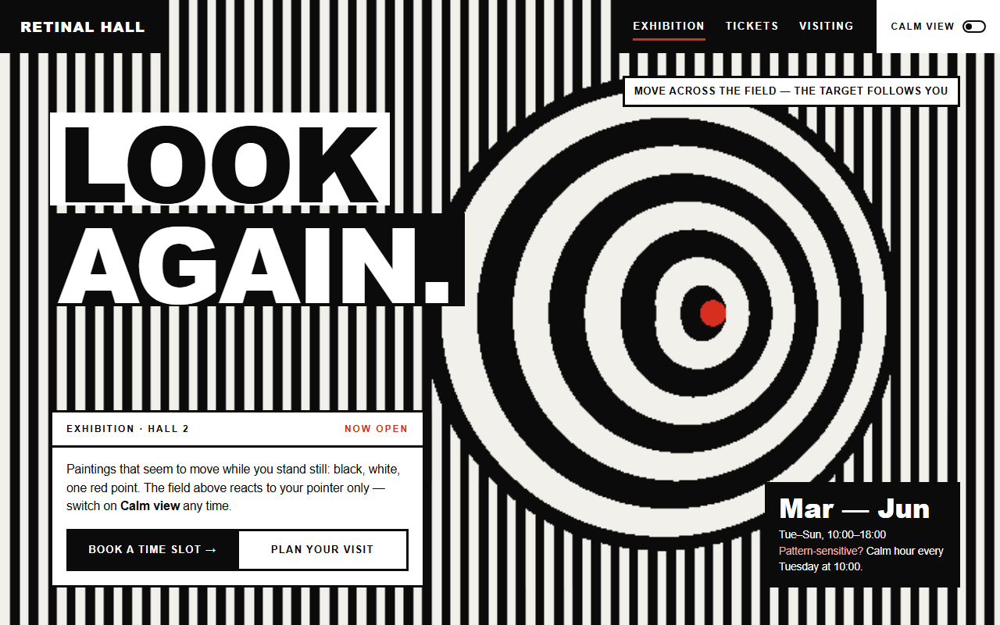

# Op-Art Optical — Living Style

> **Living style.** The hero is a painting that reacts to the visitor — and a switch that turns it off. Both halves matter equally.

## 1. Design philosophy
Op-art makes the eye do the work: regular stripes and offset circles appear to bulge and shimmer. On the web this is powerful and risky. The pattern is a **single hero object** that responds only to the pointer; all text sits in **opaque boxes**; and a **Calm view** switch is always visible.

Test: *is every motion caused by the visitor, and can they stop it in one click?*

## 2. Colour tokens
```css
:root {
  --color-bg: #F2F0EA;      /* gallery white */
  --color-surface: #FFFFFF; /* text boxes */
  --color-ink: #0B0B0B;
  --color-muted: #4A4A47;
  --color-accent: #D62E1F;  /* one red point: target centre, "now open", focus */
  --color-border: #0B0B0B;
}
```
Calm view colours: stripes `#B2B4B8` on `#E2E6E8` — low contrast, no rings.

## 3. Typography
- **Display:** heavy grotesque (`'Arial Black', 'Franklin Gothic Heavy', Impact`), uppercase, 70–140px, leading 0.84, set inside inline white or inverted black boxes.
- **Body/UI:** Arial/Helvetica 14–16px on solid white only.
- **Labels:** 12px bold uppercase, 0.14–0.16em tracking.

## 4. Layout
- The field fills the hero; header pieces are solid black blocks with the Calm switch as a white block at the right.
- Content anchors to the left and bottom edges; the target sits right of centre so the eye travels headline → target.
- Below the hero, everything is a strict 3px black grid: works strip, booking split, care grid.
- Mobile: hide the hint and stamp, keep the title, card and Calm switch.

## 5. Signature interaction — the reactive field
| Visitor | Field response |
|---|---|
| Moves the pointer outside the target | stripes magnify around the pointer (a lens): `X = x − (x − px) · 0.62 · e^(−r²/150²)` |
| Moves the pointer anywhere | the eccentric rings turn toward it: offset `v` (max 0.32R) points at the pointer; ring distance uses `p − c − v·(1 − r/R)` |
| Leaves the hero | field returns to rest |
| Presses **Calm view** | field becomes static low-contrast stripes; works are dimmed; pointer ignored |

Nothing moves on a timer. `prefers-reduced-motion: reduce` turns Calm view **on** by default (the visitor can still turn it off).

## 6. Motion language
- Only pointer-driven redraws (one per animation frame).
- No scroll-linked motion, no rotating rings, no animated stripes, no hover zoom.
- The only CSS transition is the Calm switch knob (0.15s).

## 7. Section library
1. **Hero** — field canvas, black header blocks + Calm switch, boxed headline, summary card with a split action bar, dates stamp, a small hint box.
2. **Works** — five studies drawn by the same per-pixel painter, each from a single-mark rule (wavy stripes, star rings, compressing lines, falling checkerboard, spiral with one red point).
3. **Tickets** — day chips (with the calm hour marked), time chips with capacity (full = dashed, disabled), adult/concession steppers, total, inline validation, confirmation.
4. **If patterns bother you** — calm hour, quiet room, printed guide, Calm view: four boxes.
5. **Footer** — access facts in one line.

## 8. Code recipes
```js
// per-pixel painter: fn(x, y, W, H) → 0 light, 1 ink, 2 red; Uint32 writes (ABGR on little-endian)
function paint(canvas, fn, scale) { /* createImageData → buf[i] = colours[fn(x/scale, y/scale, W, H)] */ }
// hero: render at ~0.55 of CSS size, redraw once per frame on pointermove
const S = 0.55;
// works (examples)
(x, y) => Math.floor((x + 14 * Math.sin(y / 22)) / 9) % 2                      // Current
(x, y, W, H) => { const r = Math.hypot(x - W/2, y - H/2), a = Math.atan2(y - H/2, x - W/2);
                  return Math.floor((r + 6 * Math.sin(a * 14)) / 9) % 2 }        // Blaze
(x, y, W, H) => { const s = 4 + Math.abs(y - H * .55) / 5;
                  return (Math.floor(x / s) + Math.floor(y / s)) % 2 }           // Square fall
```
Never use stripes thinner than ~6 CSS px (moiré on screens and in screenshots).

## 9. Safety and content
- Always say plainly what the patterns can do (headaches, dizziness, rarely seizures) and what help exists (calm hour, quiet room, printed guide).
- Never autoplay video of the works. Never flash.
- Fictional or real artworks must be credited correctly; do not imitate a living artist's specific painting.

## 10. Forbidden patterns (anti-slop)
- NEVER animate the field without pointer input; NEVER hide the Calm switch.
- NEVER put text, inputs or links directly on stripes.
- NEVER add gradients, shadows or a second accent colour.
- NEVER use the reactive field on long reading pages; one hero, once.

## 11. Accessibility
- The field canvas is `aria-hidden`; works canvases have short `aria-label`s.
- Calm switch is a `button` with `aria-pressed`, labelled, reachable in the header.
- Chips are radios with `aria-checked`; full slots are disabled with dashed borders and a text label.
- Booking errors and confirmations use `role=status`.

## 12. Quality gate
(1) Does anything move without the pointer? (2) Is Calm view one click away and default under reduced motion? (3) Is all text on solid boxes? (4) Does one redraw stay around 30ms or less at 1280×800 (measure it)? (5) Is the pattern-safety section present?

## Required semantic-token interface
```css
:root {
  --color-bg: #F2F0EA;
  --color-surface: #FFFFFF;
  --color-ink: #0B0B0B;
  --color-muted: #4A4A47;
  --color-accent: #D62E1F;
  --color-border: #0B0B0B;
  --font-display: 'Arial Black', 'Franklin Gothic Heavy', Impact, sans-serif;
  --font-body: Arial, Helvetica, sans-serif;
  --radius-control: 0px;
  --focus-ring: 3px solid var(--color-accent);
}
```

## Invocation example
```text
Use the op-art-optical living style. Paint the hero field per pixel: stripes that
magnify around the pointer and eccentric rings that turn toward it, redrawn only on
pointer movement. Put a Calm view switch in the header (on by default for reduced
motion). Text only in solid boxes; one red point; add a pattern-safety section.
```



`demo.html` is a complete, interactive single-file page; the preview shows its first screen.
