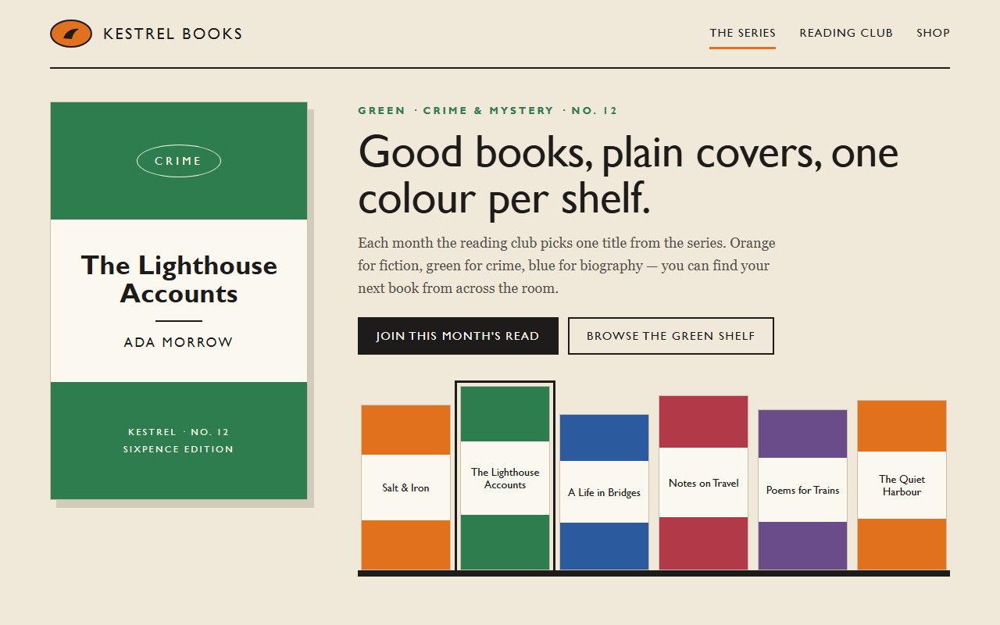

# Paperback Tri-Band (1930s–50s Series Covers)

## 1. Design Philosophy
Mid-century paperback series used a rigid system: three horizontal bands, a cream centre for title and author, and one colour per genre. The system made cheap books dignified and findable from across a room. Apply it to any catalogue: colour encodes category, the layout never changes, and the content does the talking.

## 2. Color Tokens & Surface Rules
```css
:root {
  --color-bg: #F0E9DA;
  --color-surface: #FBF8F0;
  --color-ink: #1D1C1A;
  --color-muted: #55504A;
  --color-accent: #B5541A;
  --color-border: #1D1C1A;
  --band-orange: #E2711D;
  --band-green: #2E7D4F;
  --band-blue: #2B5A9E;
  --band-cherry: #B23A48;
  --band-purple: #6B4C8A;
}
```
- **Rule:** `--color-accent` (#B5541A) is reserved for the primary action, the current state and one focal detail per view. Additional pigment tokens are for illustration and ornament; verify contrast before using any of them for text.

## 3. Typography & Hierarchy
- **Display font stack:** `'Gill Sans MT', 'Gill Sans', Calibri, 'Trebuchet MS', sans-serif`
- **Body font stack:** `Georgia, 'Times New Roman', serif`
- Display: a humanist sans (Gill Sans MT, Calibri fallback) at 50–60px, regular weight, sentence case.
- Cover titles: semi-bold humanist sans centred; author in letter-spaced caps under a short rule.
- Reading text in Georgia at 17–18px.
- Category kicker in uppercase tracked caps in the category's band colour (check contrast; darken for text).

## 4. Layout, Grid & Geometry
- Hero: one large cover (≈ 330×510) on the left, title/description/actions on the right.
- Covers are three rows: 30% band · cream title panel · 30% band, with 6px cream separators.
- A shelf of spines (varied heights, same system) along the bottom acts as browsing navigation; the current spine gets an outline ring.
- Each category owns exactly one band colour across the whole site.

## 5. Component Specifications
- **Cover:** grid-template-rows bands; an oval series label in the top band; colophon text in the bottom band.
- **Spine:** narrow three-band block with the title in the cream middle; focusable, with `aria-current` for the selected title.
- **Publisher mark:** a small oval with a simple bird silhouette — design your own mark; never reuse a real publisher's logo.
- **Buttons:** rectangular, uppercase tracked humanist sans; filled ink + outline.

## 6. Strict Forbidden Patterns (Anti-Slop Checklist)
- NEVER reproduce a real publisher's logo, name or cover.
- NEVER put images or illustrations inside the title panel; typography only.
- NEVER mix band colours on one cover.
- NEVER use band colours as text colour on cream unless they pass 4.5:1.

---

## 7. Distinctive art direction and page anatomy

**Reference era:** 1935–1955 paperback series covers. This is a contemporary interpretation, not a reproduction of a historical artefact or a trademarked brand. Make work that feels designed by a person with a point of view.

- **Reference composition:** `hero cover + shelf of spines`. Lead with a purposeful hierarchy, a real content block, and the signature `three-band cover system` treatment; do not assume every product needs a dashboard.
- **Sample editorial voice:** “Good books, plain covers, one colour per shelf.”. Replace sample copy with authentic project copy; do not ship the preview's fictional brand or made-up details.
- **Use cases:** Publishers, reading clubs, newsletters, podcasts, libraries, course catalogues. Develop other applications only when the visual language matches their audience and task.
- **Key visual device:** `three-band cover system`; create it with original vector or CSS geometry, real user-provided photography, or properly licensed assets.
- **Minimum component vocabulary:** header/navigation, primary action, secondary action, content grouping, form/input, an item or list row, and visible feedback state.
- **Repeatable signature:** keep the typographic proportion and materiality on subsequent pages; vary composition based on content so the site is not one repeated hero template.

## Required semantic-token interface
The implementation MUST use these shared CSS custom properties (the palette layer may override them later):

```css
:root {
  --color-bg: #F0E9DA;
  --color-surface: #FBF8F0;
  --color-ink: #1D1C1A;
  --color-muted: #55504A;
  --color-accent: #B5541A;
  --color-border: #1D1C1A;
  --font-display: 'Gill Sans MT', 'Gill Sans', Calibri, 'Trebuchet MS', sans-serif;
  --font-body: Georgia, 'Times New Roman', serif;
  --radius-control: 0px;
  --focus-ring: 3px solid var(--color-accent);
}
```

Use `var(--color-bg)` rather than hardcoding background colors throughout components. When combining a palette, **load style tokens first, then palette tokens** (the later palette overrides the six `--color-*` values). A palette changes color only, not the style's spatial or typographic DNA.

## 8. Responsive behavior (do not skip)

- At `>= 1200px`, use the full composition described above. At `768–1199px`, reduce columns and proportionally scale headlines. Below `768px`, collapse to a single deliberate reading path; keep the primary action visible without floating overlays.
- Typography: scale the display size with `clamp()` (for example `clamp(2.5rem, 6vw, 4rem)`), keep body text between 16px and 18px.
- Use `minmax(0, 1fr)` for long content, `overflow-wrap: anywhere` for technical tokens, and a horizontal overflow wrapper for necessary data tables.
- All interactive controls have touch targets around 44×44 CSS pixels. Do not hide access to important workflows on mobile.
- Offer low-motion alternatives; respect `prefers-reduced-motion: reduce`.

## 9. Accessible components and states

- Text contrast: normal text at least WCAG AA 4.5:1 and large text at least 3:1, including muted labels. Decorative pigments and pattern colours are **not** automatically safe for foreground copy; test the actual pair.
- Keyboard: visible `:focus-visible` ring, logical tab order, Escape on dismissible overlays, proper native controls; hover is never the only feedback.
- Supply designed states: default, hover, focus, pressed, disabled, loading, empty, error, success, and selected where applicable. Announce async outcomes in a polite live region, not by color alone.
- Use semantic landmarks (`header`, `nav`, `main`, `aside`, `footer`) and ordered heading levels. Ornamental SVG uses `aria-hidden="true"`; meaningful illustrations get a short `role="img"` label.

## 10. Anti-clone quality gate

Before delivery, check: (1) Could the result be mistaken for another skill in this library? If so, change the **composition**, not merely its colors. (2) Are the content and controls plausible for the product? (3) Are there illegible labels or invented statistics? (4) Do mobile, keyboard and reduced-motion states work? (5) Has AI-default hero/card/glow styling slipped back in?

## 11. Invocation example

```text
Use the paperback-tri-band design skill. Identify the product's core workflow, map its content hierarchy, apply its tokens and signature composition, and build a usable responsive page with real content states. Do not mimic the sample preview's fictional brand; do not introduce generic AI gradient/card patterns. Explain design choices in 5 concise sentences after implementation.
```

## 12. Visual reference



`demo.html` is the local, self-contained composition used to generate this preview. It illustrates a style direction, not a production-ready application.
