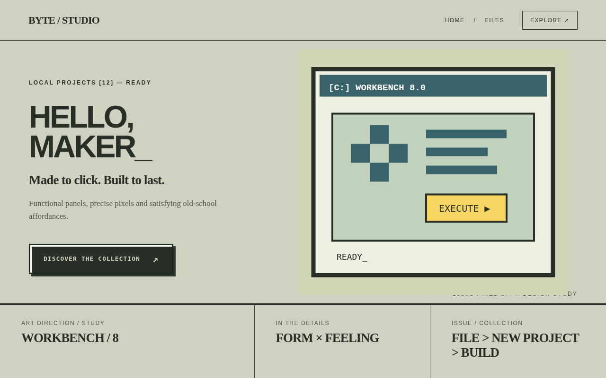

# Pixel Workbench — Art Direction Skill

## Historical DNA and design intent

1990s pixel UI. Chunky outlined windows, 1-bit-style icons, crisp pixel offsets, and explicit menu commands. Keep body copy readable. This is an original, modern adaptation of the movement's design principles, not a period reproduction.

## Visual grammar

- **Palette:** paper or canvas `#D1D1C2`, core ink `#282F27`, contrasting accent `#3A6F68`, rules `#333C31`.
- **Type:** `Courier New, monospace`; make display hierarchy unmistakable and use text styles sparingly.
- **Layout:** `desktop` with a deliberate tension between large shapes and readable content blocks; avoid anonymous card rows.
- **Texture & imagery:** signature motif `pixel`; prefer local CSS/SVG for motifs, photographs only when supplied or clearly licensed.
- **Geometry:** align interaction controls consistently even when decorative geometry overlaps or rotates.

## Core components

Header: compact, navigable and visible. Hero: one clear editorial statement (not a list of generic benefits). Supporting area: two strong proof points or content modules, not a repetitive three-card row. CTAs: visible action verbs with accessible state feedback. Forms/data: readable labels and error messages.

## Forbidden patterns

- No purple-cyan gradients, no floating glass cards, no generic sparkle icons, no fixed "AI" motif.
- No center-aligned heading + subtitle + two pills as the default composition.
- No ornamental elements that block text, cover controls, or substitute for content.
- No exact imitation of trademarked visual identities or historical artwork.


---

## 7. Distinctive art direction and page anatomy

**Reference era:** 1990s pixel UI. This is a contemporary interpretation, not a reproduction of a historical poster or a trademarked brand. Make work that feels designed by a person with a point of view.

- **Reference composition:** `desktop`. Lead with a purposeful hierarchy, a real content block, and the signature `pixel` visual treatment; do not assume every product needs a dashboard.
- **Sample editorial voice:** “WORKBENCH / 8” / “HELLO, MAKER_”. Replace sample copy with authentic project copy; do not ship the preview's fictional brand or made-up metrics.
- **Use case:** DevTools. Develop other applications only when the historical language matches their audience and task.
- **Key visual device:** `pixel`; create it with original vector or CSS geometry, real user-provided photography, or properly licensed assets. Never lift a historic poster pixel-for-pixel.
- **Minimum component vocabulary:** header/navigation, primary action, secondary action, content grouping, form/input, an item or list row, and visible feedback state.
- **Repeatable signature:** Maintain distinctive typographic proportion and materiality on subsequent pages; vary composition based on content so the site is not one repeated hero template.

## Required semantic-token interface
The implementation MUST use these shared CSS custom properties (the palette layer may override them later):

```css
:root {
  --color-bg: #D1D1C2;
  --color-surface: #EFEFE1;
  --color-ink: #282F27;
  --color-muted: #4E584D;
  --color-accent: #3A6F68;
  --color-border: #333C31;
  --font-display: Courier New, monospace;
  --font-body: Arial, sans-serif;
  --radius-control: 0px;
  --focus-ring: 3px solid var(--color-accent);
}
```

Use `var(--color-bg)` rather than hardcoding background colors throughout components. When combining a palette, **load style tokens first, then palette tokens** (the later palette overrides the six `--color-*` values). A palette changes color only, not the style's spatial or typographic DNA. Any legacy token names in the original spec are descriptive aliases; use this semantic contract in new code.


## 8. Responsive behavior (do not skip)

- At `>= 1200px`, use the full asymmetrical or editorial grid. At `768–1199px`, reduce columns and proportionally scale headlines. Below `768px`, collapse to a single deliberate reading path; keep the primary action visible without floating overlays.
- Typography: `clamp(2.5rem, 6.5vw, 6.75rem)` for a large display heading, `clamp(1rem, 1.2vw, 1.125rem)` for body; adjust the clamp for special historical styles while keeping body text readable.
- Use `minmax(0, 1fr)` for long content, `overflow-wrap: anywhere` for technical tokens, and a horizontal overflow wrapper for necessary data tables.
- All interactive controls have touch targets around 44×44 CSS pixels. Do not hide access to important workflows on mobile.
- Offer low-motion alternatives; respect `prefers-reduced-motion: reduce`.

## 9. Accessible components and states

- Text contrast: normal text at least WCAG AA 4.5:1 and large text at least 3:1, including muted labels. Some illustrative accents are **not** safe for foreground copy; test the actual foreground/background pair.
- Keyboard: visible `:focus-visible` ring, logical tab order, Escape on dismissible overlays, proper native controls; hover is never the only feedback.
- Supply designed states: default, hover, focus, pressed, disabled, loading, empty, error, success, and selected where applicable. Announce async outcomes in a polite live region, not by color alone.
- Use semantic landmarks (`header`, `nav`, `main`, `aside`, `footer`) and ordered heading levels. Image alt describes meaning, while purely ornamental illustrations use empty alt or `aria-hidden`.

## 10. Anti-clone quality gate

Before delivery, check: (1) Could the preview be mistaken for another skill in this library? If so, change the **composition**, not merely its colors. (2) Are the content and controls plausible for the product? (3) Are there any illegible labels or fake chart metrics? (4) Do mobile, keyboard and reduced-motion states work? (5) Has AI-default hero/card/glow styling slipped back in?

## 11. Invocation example

```text
Use the pixel-workbench design skill. Identify the product's core workflow, map its content hierarchy, apply its tokens and signature composition, and build a usable responsive page with real content states. Do not mimic the sample preview's fictional brand; do not introduce generic AI gradient/card patterns. Explain design choices in 5 concise sentences after implementation.
```

## 12. Visual reference



`demo.html` is the local, self-contained composition used to generate this preview. It illustrates a style direction, not a production-ready application or a functional app.
