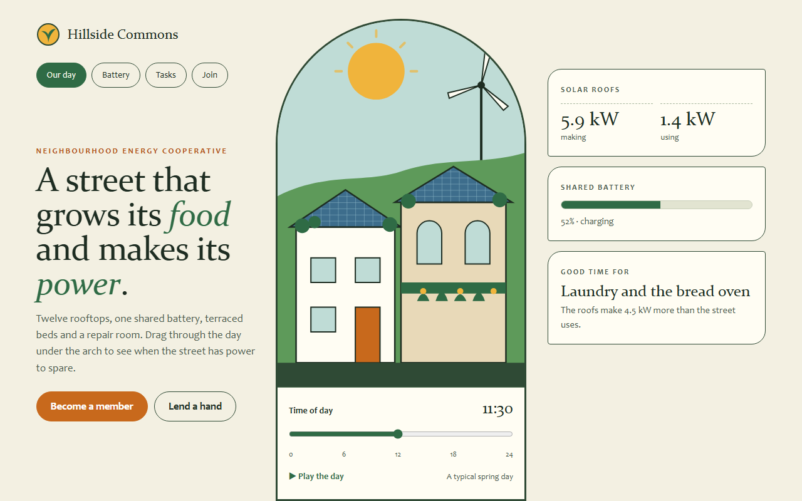

# Solarpunk Commons — Living Style

> **Living style.** The illustration is a model. Turn the dial and the street's day plays out: the sun crosses the arch, roofs make power, the battery fills, windows light at dusk, and the page tells you what that means for your laundry.

## 1. Design philosophy
Solarpunk imagines a future that is green, local and repaired rather than chrome and dystopian. The interface is optimistic but **civic**: shared resources, clear schedules, plain language, honest numbers. The signature turns an abstract idea (a shared battery) into something a neighbour understands in five seconds.

Test: *would this help a neighbour decide something today, and is every number honest?*

## 2. Colour tokens
```css
:root {
  --color-bg: #F3F0E2;
  --color-surface: #FFFDF3;
  --color-ink: #1E2D22;
  --color-muted: #4B5A4D;
  --color-accent: #C8691C;   /* primary action, time marker */
  --color-border: #2F4A35;
  --leaf: #5E9A5A; --moss: #2F6B45; --sun: #F0B43C; --sky: #BFDCD6; --terracotta: #B4531A;
}
```
Sky steps (flat colours, never gradients): night `#1E2D3A`, before dawn `#2C3F4F`, dawn `#E9C9A4`, day `#BFDCD6`, dusk `#E8B08A`.

## 3. Typography
- **Display:** warm transitional serif (`Constantia, 'Palatino Linotype', Georgia`), 40–58px; italic moss-green for the two key nouns.
- **Body/UI:** humanist sans (`Candara, 'Segoe UI'`) 15–17px.
- **Labels:** 12–13px uppercase, 0.16–0.2em tracking, terracotta kickers.

## 4. Layout
- **Desktop:** message · arched window (≈400px, top radius = half the width) with the dial attached below · live readout cards.
- **Tablet:** message + arch; readouts become a three-card row underneath.
- **Phone:** message → arch (≥440px) with dial → readouts.
- Cards use leaf-cut corners `border-radius: 22px 4px 22px 4px`; buttons and nav are 40–48px pills.

## 5. Signature interaction — the day dial
| Input | Scene | Readouts |
|---|---|---|
| Dial (`input type=range`, 0–23:45 in 15-minute steps; arrow keys) | sun position on an arc inside the arch; flat sky colour step; stars + moon at night; windows glow warm after 19:00; roof panels brighten with output; turbine angle follows the time | making (kW), using (kW), battery % + charging/supplying, advice card |
| "Play the day" | advances 2.4 hours per second until midnight; pause any time | same |
| Click on the 24-hour chart | jumps to that time | same, marker moves |

Advice rules (plain language): surplus > 2 kW → "Good time for laundry and the bread oven"; small surplus → "charging the cargo bikes"; deficit with battery > 30% → "running on the shared battery"; low battery → "please hold washing and the oven" (terracotta border).

## 6. Motion language
- Scene changes only when the dial moves or Play is pressed. No idle drifting clouds, no spinning turbine on its own.
- Sky fill and battery bar ease over 0.3–0.4s; everything else updates per step.
- `prefers-reduced-motion`: no transitions; Play jumps to evening instead of animating.

## 7. Section library
1. **Hero** — mark, pill nav, kicker, headline, lede that tells people to use the dial, two buttons; arch scene + dial + Play; readout cards (roofs, battery meter, advice).
2. **The shared battery** — 24h SVG chart: generation area, use line, battery dashed line, time marker synced with the dial.
3. **Things we do together** — task cards with day/time, description, filled/empty slot dots, "Count me in" toggle (`aria-pressed`), full state.
4. **Membership** — arch-topped form (name, email, house number, household size) with inline validation.
5. **Footer** — states clearly when figures are a model rather than live readings.

## 8. Code recipes
```js
// one day in 15-minute steps; replace with real meter data when available
const gen = t => t < 6 || t > 19.5 ? 0 : 6.2 * Math.pow(Math.sin(Math.PI * (t - 6) / 13.5), 1.2);
const use = t => 1.0 + 1.8 * g(t, 7.5, 1.1) + 2.6 * g(t, 19, 1.5) + .7 * g(t, 13, 1.4);  // g = gaussian bump
for (i = 0..96) { soc = clamp(5, 100, soc + (gen(t) - use(t)) * 0.25 / 20 * 100) }      // 20 kWh battery
// sun on an arc that stays inside the arch window
const a = Math.PI * (t - 6) / 13.5;  sun.translate(200 - 140 * Math.cos(a), 400 - 180 * Math.sin(a));
```
- Use a native range input for the dial (keyboard, screen readers) and set `aria-valuetext` to "11:30".
- The meter is `role="meter"` with `aria-valuenow`.
- Keep the scene SVG `preserveAspectRatio="xMidYMax slice"` so the ground stays anchored; keep moving parts inside the visible upper area.

## 9. Content rules
- Label models as models. Never present invented impact numbers (CO₂ saved, households served) as facts.
- Advice must be actionable and kind ("please hold", not "do not").
- Illustrations, not stock photos of wind farms with lens flare.

## 10. Forbidden patterns (anti-slop)
- NEVER use dystopian neon, chrome, glassmorphism or glowing gradients.
- NEVER animate the scene on its own.
- NEVER hide the numbers behind icons only; always say kW and %.
- NEVER use terracotta for body text on cream unless contrast is verified.

## 11. Accessibility
- The arch is `role="img"` with a label; the dial is a labelled range input with `aria-valuetext`; the advice card is `aria-live="polite"`.
- Task buttons use `aria-pressed`; full tasks are disabled with a text label.
- Forms: `aria-invalid`, one combined `role=alert` message, focus to the first invalid field.

## 12. Quality gate
(1) Does every dial position produce a consistent scene, readouts, advice and chart marker? (2) Does anything move without input? (3) Are figures labelled as a model or as live data? (4) Is the dial usable by keyboard? (5) Phone layout keeps the dial right under the scene?

## Required semantic-token interface
```css
:root {
  --color-bg: #F3F0E2;
  --color-surface: #FFFDF3;
  --color-ink: #1E2D22;
  --color-muted: #4B5A4D;
  --color-accent: #C8691C;
  --color-border: #2F4A35;
  --font-display: Constantia, 'Palatino Linotype', Georgia, serif;
  --font-body: Candara, 'Segoe UI', sans-serif;
  --radius-control: 24px;
  --focus-ring: 3px solid var(--color-accent);
}
```

## Invocation example
```text
Use the solarpunk-commons living style. Build an arched illustration of the street
driven by a time-of-day range input: sun arc, flat sky steps, lit windows at dusk,
roof output and turbine angle. Connect it to a simple generation/use/battery model,
show kW and battery %, give plain-language advice, and sync a 24-hour chart. Motion
only from the dial or a user-pressed Play; label the figures as a model.
```



`demo.html` is a complete, interactive single-file page; the preview shows its first screen.
