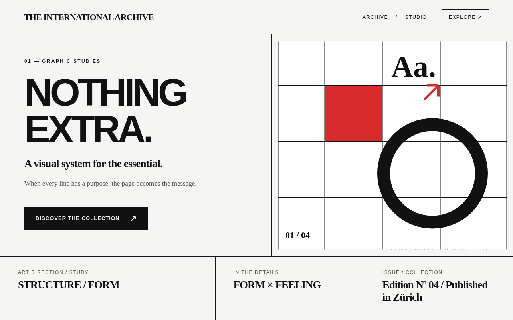

# Swiss Editorial (International Typographic Style)

## 1. Design Philosophy
Inspired by 1950s–1970s Zürich poster archives, Josef Müller-Brockmann, and modernist print systems. Every pixel serves structural clarity. Hierarchy is achieved exclusively through typographic scale, mathematical grid alignment, and negative space—never through decorative shadows, glows, or gradients.

## 2. Color Tokens & Surface Rules
```css
:root {
  --bg-canvas: #F5F5F3;      /* Crisp archival off-white */
  --bg-surface: #FFFFFF;     /* Pure white grid cell */
  --text-primary: #0E0E0E;   /* Dense black ink */
  --text-secondary: #525252; /* Neutral technical grey */
  --border-grid: #1A1A1A;    /* Exposed structural hairline */
  --border-subtle: #D4D4D0;  /* Secondary divider */
  --accent: #D92B2B;         /* Functional Swiss vermilion red (max 5% area) */
}
```
- **Rule:** Maximum 1 functional accent color (`--accent`), reserved strictly for active states, directional arrows (`→`), or index highlights.

## 3. Typography & Hierarchy
- **Primary Font:** `'Neue Haas Grotesk', 'Helvetica Neue', 'Inter', Arial, sans-serif`
- **Metadata / Index Font:** `'IBM Plex Mono', 'JetBrains Mono', monospace`
- **Headlines (`H1`):** Extra-bold (`800`), uppercase or sentence-case with tight tracking (`-0.04em`), tight line-height (`0.95` to `1.05`), massive contrast against body text (minimum 4:1 ratio).
- **Body:** `14px–16px`, line-height `1.5`, strictly left-aligned (rag-right). Never center-align paragraphs.
- **Indexing:** Prefix sections and nav items with numeric indices (`01 / ARCHIVE`, `02 / ESSAYS`, `03 / SYSTEM`).

## 4. Layout, Grid & Geometry
- **Exposed Grid:** Use visible `1px solid var(--border-grid)` vertical and horizontal lines to divide page regions like an architectural blueprint.
- **Border Radius:** Strictly `0px` on all containers, buttons, inputs, and images. No exceptions.
- **Asymmetry:** Use asymmetric column splits (e.g., `20% metadata rail | 45% headline block | 35% photography/visual`).
- **Spacing Scale:** Strict 8px base unit (`8, 16, 24, 32, 48, 64, 96px`).

## 5. Component Specifications
- **Buttons:** Rectangular (`border-radius: 0`), `1px solid #0E0E0E`, uppercase monospace or bold sans text, instant hover inversion (black background, white text—no bounce or glow).
- **Cards:** Do not float cards on a grey background. Use adjacent grid cells separated by shared `1px` borders.
- **Imagery:** High-contrast black-and-white or desaturated editorial photography cropped sharply to grid boundaries.

## 6. Strict Forbidden Patterns (Anti-Slop Checklist)
- NEVER use `border-radius` greater than `0px`.
- NEVER use box-shadows, drop-shadows, glassmorphism, or backdrop blur.
- NEVER use color gradients (especially purple/blue/cyan AI defaults).
- NEVER center-align hero sections with a subtitle and two pill buttons.
- NEVER add decorative emojis or generic outline icons next to headings.

---

## 7. Distinctive art direction and page anatomy

**Reference era:** 1950s Swiss. This is a contemporary interpretation, not a reproduction of a historical poster or a trademarked brand. Make work that feels designed by a person with a point of view.

- **Reference composition:** `split`. Lead with a purposeful hierarchy, a real content block, and the signature `grid` visual treatment; do not assume every product needs a dashboard.
- **Sample editorial voice:** “STRUCTURE / FORM” / “NOTHING EXTRA.”. Replace sample copy with authentic project copy; do not ship the preview's fictional brand or made-up metrics.
- **Use case:** Editorial. Develop other applications only when the historical language matches their audience and task.
- **Key visual device:** `grid`; create it with original vector or CSS geometry, real user-provided photography, or properly licensed assets. Never lift a historic poster pixel-for-pixel.
- **Minimum component vocabulary:** header/navigation, primary action, secondary action, content grouping, form/input, an item or list row, and visible feedback state.
- **Repeatable signature:** Maintain distinctive typographic proportion and materiality on subsequent pages; vary composition based on content so the site is not one repeated hero template.

## Required semantic-token interface
The implementation MUST use these shared CSS custom properties (the palette layer may override them later):

```css
:root {
  --color-bg: #F5F5F3;
  --color-surface: #FFFFFF;
  --color-ink: #111111;
  --color-muted: #555552;
  --color-accent: #D92B2B;
  --color-border: #171717;
  --font-display: Arial, Helvetica, sans-serif;
  --font-body: Arial, sans-serif;
  --radius-control: 0px;
  --focus-ring: 3px solid var(--color-accent);
}
```

Use `var(--color-bg)` rather than hardcoding background colors throughout components. When combining a palette, **load style tokens first, then palette tokens** (the later palette overrides the six `--color-*` values). A palette changes color only, not the style's spatial or typographic DNA. Any legacy token names in the original spec are descriptive aliases; use this semantic contract in new code.


## 8. Responsive behavior (do not skip)

- At `>= 1200px`, use the full asymmetrical or editorial grid. At `768–1199px`, reduce columns and proportionally scale headlines. Below `768px`, collapse to a single deliberate reading path; keep the primary action visible without floating overlays.
- Typography: `clamp(2.5rem, 6.5vw, 6.75rem)` for a large display heading, `clamp(1rem, 1.2vw, 1.125rem)` for body; adjust the clamp for special historical styles while keeping body text readable.
- Use `minmax(0, 1fr)` for long content, `overflow-wrap: anywhere` for technical tokens, and a horizontal overflow wrapper for necessary data tables.
- All interactive controls have touch targets around 44×44 CSS pixels. Do not hide access to important workflows on mobile.
- Offer low-motion alternatives; respect `prefers-reduced-motion: reduce`.

## 9. Accessible components and states

- Text contrast: normal text at least WCAG AA 4.5:1 and large text at least 3:1, including muted labels. Some illustrative accents are **not** safe for foreground copy; test the actual foreground/background pair.
- Keyboard: visible `:focus-visible` ring, logical tab order, Escape on dismissible overlays, proper native controls; hover is never the only feedback.
- Supply designed states: default, hover, focus, pressed, disabled, loading, empty, error, success, and selected where applicable. Announce async outcomes in a polite live region, not by color alone.
- Use semantic landmarks (`header`, `nav`, `main`, `aside`, `footer`) and ordered heading levels. Image alt describes meaning, while purely ornamental illustrations use empty alt or `aria-hidden`.

## 10. Anti-clone quality gate

Before delivery, check: (1) Could the preview be mistaken for another skill in this library? If so, change the **composition**, not merely its colors. (2) Are the content and controls plausible for the product? (3) Are there any illegible labels or fake chart metrics? (4) Do mobile, keyboard and reduced-motion states work? (5) Has AI-default hero/card/glow styling slipped back in?

## 11. Invocation example

```text
Use the swiss-editorial design skill. Identify the product's core workflow, map its content hierarchy, apply its tokens and signature composition, and build a usable responsive page with real content states. Do not mimic the sample preview's fictional brand; do not introduce generic AI gradient/card patterns. Explain design choices in 5 concise sentences after implementation.
```

## 12. Visual reference



`demo.html` is the local, self-contained composition used to generate this preview. It illustrates a style direction, not a production-ready application or a functional app.
