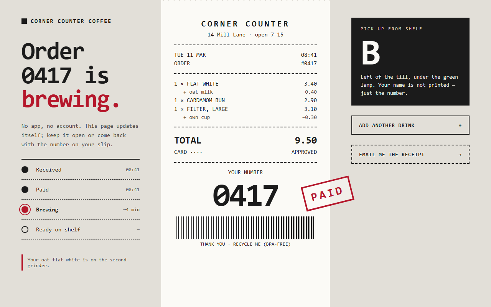

# Thermal Receipt (Point-of-Sale Paper)

## 1. Design Philosophy
A receipt is the most honest document in commerce: every line, every modifier, the total, the time. Use it as the hero object for transactional flows. The page stays functional and calm; the receipt carries character through its torn edge, dashed rules, uppercase line items and a single red stamp.

## 2. Color Tokens & Surface Rules
```css
:root {
  --color-bg: #E2DFD8;
  --color-surface: #FBFAF6;
  --color-ink: #1B1B1B;
  --color-muted: #4F4D49;
  --color-accent: #B5172B;
  --color-border: #1B1B1B;
}
```
- **Rule:** `--color-accent` (#B5172B) is reserved for the primary action, the current state and one focal detail per view. Additional pigment tokens are for illustration and ornament; verify contrast before using any of them for text.

## 3. Typography & Hierarchy
- **Display font stack:** `'Consolas', 'Lucida Console', 'Courier New', monospace`
- **Body font stack:** `'Consolas', 'Lucida Console', 'Courier New', monospace`
- Monospace throughout (Consolas/Lucida Console); one face, weights 400 and 700.
- Headline 56–64px bold monospace with negative tracking; status word in the red accent.
- Line items uppercase 15px, modifiers lowercase indented and muted; totals 24–28px bold.
- Order number displayed huge (80px+) on the slip so it is readable from a counter.

## 4. Layout, Grid & Geometry
- Three columns: status column · receipt (≈ 420–440px, full height, bleeding off the bottom) · pickup/actions column.
- Receipt top edge is a zigzag tear (two linear-gradient triangles).
- Dashed 2px rules separate receipt sections; no boxes inside the slip.
- Mobile: receipt becomes full width and appears after the status block.

## 5. Component Specifications
- **Status steps:** ordered list with filled (done), red ring (current, `aria-current=step`) and empty (pending) markers plus timestamps; announce changes in a `role=status` line.
- **Stamp:** rotated red outlined 'PAID' block overlapping the slip edge, decorative (`aria-hidden`).
- **Barcode:** repeating-linear-gradient bars; decorative unless it encodes a real code.
- **Pickup card:** inverted ink block with a giant shelf letter; outlined and dashed secondary buttons.

## 6. Strict Forbidden Patterns (Anti-Slop Checklist)
- NEVER fake a QR or barcode that looks scannable but is not, without marking it decorative.
- NEVER print full card numbers or personal data on the slip.
- NEVER add rounded cards, gradients or floating shadows around the receipt.
- NEVER rely on the red stamp alone to communicate payment state; say it in text.

---

## 7. Distinctive art direction and page anatomy

**Reference era:** 1990s point-of-sale receipts. This is a contemporary interpretation, not a reproduction of a historical artefact or a trademarked brand. Make work that feels designed by a person with a point of view.

- **Reference composition:** `central receipt slip`. Lead with a purposeful hierarchy, a real content block, and the signature `torn-edge receipt slip` treatment; do not assume every product needs a dashboard.
- **Sample editorial voice:** “Order 0417 is brewing.”. Replace sample copy with authentic project copy; do not ship the preview's fictional brand or made-up details.
- **Use cases:** Cafés, food ordering, order tracking, pickup, checkout confirmations, small retail. Develop other applications only when the visual language matches their audience and task.
- **Key visual device:** `torn-edge receipt slip`; create it with original vector or CSS geometry, real user-provided photography, or properly licensed assets.
- **Minimum component vocabulary:** header/navigation, primary action, secondary action, content grouping, form/input, an item or list row, and visible feedback state.
- **Repeatable signature:** keep the typographic proportion and materiality on subsequent pages; vary composition based on content so the site is not one repeated hero template.

## Required semantic-token interface
The implementation MUST use these shared CSS custom properties (the palette layer may override them later):

```css
:root {
  --color-bg: #E2DFD8;
  --color-surface: #FBFAF6;
  --color-ink: #1B1B1B;
  --color-muted: #4F4D49;
  --color-accent: #B5172B;
  --color-border: #1B1B1B;
  --font-display: 'Consolas', 'Lucida Console', 'Courier New', monospace;
  --font-body: 'Consolas', 'Lucida Console', 'Courier New', monospace;
  --radius-control: 0px;
  --focus-ring: 3px solid var(--color-accent);
}
```

Use `var(--color-bg)` rather than hardcoding background colors throughout components. When combining a palette, **load style tokens first, then palette tokens** (the later palette overrides the six `--color-*` values). A palette changes color only, not the style's spatial or typographic DNA.

## 8. Responsive behavior (do not skip)

- At `>= 1200px`, use the full composition described above. At `768–1199px`, reduce columns and proportionally scale headlines. Below `768px`, collapse to a single deliberate reading path; keep the primary action visible without floating overlays.
- Typography: scale the display size with `clamp()` (for example `clamp(2.5rem, 6vw, 4rem)`), keep body text between 16px and 18px.
- Use `minmax(0, 1fr)` for long content, `overflow-wrap: anywhere` for technical tokens, and a horizontal overflow wrapper for necessary data tables.
- All interactive controls have touch targets around 44×44 CSS pixels. Do not hide access to important workflows on mobile.
- Offer low-motion alternatives; respect `prefers-reduced-motion: reduce`.

## 9. Accessible components and states

- Text contrast: normal text at least WCAG AA 4.5:1 and large text at least 3:1, including muted labels. Decorative pigments and pattern colours are **not** automatically safe for foreground copy; test the actual pair.
- Keyboard: visible `:focus-visible` ring, logical tab order, Escape on dismissible overlays, proper native controls; hover is never the only feedback.
- Supply designed states: default, hover, focus, pressed, disabled, loading, empty, error, success, and selected where applicable. Announce async outcomes in a polite live region, not by color alone.
- Use semantic landmarks (`header`, `nav`, `main`, `aside`, `footer`) and ordered heading levels. Ornamental SVG uses `aria-hidden="true"`; meaningful illustrations get a short `role="img"` label.

## 10. Anti-clone quality gate

Before delivery, check: (1) Could the result be mistaken for another skill in this library? If so, change the **composition**, not merely its colors. (2) Are the content and controls plausible for the product? (3) Are there illegible labels or invented statistics? (4) Do mobile, keyboard and reduced-motion states work? (5) Has AI-default hero/card/glow styling slipped back in?

## 11. Invocation example

```text
Use the thermal-receipt design skill. Identify the product's core workflow, map its content hierarchy, apply its tokens and signature composition, and build a usable responsive page with real content states. Do not mimic the sample preview's fictional brand; do not introduce generic AI gradient/card patterns. Explain design choices in 5 concise sentences after implementation.
```

## 12. Visual reference



`demo.html` is the local, self-contained composition used to generate this preview. It illustrates a style direction, not a production-ready application.
