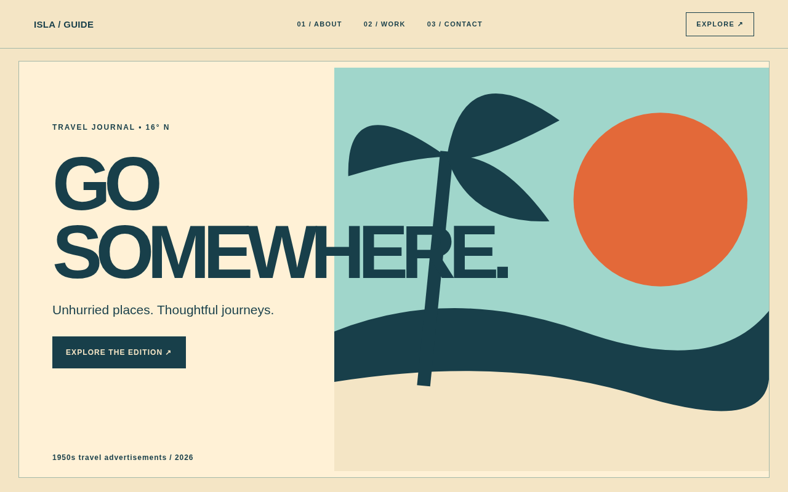

# Tropical Travel Poster — Art Direction Skill

## Creative rationale

- **Historical / editorial DNA:** 1950s travel advertisements. This is a contemporary interpretation, not a reproduction of an identifiable historical work.
- **Ideal audience:** Travel and adjacent use cases requiring this visual character.
- **Signature composition:** travel — Oversized destination lettering, layered geographic silhouettes, honest itineraries.
- **Illustration device:** tropical; create it with original CSS/SVG or licensed, project-specific visual material.
- **Typography:** Arial Black, Arial, sans-serif. Use this to distinguish headings from reading copy, never as an excuse to shrink normal text.

## Semantic CSS foundations

```css
:root {
  --color-bg: #F4E5C5;
  --color-surface: #FFF1D6;
  --color-ink: #183F4A;
  --color-muted: #4C6562;
  --color-accent: #E36939;
  --color-border: #A3B8A9;
  --font-display: Arial Black, Arial, sans-serif;
  --font-body: Arial, Helvetica, sans-serif;
  --radius-control: 8px;
  --focus-ring: 3px solid var(--color-accent);
}
```

## Specific page blueprint

1. Navigation carries 4–6 useful destinations and a clear current-page state; styling echoes the print/period source but remains usable.
2. Hero uses a purposeful statement and a **travel** composition; its art element reinforces the message, not merely decorates.
3. First content section proves the premise with genuine photos, descriptions, inventory or process, depending on product.
4. Primary CTA reflects a real task for travel; secondary CTA should be a helpful alternative rather than a redundant button.
5. Supporting content adopts the historical graphic vocabulary without repeating the same composition on every page.

## Specific anti-patterns

- No invented travel discounts or claimed destination accessibility.
- No purple-blue generative gradients, repeated floating feature cards, generic sparkle symbols or indistinguishable pill-button hero.
- Avoid using historical ornament as a substitute for accessible information or functional UI.

## Implementation contract

- Use the six shared color tokens (`--color-bg`, `--color-surface`, `--color-ink`, `--color-muted`, `--color-accent`, `--color-border`) so palettes can override color **only**; preserve the style’s independent typographic and spatial identity.
- Provide clear semantic `header`, `nav`, `main`, and `footer` landmarks. Use native links and buttons; no decorative-only CTAs.
- Under 768px, recast the information hierarchy into a single intentional reading path; do not simply shrink the desktop canvas. At 768–1199px use a measured two-column adaptation and at larger sizes use the complete art-directed composition.
- Use visible focus styles (`:focus-visible` with `--focus-ring`), proper text alternatives, logical tab order and touch targets around 44px. Honor `prefers-reduced-motion`.
- Check actual text/background pairs against WCAG AA (4.5:1 for ordinary copy); an accent that is decorative may not be suitable for text.
- Create genuine hover, focus, selected, disabled, loading, error, empty and success states when applicable. Make success/errors perceivable without color alone.
- Do not invent statistics, testimonials, inventory, services, safety information, legal outcomes or product capabilities. Placeholder brand names in previews are fictional demonstrations, not ready-made content.
- Do not copy SITE123 customer templates, third-party logos, photographs or artwork. All examples here use original abstract HTML/SVG illustration.

## QA before delivery

1. Does the structure look different when viewed in grayscale, rather than just swapping colors? 2. Is the user’s primary task obvious? 3. Do keyboard, mobile and error states work? 4. Does the content sound like the real brand and avoid made-up proof? 5. Does the output remain coherent across a second screen?

## Demo composition



Open [the self-contained source HTML](./demo.html). Its sample words and imagery are fictional and illustrative.
