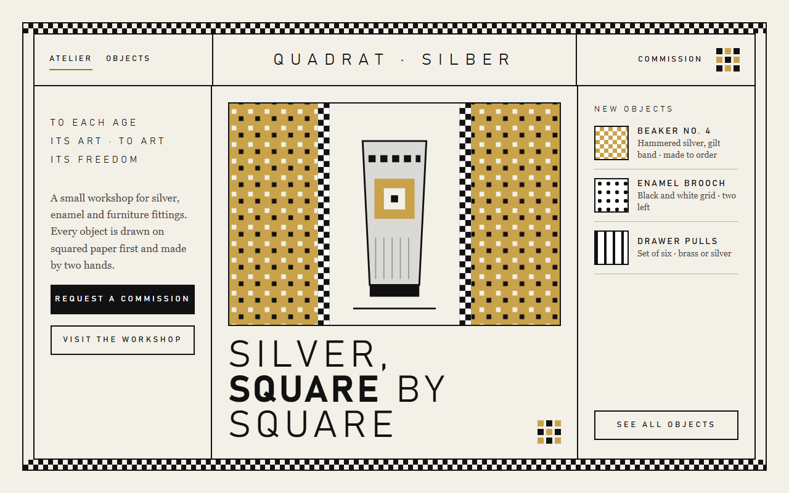

# Vienna Secession 1905 (Wiener Werkstätte Grid)

## 1. Design Philosophy
The Vienna workshops answered Art Nouveau's curves with the square: black and white chequers, gold grids, tall narrow frames and lettering built from geometry. It is luxurious through restraint and precision rather than flourish. Every element sits on a visible square module.

## 2. Color Tokens & Surface Rules
```css
:root {
  --color-bg: #F3F0E8;
  --color-surface: #FFFFFF;
  --color-ink: #111111;
  --color-muted: #4E4B46;
  --color-accent: #9A7424;
  --color-border: #111111;
  --gold: #C9A24A;
  --module: 16px;
}
```
- **Rule:** `--color-accent` (#9A7424) is reserved for the primary action, the current state and one focal detail per view. Additional pigment tokens are for illustration and ornament; verify contrast before using any of them for text.

## 3. Typography & Hierarchy
- **Display font stack:** `'Bahnschrift', 'Arial Narrow', Arial, sans-serif`
- **Body font stack:** `Georgia, 'Times New Roman', serif`
- Display: light-weight narrow geometric sans (Bahnschrift Light) in uppercase with 0.14–0.42em tracking; one word may switch to bold for emphasis.
- Reading text: Georgia 15–17px.
- Navigation and buttons: 13px uppercase, 0.22–0.28em tracking.

## 4. Layout, Grid & Geometry
- Double frame: outer 2px rule, 16px chequerboard bands top and bottom, inner 2px rule.
- Three columns (≈ 288px · 1fr · 288px) separated by 2px rules; header cells mirror the columns.
- Centre column holds one framed visual panel and a large title; side columns hold motto/actions and an object list.
- Ornament is only squares: 3×3 gold/black clusters, chequer thumbnails, stripe and dot fields.

## 5. Component Specifications
- **Chequer band:** `conic-gradient` 25% steps at 16px.
- **Object row:** 56px square pattern thumbnail + tracked caps title + serif detail.
- **Buttons:** square-cornered, 2px border, tracked caps; primary filled black.
- **Visual panel:** original geometric SVG object on a gold/black square pattern ground.

## 6. Strict Forbidden Patterns (Anti-Slop Checklist)
- NEVER introduce curves, flourishes or Art-Nouveau whiplash lines (use `art-nouveau-atelier` for that).
- NEVER use gold (#C9A24A) for text; use the darker accent #9A7424 only for large text or rules.
- NEVER round corners or add shadows.
- NEVER break the square module with arbitrary spacing.

---

## 7. Distinctive art direction and page anatomy

**Reference era:** 1903–1910 Vienna Secession. This is a contemporary interpretation, not a reproduction of a historical artefact or a trademarked brand. Make work that feels designed by a person with a point of view.

- **Reference composition:** `double-framed three-column grid`. Lead with a purposeful hierarchy, a real content block, and the signature `chequerboard and gold-square ornament` treatment; do not assume every product needs a dashboard.
- **Sample editorial voice:** “Silver, square by square.”. Replace sample copy with authentic project copy; do not ship the preview's fictional brand or made-up details.
- **Use cases:** Jewellery, silversmiths, architecture, interiors, furniture, cafés, design objects. Develop other applications only when the visual language matches their audience and task.
- **Key visual device:** `chequerboard and gold-square ornament`; create it with original vector or CSS geometry, real user-provided photography, or properly licensed assets.
- **Minimum component vocabulary:** header/navigation, primary action, secondary action, content grouping, form/input, an item or list row, and visible feedback state.
- **Repeatable signature:** keep the typographic proportion and materiality on subsequent pages; vary composition based on content so the site is not one repeated hero template.

## Required semantic-token interface
The implementation MUST use these shared CSS custom properties (the palette layer may override them later):

```css
:root {
  --color-bg: #F3F0E8;
  --color-surface: #FFFFFF;
  --color-ink: #111111;
  --color-muted: #4E4B46;
  --color-accent: #9A7424;
  --color-border: #111111;
  --font-display: 'Bahnschrift', 'Arial Narrow', Arial, sans-serif;
  --font-body: Georgia, 'Times New Roman', serif;
  --radius-control: 0px;
  --focus-ring: 3px solid var(--color-accent);
}
```

Use `var(--color-bg)` rather than hardcoding background colors throughout components. When combining a palette, **load style tokens first, then palette tokens** (the later palette overrides the six `--color-*` values). A palette changes color only, not the style's spatial or typographic DNA.

## 8. Responsive behavior (do not skip)

- At `>= 1200px`, use the full composition described above. At `768–1199px`, reduce columns and proportionally scale headlines. Below `768px`, collapse to a single deliberate reading path; keep the primary action visible without floating overlays.
- Typography: scale the display size with `clamp()` (for example `clamp(2.5rem, 6vw, 4rem)`), keep body text between 16px and 18px.
- Use `minmax(0, 1fr)` for long content, `overflow-wrap: anywhere` for technical tokens, and a horizontal overflow wrapper for necessary data tables.
- All interactive controls have touch targets around 44×44 CSS pixels. Do not hide access to important workflows on mobile.
- Offer low-motion alternatives; respect `prefers-reduced-motion: reduce`.

## 9. Accessible components and states

- Text contrast: normal text at least WCAG AA 4.5:1 and large text at least 3:1, including muted labels. Decorative pigments and pattern colours are **not** automatically safe for foreground copy; test the actual pair.
- Keyboard: visible `:focus-visible` ring, logical tab order, Escape on dismissible overlays, proper native controls; hover is never the only feedback.
- Supply designed states: default, hover, focus, pressed, disabled, loading, empty, error, success, and selected where applicable. Announce async outcomes in a polite live region, not by color alone.
- Use semantic landmarks (`header`, `nav`, `main`, `aside`, `footer`) and ordered heading levels. Ornamental SVG uses `aria-hidden="true"`; meaningful illustrations get a short `role="img"` label.

## 10. Anti-clone quality gate

Before delivery, check: (1) Could the result be mistaken for another skill in this library? If so, change the **composition**, not merely its colors. (2) Are the content and controls plausible for the product? (3) Are there illegible labels or invented statistics? (4) Do mobile, keyboard and reduced-motion states work? (5) Has AI-default hero/card/glow styling slipped back in?

## 11. Invocation example

```text
Use the vienna-secession-1905 design skill. Identify the product's core workflow, map its content hierarchy, apply its tokens and signature composition, and build a usable responsive page with real content states. Do not mimic the sample preview's fictional brand; do not introduce generic AI gradient/card patterns. Explain design choices in 5 concise sentences after implementation.
```

## 12. Visual reference



`demo.html` is the local, self-contained composition used to generate this preview. It illustrates a style direction, not a production-ready application.
