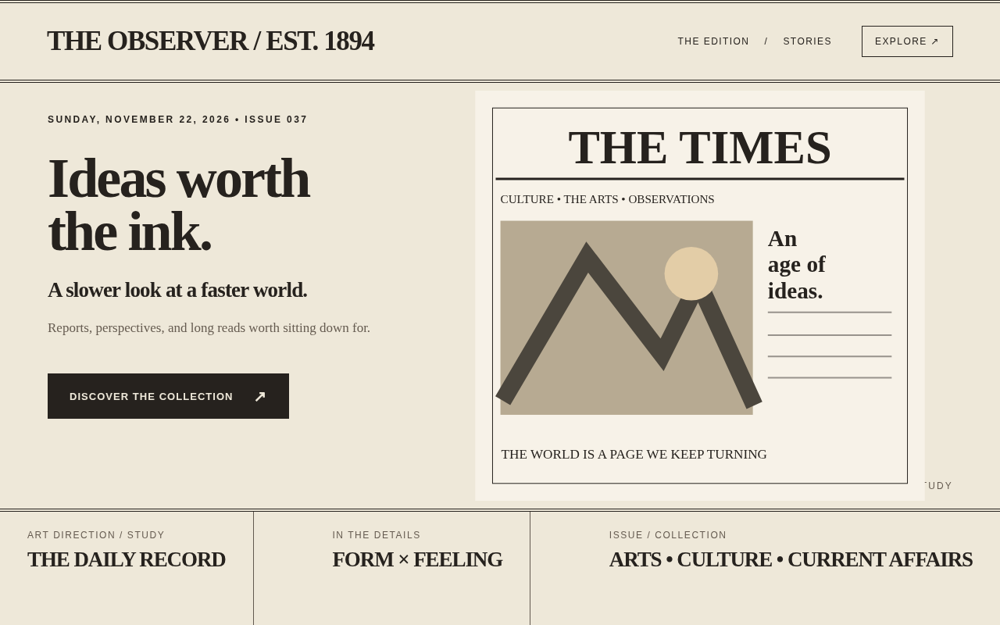

# Vintage Broadsheet (Classic Press & Literary Editorial)

## 1. Design Philosophy
Channels the authority, cadence, and gravitas of heritage broadsheet journalism (*The New York Times*, *Financial Times*, 19th-century literary reviews). Designed for reading, essays, newsletters, and data journalism that demand trust and intellectual weight.

## 2. Color Tokens & Surface Rules
```css
:root {
  --paper-newsprint: #F4EFE6; /* Warm archival newsprint */
  --paper-ft-tint: #F7EBE1;   /* Optional subtle Financial Times salmon */
  --ink-heavy: #141311;       /* Dense letterpress black */
  --ink-body: #2A2825;        /* Crisp reading ink */
  --ink-muted: #666159;       /* Byline & dateline grey */
  --rule-heavy: #141311;      /* Double-rule masthead bars */
  --rule-fine: #C5BEB2;       /* Vertical column hairlines */
  --accent-press: #8C1D18;    /* Classic editorial crimson (sparingly) */
}
```

## 3. Typography & Hierarchy
- **Masthead / Display:** `'Playfair Display', 'UnifrakturMaguntia', 'Libre Baskerville', Georgia, serif`
- **Article Headlines:** High-contrast bold/italic serif (`'Newsreader', 'Lora', 'Georgia', serif`)
- **Body Copy:** Classic readable serif (`16px–17px`, line-height `1.6`), optionally justified with hyphenation on desktop multi-column layouts.
- **Datelines & Kickers:** `11px` uppercase small-caps sans or serif with wide tracking (`0.1em`).

## 4. Layout, Grid & Geometry
- **Multi-Column Newspaper Grid:** 3 to 4 columns on desktop separated by continuous `1px solid var(--rule-fine)` vertical column dividers (`column-rule`).
- **Masthead:** Full-width centered publication name framed above and below by double horizontal rules (`border-top: 3px double #141311; border-bottom: 1px solid #141311;`), flanked by date, volume/issue number, and edition note.
- **Drop Caps:** Use classic 3-line initial drop caps (`::first-letter`) on lead feature stories.
- **Border Radius:** Strictly `0px`.

## 5. Component Specifications
- **Illustrations & Photos:** High-contrast grayscale photography, stipple engravings, or halftone prints with crisp `1px` ink frames and italicized captions below.
- **Section Dividers:** Double rules or centered typographic ornaments (`§`, `❖`, `—`).
- **Buttons / Forms:** Sharp black-bordered press boxes with uppercase serif labels (`SUBSCRIBE TO THE EDITION`).

## 6. Strict Forbidden Patterns (Anti-Slop Checklist)
- NEVER use rounded cards, colorful pill badges, or floating sticky CTA banners.
- NEVER use sans-serif body text for long-form articles.
- NEVER use pure `#FFFFFF` backgrounds or glowing dark themes.

---

## 7. Distinctive art direction and page anatomy

**Reference era:** Historic broadsheet. This is a contemporary interpretation, not a reproduction of a historical poster or a trademarked brand. Make work that feels designed by a person with a point of view.

- **Reference composition:** `news`. Lead with a purposeful hierarchy, a real content block, and the signature `newspaper` visual treatment; do not assume every product needs a dashboard.
- **Sample editorial voice:** “THE DAILY RECORD” / “Ideas worth the ink.”. Replace sample copy with authentic project copy; do not ship the preview's fictional brand or made-up metrics.
- **Use case:** Publishing. Develop other applications only when the historical language matches their audience and task.
- **Key visual device:** `newspaper`; create it with original vector or CSS geometry, real user-provided photography, or properly licensed assets. Never lift a historic poster pixel-for-pixel.
- **Minimum component vocabulary:** header/navigation, primary action, secondary action, content grouping, form/input, an item or list row, and visible feedback state.
- **Repeatable signature:** Maintain distinctive typographic proportion and materiality on subsequent pages; vary composition based on content so the site is not one repeated hero template.

## Required semantic-token interface
The implementation MUST use these shared CSS custom properties (the palette layer may override them later):

```css
:root {
  --color-bg: #EEE8D9;
  --color-surface: #F7F2E8;
  --color-ink: #26221E;
  --color-muted: #655B50;
  --color-accent: #8E292B;
  --color-border: #62594F;
  --font-display: Georgia, Times New Roman, serif;
  --font-body: Georgia, serif;
  --radius-control: 0px;
  --focus-ring: 3px solid var(--color-accent);
}
```

Use `var(--color-bg)` rather than hardcoding background colors throughout components. When combining a palette, **load style tokens first, then palette tokens** (the later palette overrides the six `--color-*` values). A palette changes color only, not the style's spatial or typographic DNA. Any legacy token names in the original spec are descriptive aliases; use this semantic contract in new code.


## 8. Responsive behavior (do not skip)

- At `>= 1200px`, use the full asymmetrical or editorial grid. At `768–1199px`, reduce columns and proportionally scale headlines. Below `768px`, collapse to a single deliberate reading path; keep the primary action visible without floating overlays.
- Typography: `clamp(2.5rem, 6.5vw, 6.75rem)` for a large display heading, `clamp(1rem, 1.2vw, 1.125rem)` for body; adjust the clamp for special historical styles while keeping body text readable.
- Use `minmax(0, 1fr)` for long content, `overflow-wrap: anywhere` for technical tokens, and a horizontal overflow wrapper for necessary data tables.
- All interactive controls have touch targets around 44×44 CSS pixels. Do not hide access to important workflows on mobile.
- Offer low-motion alternatives; respect `prefers-reduced-motion: reduce`.

## 9. Accessible components and states

- Text contrast: normal text at least WCAG AA 4.5:1 and large text at least 3:1, including muted labels. Some illustrative accents are **not** safe for foreground copy; test the actual foreground/background pair.
- Keyboard: visible `:focus-visible` ring, logical tab order, Escape on dismissible overlays, proper native controls; hover is never the only feedback.
- Supply designed states: default, hover, focus, pressed, disabled, loading, empty, error, success, and selected where applicable. Announce async outcomes in a polite live region, not by color alone.
- Use semantic landmarks (`header`, `nav`, `main`, `aside`, `footer`) and ordered heading levels. Image alt describes meaning, while purely ornamental illustrations use empty alt or `aria-hidden`.

## 10. Anti-clone quality gate

Before delivery, check: (1) Could the preview be mistaken for another skill in this library? If so, change the **composition**, not merely its colors. (2) Are the content and controls plausible for the product? (3) Are there any illegible labels or fake chart metrics? (4) Do mobile, keyboard and reduced-motion states work? (5) Has AI-default hero/card/glow styling slipped back in?

## 11. Invocation example

```text
Use the vintage-broadsheet design skill. Identify the product's core workflow, map its content hierarchy, apply its tokens and signature composition, and build a usable responsive page with real content states. Do not mimic the sample preview's fictional brand; do not introduce generic AI gradient/card patterns. Explain design choices in 5 concise sentences after implementation.
```

## 12. Visual reference



`demo.html` is the local, self-contained composition used to generate this preview. It illustrates a style direction, not a production-ready application or a functional app.
