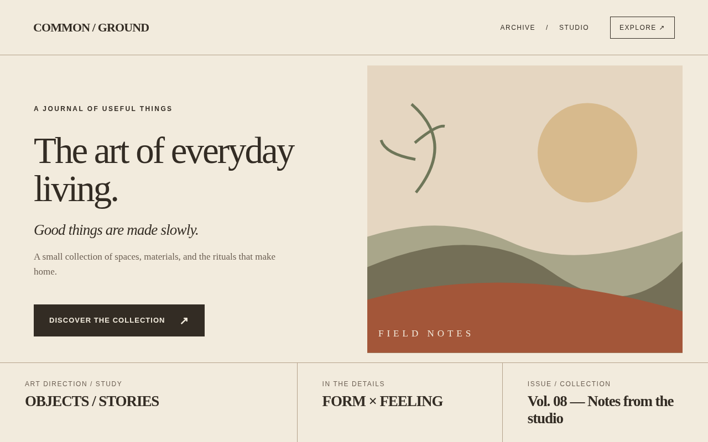

# Warm Analog (Literary & Print Magazine Editorial)

## 1. Design Philosophy
Modeled after independent art monographs, Kinfolk/Cereal print editions, and architectural journals. Rejects cold digital plastic in favor of warmth, stillness, tactile materials, and unhurried reading rhythm.

## 2. Color Tokens & Surface Rules
```css
:root {
  --bg-linen: #F6F2EB;        /* Warm natural paper */
  --bg-secondary: #EDE7DC;    /* Subtle archival stone */
  --ink-primary: #1F1C18;     /* Warm espresso charcoal (never pure #000) */
  --ink-secondary: #5C554C;   /* Weathered umber */
  --ink-muted: #8C8478;       /* Caption stone */
  --rule-hairline: #D6CEC2;   /* Fine editorial divider */
  --accent-rust: #9E472A;     /* Terracotta ink link accent */
}
```

## 3. Typography & Hierarchy
- **Headlines & Body Serif:** `'Cormorant Garamond', 'EB Garamond', 'Playfair Display', Georgia, serif`
- **Metadata & Captions Sans:** `'Plus Jakarta Sans', 'DM Sans', sans-serif` (`11px`, uppercase, `letter-spacing: 0.12em`)
- **Subtitles / Pull Quotes:** Italic serif (`font-style: italic`) to create classic book-like cadence.
- **Reading Width:** Constrain body text strictly to `55ch–65ch` with generous line-height (`1.65–1.75`).

## 4. Layout, Grid & Geometry
- **Whitespace:** At least 35–45% of the viewport must remain calm, uncluttered linen background.
- **Dividers:** Use double hairline rules or single `1px solid var(--rule-hairline)` rules to frame mastheads and footer indexes.
- **Photography:** Asymmetric two-column image placements (one tall architectural hero, one smaller inset plate with a caption like `PLATE 12 — ARCHIVE STUDY`).
- **Border Radius:** Strictly `0px` on photography and dividers.

## 5. Component Specifications
- **Navigation:** Ultra-minimal masthead strip: Publication title left, Issue number centered (`ISSUE NO. 04 — AUTUMN / WINTER`), sparse links right separated by middots (`·`).
- **Links / CTAs:** No heavy boxed buttons. Use refined text links (`READ THE MANIFESTO →`) in `--accent-rust` with delicate underline hover states.
- **Index Footers:** Roman numeral columns (`I. MATERIAL ARCHIVE`, `II. ARCHITECTURAL SENSE`, `III. THE HUMAN INDEX`).

## 6. Strict Forbidden Patterns (Anti-Slop Checklist)
- NEVER use pure white (`#FFFFFF`) or pure digital black (`#000000`).
- NEVER use bright neon accents, chunky rounded buttons, or dark-mode gradients.
- NEVER pack the screen with badges, KPI counters, or floating notification cards.
- NEVER use stock corporate illustrations or glossy 3D icons.

---

## 7. Distinctive art direction and page anatomy

**Reference era:** Warm analog. This is a contemporary interpretation, not a reproduction of a historical poster or a trademarked brand. Make work that feels designed by a person with a point of view.

- **Reference composition:** `journal`. Lead with a purposeful hierarchy, a real content block, and the signature `landscape` visual treatment; do not assume every product needs a dashboard.
- **Sample editorial voice:** “OBJECTS / STORIES” / “The art of everyday living.”. Replace sample copy with authentic project copy; do not ship the preview's fictional brand or made-up metrics.
- **Use case:** Lifestyle. Develop other applications only when the historical language matches their audience and task.
- **Key visual device:** `landscape`; create it with original vector or CSS geometry, real user-provided photography, or properly licensed assets. Never lift a historic poster pixel-for-pixel.
- **Minimum component vocabulary:** header/navigation, primary action, secondary action, content grouping, form/input, an item or list row, and visible feedback state.
- **Repeatable signature:** Maintain distinctive typographic proportion and materiality on subsequent pages; vary composition based on content so the site is not one repeated hero template.

## Required semantic-token interface
The implementation MUST use these shared CSS custom properties (the palette layer may override them later):

```css
:root {
  --color-bg: #F2EBDD;
  --color-surface: #E5D6C1;
  --color-ink: #332C24;
  --color-muted: #6B5E52;
  --color-accent: #A35639;
  --color-border: #B5A28B;
  --font-display: Georgia, serif;
  --font-body: Georgia, serif;
  --radius-control: 3px;
  --focus-ring: 3px solid var(--color-accent);
}
```

Use `var(--color-bg)` rather than hardcoding background colors throughout components. When combining a palette, **load style tokens first, then palette tokens** (the later palette overrides the six `--color-*` values). A palette changes color only, not the style's spatial or typographic DNA. Any legacy token names in the original spec are descriptive aliases; use this semantic contract in new code.


## 8. Responsive behavior (do not skip)

- At `>= 1200px`, use the full asymmetrical or editorial grid. At `768–1199px`, reduce columns and proportionally scale headlines. Below `768px`, collapse to a single deliberate reading path; keep the primary action visible without floating overlays.
- Typography: `clamp(2.5rem, 6.5vw, 6.75rem)` for a large display heading, `clamp(1rem, 1.2vw, 1.125rem)` for body; adjust the clamp for special historical styles while keeping body text readable.
- Use `minmax(0, 1fr)` for long content, `overflow-wrap: anywhere` for technical tokens, and a horizontal overflow wrapper for necessary data tables.
- All interactive controls have touch targets around 44×44 CSS pixels. Do not hide access to important workflows on mobile.
- Offer low-motion alternatives; respect `prefers-reduced-motion: reduce`.

## 9. Accessible components and states

- Text contrast: normal text at least WCAG AA 4.5:1 and large text at least 3:1, including muted labels. Some illustrative accents are **not** safe for foreground copy; test the actual foreground/background pair.
- Keyboard: visible `:focus-visible` ring, logical tab order, Escape on dismissible overlays, proper native controls; hover is never the only feedback.
- Supply designed states: default, hover, focus, pressed, disabled, loading, empty, error, success, and selected where applicable. Announce async outcomes in a polite live region, not by color alone.
- Use semantic landmarks (`header`, `nav`, `main`, `aside`, `footer`) and ordered heading levels. Image alt describes meaning, while purely ornamental illustrations use empty alt or `aria-hidden`.

## 10. Anti-clone quality gate

Before delivery, check: (1) Could the preview be mistaken for another skill in this library? If so, change the **composition**, not merely its colors. (2) Are the content and controls plausible for the product? (3) Are there any illegible labels or fake chart metrics? (4) Do mobile, keyboard and reduced-motion states work? (5) Has AI-default hero/card/glow styling slipped back in?

## 11. Invocation example

```text
Use the warm-analog design skill. Identify the product's core workflow, map its content hierarchy, apply its tokens and signature composition, and build a usable responsive page with real content states. Do not mimic the sample preview's fictional brand; do not introduce generic AI gradient/card patterns. Explain design choices in 5 concise sentences after implementation.
```

## 12. Visual reference



`demo.html` is the local, self-contained composition used to generate this preview. It illustrates a style direction, not a production-ready application or a functional app.
