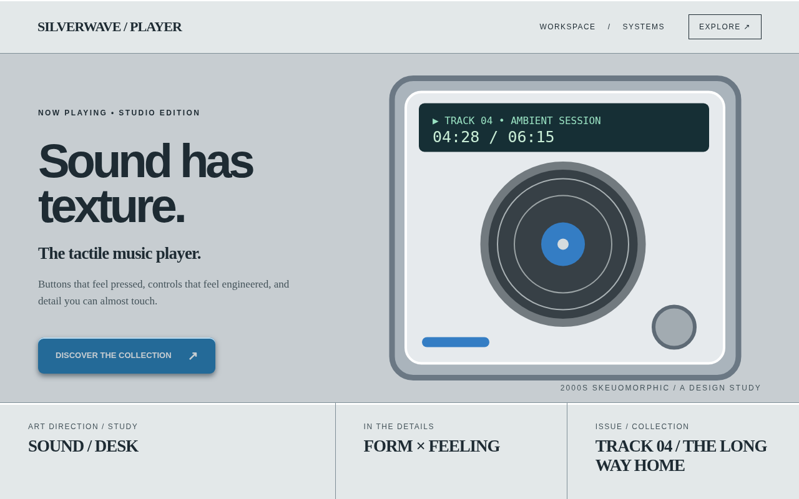

# Web 2.0 Skeuomorphic (Tactile Craft Era)

## 1. Design Philosophy
Celebrates the pre-flat-design craftsmanship of early Mac OS X and iOS 6—when interfaces felt like finely machined physical objects. Surfaces mimic real aluminum, linen, stitched leather, paper, and polished glass, giving every control unmistakable tactile affordance.

## 2. Color Tokens & Surface Rules
```css
:root {
  --metal-top: #E6E8EB;
  --metal-bottom: #B9BEC5;
  --metal-border: #8B9199;
  --leather-dark: #4A3426;
  --leather-stitch: #7D5E47;
  --paper-cream: #FCF9F2;
  --paper-rule: #E4DEC9;
  --aqua-top: #6BB4F8;
  --aqua-bottom: #266FD1;
  --ink-primary: #2B2825;
  --text-emboss-light: 0 1px 0 rgba(255, 255, 255, 0.8);
  --text-emboss-dark: 0 -1px 0 rgba(0, 0, 0, 0.6);
}
```

## 3. Typography & Hierarchy
- **UI System Chrome:** `'Lucida Grande', 'Helvetica Neue', 'SF Pro Text', sans-serif`
- **Paper Workspace:** `'Georgia', 'Charter', serif` or clean humanist sans (`'Avenir Next', sans-serif`)
- **Letterpress Effect:** Subtle `1px` vertical `text-shadow` to make labels look engraved into metal or embossed on leather.

## 4. Layout, Grid & Geometry
- **Material Zoning:** Clearly separate chrome from content—brushed aluminum top toolbar, dark stitched-leather or textured linen sidebar, warm cream paper main workspace.
- **Depth & Bevels:** Use multi-layered `box-shadow` combining subtle outer drop shadows with crisp `inset 0 1px 0 rgba(255,255,255,0.7)` top edge highlights.
- **Border Radius:** Tactile `5px–8px` corners on hardware buttons and window frames; recessed pill shapes for search bars and segmented controls.

## 5. Component Specifications
- **Toolbar Buttons:** Linear top-to-bottom subtle metallic gradient, `1px` dark hairline border, crisp top inner highlight, darker pressed `:active` inset shadow.
- **Primary Action (Aqua Pill):** Rich vertical blue gradient (`--aqua-top` to `--aqua-bottom`), inner top gloss highlight, dark blue outline, soft ambient shadow.
- **Sidebar Dividers:** Etched double-line dividers (`1px` dark shadow line above `1px` light highlight line).

## 6. Strict Forbidden Patterns (Anti-Slop Checklist)
- NEVER flatten controls into lifeless single-color Tailwind boxes.
- NEVER use neon dark-mode gradients or generic cyberpunk glow effects.
- NEVER exaggerate bevels into gaudy 1990s WordArt—keep lighting consistent (single overhead light source at 90 degrees).

---

## 7. Distinctive art direction and page anatomy

**Reference era:** 2000s skeuomorphic. This is a contemporary interpretation, not a reproduction of a historical poster or a trademarked brand. Make work that feels designed by a person with a point of view.

- **Reference composition:** `device`. Lead with a purposeful hierarchy, a real content block, and the signature `deck` visual treatment; do not assume every product needs a dashboard.
- **Sample editorial voice:** “SOUND / DESK” / “Sound has texture.”. Replace sample copy with authentic project copy; do not ship the preview's fictional brand or made-up metrics.
- **Use case:** App UI. Develop other applications only when the historical language matches their audience and task.
- **Key visual device:** `deck`; create it with original vector or CSS geometry, real user-provided photography, or properly licensed assets. Never lift a historic poster pixel-for-pixel.
- **Minimum component vocabulary:** header/navigation, primary action, secondary action, content grouping, form/input, an item or list row, and visible feedback state.
- **Repeatable signature:** Maintain distinctive typographic proportion and materiality on subsequent pages; vary composition based on content so the site is not one repeated hero template.

## Required semantic-token interface
The implementation MUST use these shared CSS custom properties (the palette layer may override them later):

```css
:root {
  --color-bg: #C7CDD1;
  --color-surface: #EFF2F3;
  --color-ink: #1E2B33;
  --color-muted: #44535A;
  --color-accent: #347DC4;
  --color-border: #7F8F98;
  --font-display: Arial, sans-serif;
  --font-body: Arial, sans-serif;
  --radius-control: 10px;
  --focus-ring: 3px solid var(--color-accent);
}
```

Use `var(--color-bg)` rather than hardcoding background colors throughout components. When combining a palette, **load style tokens first, then palette tokens** (the later palette overrides the six `--color-*` values). A palette changes color only, not the style's spatial or typographic DNA. Any legacy token names in the original spec are descriptive aliases; use this semantic contract in new code.


## 8. Responsive behavior (do not skip)

- At `>= 1200px`, use the full asymmetrical or editorial grid. At `768–1199px`, reduce columns and proportionally scale headlines. Below `768px`, collapse to a single deliberate reading path; keep the primary action visible without floating overlays.
- Typography: `clamp(2.5rem, 6.5vw, 6.75rem)` for a large display heading, `clamp(1rem, 1.2vw, 1.125rem)` for body; adjust the clamp for special historical styles while keeping body text readable.
- Use `minmax(0, 1fr)` for long content, `overflow-wrap: anywhere` for technical tokens, and a horizontal overflow wrapper for necessary data tables.
- All interactive controls have touch targets around 44×44 CSS pixels. Do not hide access to important workflows on mobile.
- Offer low-motion alternatives; respect `prefers-reduced-motion: reduce`.

## 9. Accessible components and states

- Text contrast: normal text at least WCAG AA 4.5:1 and large text at least 3:1, including muted labels. Some illustrative accents are **not** safe for foreground copy; test the actual foreground/background pair.
- Keyboard: visible `:focus-visible` ring, logical tab order, Escape on dismissible overlays, proper native controls; hover is never the only feedback.
- Supply designed states: default, hover, focus, pressed, disabled, loading, empty, error, success, and selected where applicable. Announce async outcomes in a polite live region, not by color alone.
- Use semantic landmarks (`header`, `nav`, `main`, `aside`, `footer`) and ordered heading levels. Image alt describes meaning, while purely ornamental illustrations use empty alt or `aria-hidden`.

## 10. Anti-clone quality gate

Before delivery, check: (1) Could the preview be mistaken for another skill in this library? If so, change the **composition**, not merely its colors. (2) Are the content and controls plausible for the product? (3) Are there any illegible labels or fake chart metrics? (4) Do mobile, keyboard and reduced-motion states work? (5) Has AI-default hero/card/glow styling slipped back in?

## 11. Invocation example

```text
Use the web-20-skeuomorphic design skill. Identify the product's core workflow, map its content hierarchy, apply its tokens and signature composition, and build a usable responsive page with real content states. Do not mimic the sample preview's fictional brand; do not introduce generic AI gradient/card patterns. Explain design choices in 5 concise sentences after implementation.
```

## 12. Visual reference



`demo.html` is the local, self-contained composition used to generate this preview. It illustrates a style direction, not a production-ready application or a functional app.
