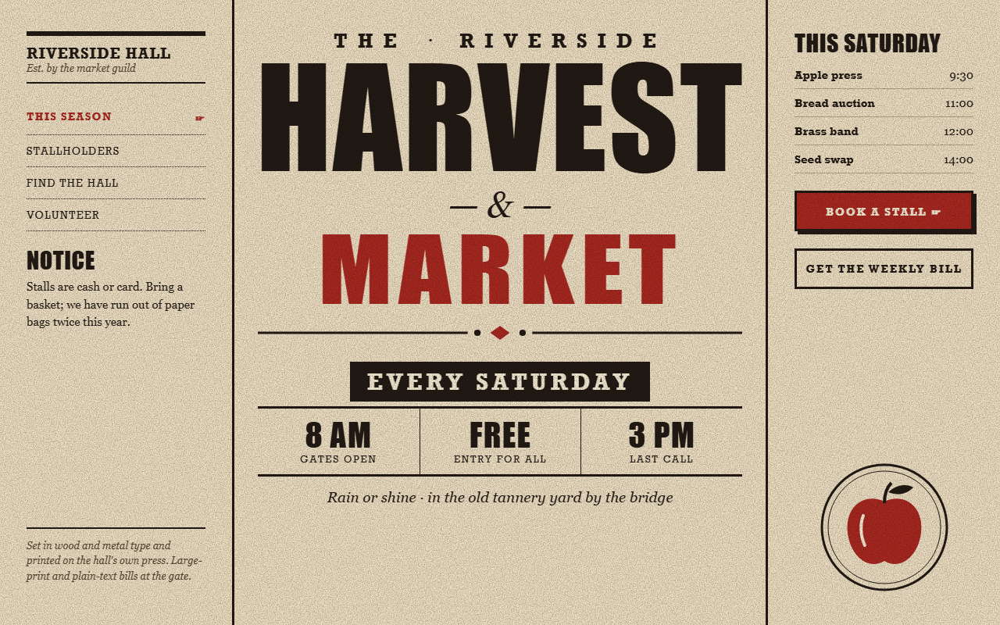

# Wood Type Broadside (19th-century Letterpress Poster)

## 1. Design Philosophy
A broadside was set line by line from whatever wood type the printer had: a huge condensed word, a spaced slab line, an italic connective, a second colour for the key word. Each line is sized to fill the measure. Recreate that rhythm with centred stacked lines and a strict two-colour discipline, and keep the practical information in plain handbill columns.

## 2. Color Tokens & Surface Rules
```css
:root {
  --color-bg: #EDE0C4;
  --color-surface: #F6EDD6;
  --color-ink: #221A14;
  --color-muted: #5A4838;
  --color-accent: #A82820;
  --color-border: #221A14;
  --font-slab: 'Rockwell', 'Rockwell Extra Bold', 'Courier New', serif;
}
```
- **Rule:** `--color-accent` (#A82820) is reserved for the primary action, the current state and one focal detail per view. Additional pigment tokens are for illustration and ornament; verify contrast before using any of them for text.

## 3. Typography & Hierarchy
- **Display font stack:** `Impact, 'Haettenschweiler', 'Arial Narrow Bold', sans-serif`
- **Body font stack:** `Georgia, 'Times New Roman', serif`
- Stack 5–7 centred lines that each fill the poster measure: spaced slab caps (0.4–0.5em tracking), a giant condensed headline (160–220px), an italic serif connective (& / at / and), a second-colour line (horizontally stretched with `scaleX`), and a reversed slab band.
- Slab serif (Rockwell) for navigation and labels, Georgia for reading text.
- Numerals in the condensed display face for times and prices.

## 4. Layout, Grid & Geometry
- Three columns: handbill (nav, notices) · poster · handbill (schedule, actions), separated by 3px ink rules.
- Printer's ornamental rule (line · dot · diamond · dot · line) between poster sections.
- Fill the full height; leftover space goes to a colophon or a woodcut-style illustration, never to blank paper.
- Mobile: poster first at reduced sizes, then handbill columns stacked.

## 5. Component Specifications
- **Paper grain:** fixed SVG `feTurbulence` overlay with multiply blend at ~50% opacity, `pointer-events:none`.
- **Facts band:** three cells between heavy rules with condensed figures and spaced slab captions.
- **Buttons:** red fill with a hard 4px offset ink shadow (a misregistered print), or outlined ghost.
- **Woodcut illustration:** chunky two-colour SVG inside a double circle.

## 6. Strict Forbidden Patterns (Anti-Slop Checklist)
- NEVER use more than two ink colours plus paper.
- NEVER apply grain over form fields so strongly that contrast drops below AA.
- NEVER use distressed 'western' novelty fonts as body text.
- NEVER centre the handbill columns; only the poster is centred.

---

## 7. Distinctive art direction and page anatomy

**Reference era:** 1870s wood type broadsides. This is a contemporary interpretation, not a reproduction of a historical artefact or a trademarked brand. Make work that feels designed by a person with a point of view.

- **Reference composition:** `three-column broadside`. Lead with a purposeful hierarchy, a real content block, and the signature `stacked wood type lines` treatment; do not assume every product needs a dashboard.
- **Sample editorial voice:** “HARVEST & MARKET — EVERY SATURDAY.”. Replace sample copy with authentic project copy; do not ship the preview's fictional brand or made-up details.
- **Use cases:** Markets, fairs, breweries, barbers, community events, local shops. Develop other applications only when the visual language matches their audience and task.
- **Key visual device:** `stacked wood type lines`; create it with original vector or CSS geometry, real user-provided photography, or properly licensed assets.
- **Minimum component vocabulary:** header/navigation, primary action, secondary action, content grouping, form/input, an item or list row, and visible feedback state.
- **Repeatable signature:** keep the typographic proportion and materiality on subsequent pages; vary composition based on content so the site is not one repeated hero template.

## Required semantic-token interface
The implementation MUST use these shared CSS custom properties (the palette layer may override them later):

```css
:root {
  --color-bg: #EDE0C4;
  --color-surface: #F6EDD6;
  --color-ink: #221A14;
  --color-muted: #5A4838;
  --color-accent: #A82820;
  --color-border: #221A14;
  --font-display: Impact, 'Haettenschweiler', 'Arial Narrow Bold', sans-serif;
  --font-body: Georgia, 'Times New Roman', serif;
  --radius-control: 0px;
  --focus-ring: 3px solid var(--color-accent);
}
```

Use `var(--color-bg)` rather than hardcoding background colors throughout components. When combining a palette, **load style tokens first, then palette tokens** (the later palette overrides the six `--color-*` values). A palette changes color only, not the style's spatial or typographic DNA.

## 8. Responsive behavior (do not skip)

- At `>= 1200px`, use the full composition described above. At `768–1199px`, reduce columns and proportionally scale headlines. Below `768px`, collapse to a single deliberate reading path; keep the primary action visible without floating overlays.
- Typography: scale the display size with `clamp()` (for example `clamp(2.5rem, 6vw, 4rem)`), keep body text between 16px and 18px.
- Use `minmax(0, 1fr)` for long content, `overflow-wrap: anywhere` for technical tokens, and a horizontal overflow wrapper for necessary data tables.
- All interactive controls have touch targets around 44×44 CSS pixels. Do not hide access to important workflows on mobile.
- Offer low-motion alternatives; respect `prefers-reduced-motion: reduce`.

## 9. Accessible components and states

- Text contrast: normal text at least WCAG AA 4.5:1 and large text at least 3:1, including muted labels. Decorative pigments and pattern colours are **not** automatically safe for foreground copy; test the actual pair.
- Keyboard: visible `:focus-visible` ring, logical tab order, Escape on dismissible overlays, proper native controls; hover is never the only feedback.
- Supply designed states: default, hover, focus, pressed, disabled, loading, empty, error, success, and selected where applicable. Announce async outcomes in a polite live region, not by color alone.
- Use semantic landmarks (`header`, `nav`, `main`, `aside`, `footer`) and ordered heading levels. Ornamental SVG uses `aria-hidden="true"`; meaningful illustrations get a short `role="img"` label.

## 10. Anti-clone quality gate

Before delivery, check: (1) Could the result be mistaken for another skill in this library? If so, change the **composition**, not merely its colors. (2) Are the content and controls plausible for the product? (3) Are there illegible labels or invented statistics? (4) Do mobile, keyboard and reduced-motion states work? (5) Has AI-default hero/card/glow styling slipped back in?

## 11. Invocation example

```text
Use the wood-type-broadside design skill. Identify the product's core workflow, map its content hierarchy, apply its tokens and signature composition, and build a usable responsive page with real content states. Do not mimic the sample preview's fictional brand; do not introduce generic AI gradient/card patterns. Explain design choices in 5 concise sentences after implementation.
```

## 12. Visual reference



`demo.html` is the local, self-contained composition used to generate this preview. It illustrates a style direction, not a production-ready application.
