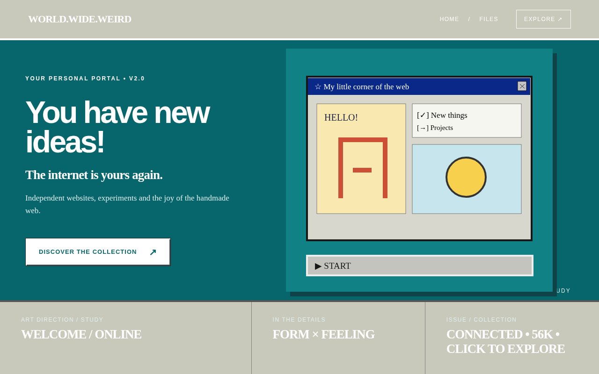

# Y2K Early Digital (Windows 95 / Indie Web 1999)

## 1. Design Philosophy
Celebrates the honest, functional, zero-bullshit utility of late-1990s personal computing and early indie web directories. No tracking popups, no bloated hero animations—just crisp beveled windows, fast tree navigation, and unmistakable hyperlinks.

## 2. Color Tokens & Surface Rules
```css
:root {
  --win-bg: #C0C0C0;          /* Classic system grey */
  --win-desktop: #008080;     /* Classic teal desktop (optional backdrop) */
  --win-surface: #FFFFFF;     /* Recessed document viewport */
  --win-title-bar: #000080;   /* Classic navy active window bar */
  --win-title-text: #FFFFFF;
  --bevel-light: #FFFFFF;     /* Top-left 3D highlight */
  --bevel-shadow: #808080;    /* Inner bottom-right shadow */
  --bevel-dark: #000000;      /* Outer bottom-right crisp edge */
  --link-blue: #0000EE;       /* Honest classic blue hyperlink */
  --link-visited: #551A8B;    /* Classic visited purple */
  --ink-text: #000000;
}
```

## 3. Typography & Hierarchy
- **System UI:** `'MS Sans Serif', 'Tahoma', 'Verdana', 'Pixelify Sans', sans-serif` (`12px–13px`, crisp rendering)
- **Code / Directory Trees:** `'Courier New', 'VT323', monospace`
- **Links:** Always underlined (`text-decoration: underline`) in `--link-blue`.

## 4. Layout, Grid & Geometry
- **3D Beveled Borders (Raised):**
  ```css
  border-top: 2px solid #FFFFFF;
  border-left: 2px solid #FFFFFF;
  border-right: 2px solid #000000;
  border-bottom: 2px solid #000000;
  box-shadow: inset -1px -1px 0 #808080, inset 1px 1px 0 #DFDFDF;
  ```
- **3D Sunken Panels (Inputs / Content Frames):** Invert the bevel colors (dark top-left, white bottom-right).
- **Border Radius:** Strictly `0px` everywhere.

## 5. Component Specifications
- **Window Frames:** Classic navy title bar with left bitmap icon, bold white window title, and right-aligned square `_`, `□`, `×` beveled buttons.
- **Directory Sidebar:** Classic collapsible folder tree (`[+]`, `[-]`) with crisp 16x16 pixel folder/file icons.
- **Status Bar:** Bottom sunken segmented strip displaying item counts, connection state, or version number.

## 6. Strict Forbidden Patterns (Anti-Slop Checklist)
- NEVER use smooth CSS blur shadows or rounded corners.
- NEVER mix modern flat minimalist SVG icons with beveled 90s chrome (use pixel/bitmap iconography).
- NEVER overdo unreadable "glitch/cyberpunk" effects—authentic 1999 UI was clean, legible, and structured.

---

## 7. Distinctive art direction and page anatomy

**Reference era:** 1998–2002 early web. This is a contemporary interpretation, not a reproduction of a historical poster or a trademarked brand. Make work that feels designed by a person with a point of view.

- **Reference composition:** `desktop`. Lead with a purposeful hierarchy, a real content block, and the signature `windows` visual treatment; do not assume every product needs a dashboard.
- **Sample editorial voice:** “WELCOME / ONLINE” / “You have new ideas!”. Replace sample copy with authentic project copy; do not ship the preview's fictional brand or made-up metrics.
- **Use case:** Retro Web. Develop other applications only when the historical language matches their audience and task.
- **Key visual device:** `windows`; create it with original vector or CSS geometry, real user-provided photography, or properly licensed assets. Never lift a historic poster pixel-for-pixel.
- **Minimum component vocabulary:** header/navigation, primary action, secondary action, content grouping, form/input, an item or list row, and visible feedback state.
- **Repeatable signature:** Maintain distinctive typographic proportion and materiality on subsequent pages; vary composition based on content so the site is not one repeated hero template.

## Required semantic-token interface
The implementation MUST use these shared CSS custom properties (the palette layer may override them later):

```css
:root {
  --color-bg: #07666C;
  --color-surface: #D6D3C9;
  --color-ink: #FFFFFF;
  --color-muted: #E0F0EF;
  --color-accent: #F6D451;
  --color-border: #808080;
  --font-display: Tahoma, Arial, sans-serif;
  --font-body: Arial, sans-serif;
  --radius-control: 0px;
  --focus-ring: 3px solid var(--color-accent);
}
```

Use `var(--color-bg)` rather than hardcoding background colors throughout components. When combining a palette, **load style tokens first, then palette tokens** (the later palette overrides the six `--color-*` values). A palette changes color only, not the style's spatial or typographic DNA. Any legacy token names in the original spec are descriptive aliases; use this semantic contract in new code.


## 8. Responsive behavior (do not skip)

- At `>= 1200px`, use the full asymmetrical or editorial grid. At `768–1199px`, reduce columns and proportionally scale headlines. Below `768px`, collapse to a single deliberate reading path; keep the primary action visible without floating overlays.
- Typography: `clamp(2.5rem, 6.5vw, 6.75rem)` for a large display heading, `clamp(1rem, 1.2vw, 1.125rem)` for body; adjust the clamp for special historical styles while keeping body text readable.
- Use `minmax(0, 1fr)` for long content, `overflow-wrap: anywhere` for technical tokens, and a horizontal overflow wrapper for necessary data tables.
- All interactive controls have touch targets around 44×44 CSS pixels. Do not hide access to important workflows on mobile.
- Offer low-motion alternatives; respect `prefers-reduced-motion: reduce`.

## 9. Accessible components and states

- Text contrast: normal text at least WCAG AA 4.5:1 and large text at least 3:1, including muted labels. Some illustrative accents are **not** safe for foreground copy; test the actual foreground/background pair.
- Keyboard: visible `:focus-visible` ring, logical tab order, Escape on dismissible overlays, proper native controls; hover is never the only feedback.
- Supply designed states: default, hover, focus, pressed, disabled, loading, empty, error, success, and selected where applicable. Announce async outcomes in a polite live region, not by color alone.
- Use semantic landmarks (`header`, `nav`, `main`, `aside`, `footer`) and ordered heading levels. Image alt describes meaning, while purely ornamental illustrations use empty alt or `aria-hidden`.

## 10. Anti-clone quality gate

Before delivery, check: (1) Could the preview be mistaken for another skill in this library? If so, change the **composition**, not merely its colors. (2) Are the content and controls plausible for the product? (3) Are there any illegible labels or fake chart metrics? (4) Do mobile, keyboard and reduced-motion states work? (5) Has AI-default hero/card/glow styling slipped back in?

## 11. Invocation example

```text
Use the y2k-early-digital design skill. Identify the product's core workflow, map its content hierarchy, apply its tokens and signature composition, and build a usable responsive page with real content states. Do not mimic the sample preview's fictional brand; do not introduce generic AI gradient/card patterns. Explain design choices in 5 concise sentences after implementation.
```

## 12. Visual reference



`demo.html` is the local, self-contained composition used to generate this preview. It illustrates a style direction, not a production-ready application or a functional app.
